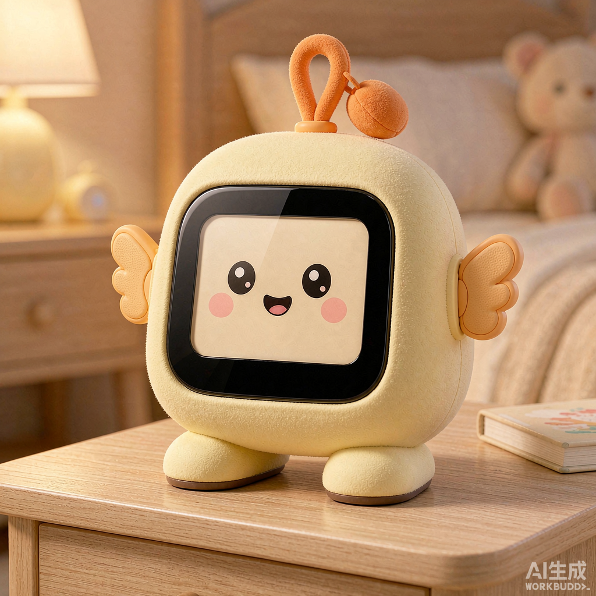

# CHICK-01 外形、表情与结构方案资料

归档日期：2026-11-08。来源：用户指定的 Workbuddy 会话目录 `2026-11-07-11-44-40`。

本目录保存 **5 份原始文档和 8 张 AI 概念渲染图**。原文件名称与内容均保留，归档说明另列于本页。它们属于外部设计会话的参考资料；原文中的“下一步”、刷机、调参和代码示例不构成本仓库的执行授权或当前验收结论。项目状态以[开发交接](../../DEVELOPMENT_HANDOFF.md)和对应实测报告为准。

图为 AI 生成的概念效果，不是实物、工程图或装配验证照片。

## 文档入口

| 文档 | 内容 |
| --- | --- |
| [会话纪要](2026-11-08/ESP32_AI玩具_CHICK-01_会话纪要_2026-11-08.md) | 外形选择、硬件与音频讨论、表情分层和来源会话的待办 |
| [屏幕表情系统清单 v1.0](2026-11-08/CHICK-01_屏幕表情系统清单_v1.0.html) | 12 个系统状态、15 个情绪预设、微动画和浏览器参数预览 |
| [小鸡款三视图与结构拆解](2026-11-08/CHICK-01_小鸡款_三视图与结构拆解.html) | 外观尺寸、结构示意、零件与装配流程 |
| [打印与装配指南 v0.1](2026-11-08/CHICK-01_打印与装配指南_v0.1.html) | 试制零件、切片建议、装配与 v0.2 待办 |
| [音频改造指南](2026-11-08/CHICK-01_音频改造指南_微雪板+40mm喇叭.html) | 微雪板、外接喇叭、音腔和麦克风布局的来源建议 |

四份 HTML 的图形、样式均在文件内；表情清单还含内联 JavaScript，用于生成 SVG 预览和参数表。GitHub 文件页显示源码，下载 HTML 后可在浏览器中查看。归档过程未运行其中的代码或硬件操作步骤。

## 配图

实际附件为 8 张 1024×1024 PNG，包含来源纪要所述的 7 个保留方向及柴犬参考图；[浏览全部原图](2026-11-08/generated-images/)。

- [小鸡翅膀款](2026-11-08/generated-images/消费级AI智能玩具产品设计渲染图_可爱的小鸡造型桌面机器人__2026-11-07T03-45-30.png)
- [太空员](2026-11-08/generated-images/消费级AI智能玩具产品设计渲染图_太空员宇航员造型桌面机器人_2026-11-07T03-46-38.png)
- [蘑菇夜灯](2026-11-08/generated-images/消费级AI智能玩具产品设计渲染图_蘑菇造型桌面机器人_淡粉色_2026-11-07T03-46-53.png)
- [小恐龙](2026-11-08/generated-images/消费级AI智能玩具产品设计渲染图_可爱小恐龙造型桌面机器人__2026-11-07T03-55-03.png)
- [熊猫](2026-11-08/generated-images/消费级AI智能玩具产品设计渲染图_可爱熊猫造型桌面机器人_黑_2026-11-07T03-55-17.png)
- [猫头鹰](2026-11-08/generated-images/消费级AI智能玩具产品设计渲染图_可爱猫头鹰造型桌面机器人__2026-11-07T03-55-39.png)
- [复古收音机](2026-11-08/generated-images/消费级AI智能玩具产品设计渲染图_复古收音机造型桌面AI机器_2026-11-07T03-55-55.png)
- [柴犬参考](2026-11-08/generated-images/消费级AI智能玩具产品设计渲染图_可爱柴犬造型桌面机器人_奶_2026-11-07T03-45-45.png)

## 审阅记录与使用边界

- 表情资料提出 L0 系统状态、L1 情绪、L2 微动画三层，并建议先实现 8 个 MVP 表现。这里保存的是设计与网页预览，尚未据此接入 LVGL、改动协议或完成实机性能验证。
- 纪要把公开 Device06 的 25/25 结果称作“五人家庭”，并称尚无真实机器人录音，与仓库证据口径不符。该公开诊断另有陌生误接纳 2/100，不能作为家庭通过；11 月 7 日已完成 M01 机器人／电脑登记候选的基础采集，独立查询仍待采。参见[公开诊断](../../verification/2026-11-05-speaker-channel.md)和[真实采集报告](../../verification/2026-11-07-robot-audio-capture.md)。
- 原文的固件版本、服务状态、AEC 归因、guard／增益建议属于来源会话当时的记录或推断，后续应与最新交接核对，不能直接作为刷机或改参依据。本次归档未更改设备、固件、服务、VAD、AEC 或声纹策略。
- 口型示例在调用 `OutputData` 前提取待播 PCM，不能直接证明与实际播放时间同步；项目现有界面设计要求依据真实 DMA 完成和有效代次观察声音。参见[现有声音驱动界面设计](../../superpowers/specs/2026-10-25-xiaoman-watch-orb-ui-design.md#5-声音如何驱动光球)。
- 音频指南中“60×60×42 mm ≈15 cc”存在体积计算不一致：该几何体积为 **151.2 cm³**。BOM 报价、声学提升、CPU／Flash 预算和承重指标也未在本次归档中验证，原文保持不变，实施前需独立复核。
- 原纪要提到的 `model/` 生成器、STL 与结构预览没有列入本次用户指定的附件范围，因此未随这份文档与配图快照入库；“水密／可打印”等来源自述不代表本仓库已复核模型或实物。

本次校验范围：13 个原文件逐一与来源比较 SHA256；检查 PNG 格式／尺寸、HTML 外部资源引用和本页相对链接。此类文件完整性检查不等于结构、声学、电气或产品验收。
