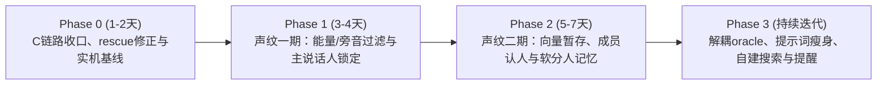

# 产品架构收敛、声纹识别与后续开发计划（2026-11-23）

> **核心决策（2026-11-23）：**
> 1. **主线唯一锁定 C 链路（千问原生 Realtime 端到端语音）**：暂不强求声音克隆，停止 A 链路（Omni→文字→CosyVoice）的维护与复测，B 链路仅保留现有代码作冷备。
> 2. **声纹识别作为核心增量**：复用现有 `internal/speaker` 与 `internal/speakerlive` 底座，在 Go 服务端上行链路分两期落地“旁音过滤 / 主说话人锁定”与“家庭成员识别 / 分人记忆”。
> 3. **工程与硬件边界不变**：唯一支持微雪 ESP32-S3 2.16（固件 2.5.4+），管理端与小程序仅使用真实 API，所有运行依赖、测试与服务部署均在云服务器执行。

---

## 一、 现状评估与现存核心问题

### 1. 已具备的核心工程资产
- **播放事实账本（`internal/realtimestate`）**：通过微雪 I²S DMA 回执 + OutputASR 对齐 `assistant_spoken_prefix`，遵循“设备实际播了多少，模型才算说了多少”，打断后续讲不串台。
- **实证驱动的精简投影与门控**：
  - 8 轮精简状态投影（`ConversationStateFor`）已上线，消除了历史诊断字段回灌导致的复读问题。
  - 反向搜索门控（`internal/realtimelive/search_gate.go`）已上线，强关续讲、故事、回忆、寒暄、观点、设备控制六类非搜索轮次。
  - 探针实测证伪“常驻单连接”（仅差 6ms），避免了无效重构。
- **声纹提取与聚类底座已就绪**：`internal/speaker/tracker.go`、`internal/speakerlive/observer.go` 及 `internal/realtimelive/speaker_observation.go` 已实现 Linux 独立 helper 进程提取 16kHz PCM 声纹、余弦相似度会话内聚类（`guest_1..8`）以及过短/低能量（`too_short` / `low_energy`）判定，目前仅用于测试观察，尚未接入对话决策。

### 2. 当前亟待解决的 5 个问题
1. **A / B / C 三条链路并行导致研发与测试内耗**：
   - A 链路用最贵的 Omni 模型只取文字再调 CosyVoice 分段合成，双份计费且微雪实测首包（7.9s~12.9s）比 C 链路（1.1s~1.7s）慢数倍，在不强求声音克隆时无保留价值。
   - 近期优化（`search_gate.go`、`rescue.go`）只对 C 链路生效，维持三套实机回归矩阵严重分散精力。
2. **慢轮补偿（`rescue.go`）受限于千问黑盒 `enable_search` 插件**：
   - 内置 `enable_search` 在模型出声前阻塞 3.8~4.6s 并会吞掉模型自生成的开场音频。
   - 服务端 1.5s 超时后再新建连接通过 `rescueLine` 生成整句过渡音频，实际出声约 2.6s，存在多付一次建连推理费、偶发与正文首包撞车或因字数/问句审计（`rescueAudit`）被丢弃的风险。
3. **声学前端（旁音误触发与防回声自打断）压力全在服务端文本/波形规则**：
   - 旁边人说话（如“过来，老板”）或电视背景音会被 VAD 收音并当成指令回答。
   - 播放期间的防自我打断（`session_echo.go` / `echo_audio_match.go`）尚未结合说话人声纹特征，在真实房间混响下需实机最终核验。
4. **3200 Token 系统提示词偏重**：
   - 每轮新建连接重灌约 3200 token，消耗约 250ms 预填时间并拉高每轮基础输入成本。
5. **“家庭陪伴”粘性功能（认人、分人记忆、主动关怀）尚处起步阶段**：
   - 现有记忆绑定在 `DeviceID`（同设备最近 7 天/24 轮混用），无法区分正在说话的是爸爸、妈妈还是孩子，也缺乏定时提醒与主动问候闭环。

---

## 二、 核心优化方案与代码审查修正（2026-11-23 补充）

### 方案 1：语音链路收敛（砍 A、冻 B、保 C）
- **生产默认唯一锁定 C 链路**：`internal/realtimelive/voice_routes.go` 与管理后台将 C 设为默认生产路线；A 链路停止测试与维护，B 链路代码保留作冷备，不再为 A/B 同步新特性。
- **云端持久化配置同步（审查补充）**：仅修改代码默认值不会覆盖已落盘的设备配置（此前微雪现场测试曾停留在 `selected_route: "A"`）。Phase 0 发布时须确认云端微雪持久化配置已切回 `C`，并在管理后台禁用/隐藏 `A` 选项防误触。
- **直接收益**：音色统一为原生 `Tina`，彻底消除垫话与正文音色不一致问题，每次发版省去 A/B 实机复测矩阵。

### 方案 2：慢轮（搜索轮）体感治理与 `rescue.go` 缺陷修正
- **短期（收口现有 `rescue.go`，发布前须修 3 处代码隐患）**：
  1. **隔离 `OutputASR` 防止污染账本与记忆**：当前 `speakRescue -> streamPCM -> s.release()` 无条件调用了 `rt.asr.Feed(converted)`，导致过渡句（如“稍等我想想”）进入 `rt.turn.Tracker`，既污染 `assistant_spoken_prefix` 与 7 天跨会话记忆，又与不含过渡句的 `rt.turn.Generated` 原稿前缀坐标错位。**修正**：为 `release()` 恢复 `isRescue` 标记，补偿音频**只进 `rememberEchoPCMLocked`（供防回声自打断比对），不进 `rt.asr.Feed`**。
  2. **联动 `search_gate` 避免回忆轮/控制轮误触发双倍建连**：`session.go` 中 `wait := rescueDelay - time.Since(rt.stoppedAt)` 从话尾起算 1.5s，但定时器在 `routeMemory`（约 880ms）、`routeDeviceControls` 与 `Native.Open`（150~350ms）之后才启动，导致非搜索的回忆轮到达此处时 `wait` 被压至下限 `200ms`，必然触发 `rescueLine` 白跑一次大模型连接。**修正**：当 `search_gate` 为 `allowed=false` 时，定时器在 `prepared`（主连接就绪）后至少等待 `1.2~1.5s`（仅兜底纯上游卡顿）；当 `search_gate` 为 `allowed=true` 时才按 `stoppedAt + 1.5s` 触发。
  3. **消除字中硬切拼接突兀**：`streamPCM` 每发一帧（60ms）检查 `answer.arrived()` 立即中止，会把 6~9 字短句切出半截字并紧贴正文首字。**修正**：若尚未发出首帧则立即丢弃；若已开始播报，由于补偿句严格限制在 `≤9` 字 / `≤1.8s`，应播完当前短句（或切出时插入 2~3 帧 120~180ms 静音呼吸口）再进正文。
  - **退路预案**：若实机发现 1.5s 触发 + 实时生成（约 2.6s 出声）仍易与正文撞车，则简化为仅在 `search_gate` 命中 `fresh_information` 时于话尾 0.6s 播放同源短过渡音，不再发起第二次大模型调用。
- **中期（剥离黑盒插件）**：
  - 关闭千问 Realtime 的 `enable_search`，当 `search_gate` 判定 `fresh_information` 时由 Go 服务端自行并发请求轻量搜索接口（控制在 600~800ms），将摘要拼入 `composeReplyPrompt`，把搜索轮首包从 4.6s 压至 1.8~2.0s。

### 方案 3：声纹识别分两期落地（复用 `internal/speaker` & `internal/speakerlive`）
声纹识别全部在 Go 服务端收音侧（16kHz 上行 PCM）完成，与 C 链路天然契合（CPU 推理耗时 <40ms，不拖慢首包）。结合当前源码审查，需重点处理以下工程边界：

1. **第一期：旁音过滤与会话主说话人锁定（Bystander Rejection & Session Anchor）**
   - **解除测试限制与更新 IPC 契约**：放开 `internal/speakerlive/observer.go` 中 `maxClips = 32` 和 `5 * time.Minute` 的硬限制，同步更新云端 Linux helper 启动参数（移除 `--realtime-test`）与 `decodeEvent` / `requestHeader` 的 `turn_taking_test` 校验契约；helper 异常时降级为不拦截，永不阻塞正常对话。
   - **远场低能量旁音拦截与 `1.5s (24000 采样)` 最短时长解耦（审查修正）**：
     - 现有 `speaker_observation.go` 硬编码 `<24000` 采样（1.5 秒）直接拒绝为 `too_short`，而家庭常用短口令与打断词（“你好”、“停一下”、“大点声”、“接着讲”）多在 `0.6~1.4s`。
     - **修正**：将**能量门控**与**声纹聚类**解耦。在 Go 侧 `session_input.go` 直接计算 `p.pcm` 有效语音段 RMS/信噪比（耗时 `<0.1ms`，不受 1.5s 限制）拦截远场电视声与低能量旁音（`input_rejected: bystander_low_energy`）。
   - **解决 `previewInput` 先于 `stopInput` 打断的时序冲突（审查修正）**：
     - 现有播放打断发生在说话过程中的 `previewInput`（`transcription.delta`），而 `observeSpeaker` 在说完话后的 `stopInput` 才执行。
     - **修正**：在播放期间（`p.overlapped == true`）收到 `previewInput` 且非明确停播词（`stop_request`）时，先通过 Go 本地同步校验当前已收音片段（`s.ring.Slice`）的近场能量与回声相似度；而在最终打断/准入时，**仅当声纹明确识别为其他说话人（`guest_2..8`）或远场低能量（`low_energy`）时才拦截**，对于近场正常音量但因 `<1.5s` 返回 `too_short` 的短口令放行打断。
   - **防范首轮 `guest_1` 锚点污染（审查修正）**：
     - `internal/speaker/tracker.go` 的模板取自首次达标观察且后续不更新。若首轮主说话人因 `<1.5s` 未建模板，第 2 轮旁人说话 `>1.5s` 会抢占 `guest_1`。
     - **修正**：主说话人锚点仅在**非 `overlapped`（未播音）、近场能量达标、且该轮最终通过准入生成正常回复**时锁定；会话空闲超时后自动释放锚点。

2. **第二期：家庭成员声纹库、身份注入与分人记忆**
   - **解决“不存原始音频”与“历史聊天点选绑定声纹”的数据源断层（审查修正）**：
     - 服务端严格执行原始音频零落盘（`audio_retained=false`），且当前 `observer.go` 只返回 `"label": "guest_1"`、禁止 JSON 出现 float 向量。若不暂存向量，5 分钟前的历史聊天在服务器上既无音频也无向量，无法点选绑定。
     - **修正**：① 改造 helper 在有效观察轮次返回归一化 `[]float32` 声纹向量（约 1KB，不可逆推原始语音），随 `memoryTurn` 暂存于 7 天/24 轮私有快照中；用户在管理端/小程序“近期聊天/记忆”点选某轮绑定家庭成员（如爸爸、妈妈、孩子）时，后端直接复制该轮已存的归一化向量至家庭成员声纹档案（`0600` 私有存储）。② 同时支持语音实时注册口令（“小满，录入妈妈的声音”）。
   - **提示词身份注入**：匹配成功后，在 `session.go` 的 `composeReplyPrompt` 尾部（`currentTurnInput` 旁）注入 `[当前说话人：妈妈]`，让 C 链路模型自然带出称呼并按成人/儿童调整语气。
   - **分人跨会话记忆采用“同库打标 + 软加权检索”（审查修正）**：
     - 家庭成员常围坐共聊同一话题（如妈妈讲故事、孩子说“接着讲”），且 `<1.5s` 短句会返回 `uncertain`。若按 `DeviceID + SpeakerID` 硬分桶隔离，短句或跨成员接话会丢失上下文。
     - **修正**：存储层仍按 `DeviceID` 统一维护 24 轮快照，在 `memoryTurn` 新增 `SpeakerID` 标签；检索层（`memory_selection.go`）将 `SpeakerID` 作为关联度优先权重（个人回忆优先匹配同说话人，公共续讲与 `uncertain` 轮次回退共享上下文）。

### 方案 4：声学防自打断收口与提示词瘦身
- **微雪实机防自打断核验**：核对 `voice-echo-20261120-r1`（`echo_audio_match.go`）在真实房间的听感与回执；结合声纹一期的能量/说话人门槛，停止在服务端继续堆叠纯文本前缀猜测规则。
- **提示词瘦身须先解耦 `oracle.py` 差分测试（审查修正）**：
  - 实测评估 `ConversationStateTurnLimit` 从 `8` 扩至 `12` 轮。
  - `internal/realtimestate` 系统提示词常量目前被 `testdata/oracle.py` 与旧 Python Realtime 逐字节比对。**必须先解除 `oracle.py` 的逐字节提示词耦合**，再将 3200 token 系统提示词精简至 `~1800` token（降低每轮约 40% 基础输入 token 成本并节省 ~100ms 预填延迟）。

### 方案 5：陪伴核心业务闭环（主动提醒与关怀）
- 在家庭端（小程序/网页）及语音对话中接入轻量“家庭提醒/备忘”（如老人吃药、孩子放学、生日提醒）。
- 结合声纹识别，当对应家庭成员在提醒时间窗附近唤醒小满时，主动在首轮回应中完成提醒。

---

## 三、 分阶段开发计划（Roadmap）

### Phase 0：C 链路单线收口、`rescue.go` 缺陷修正与微雪实机验收（1~2 天）
- [ ] **修复 `rescue.go` / `session.go` 三项审查问题**：
  1. `speakRescue` 下发音频隔离 `OutputASR`（只进 `rememberEchoPCMLocked`，不进 `rt.asr.Feed`）；
  2. `rescueTimer` 联动 `search_gate`（非搜索轮在 `prepared` 后至少等 1.2s，防止 `memory_selection` 回忆轮误触发）；
  3. 优化 `streamPCM` 切出逻辑，避免补偿句播到半截字被正文硬切。
- [ ] **云端验证与发布**：部署至云端，确保 `go test -race ./...` 与 `go vet ./...` 全部通过；确认云端微雪持久化路由配置已从 `A` 切回 `C`，管理后台隐藏/禁用 `A`。
- [ ] **微雪实机三项核验**：
  1. `voice-echo-20261120-r1` 真实房间外放防自打断与真人插话打断核对；
  2. 普通轮（`search_gate` 强关，1.1~1.6s 出声）、回忆轮（不误触发 `rescue`）与搜索慢轮（触发 `rescue_line`、不断连、不污染记忆）听感验收；
  3. 评估 8 轮对话状态窗口是否需上调至 `12` 轮（`internal/realtimestate/conversation_state.go`）。
- [ ] **固件看门狗日志排查**：核查微雪 2.5.4 启动时 2 条 watchdog 白名单匹配的具体任务原因。
- [ ] **链路归档**：确认 C 链路稳定后，将 A 链路标记归档，不再排入常规测试。

### Phase 1：声纹识别一期——旁音过滤与防误打断（3~4 天）
- [ ] **声纹 Observer 生产化改造（`internal/speakerlive/observer.go` & 云端 helper）**：
  - 移除 `--realtime-test` 专属的 32 次调用、5 分钟寿命及 `turn_taking_test` 硬限制，支持正式会话长连接安全复用与超时降级（helper 异常时降级为不拦截，永不阻塞正常对话）。
- [ ] **上行输入能量与声纹门控接入（`internal/realtimelive/session_input.go` & `speaker_observation.go`）**：
  - Go 本地同步计算有效语音段 RMS 拦截远场 `low_energy` 旁音（耗时 `<0.1ms`，覆盖 `<1.5s` 短语音）；
  - 严格限定主说话人 `guest_1` 锚点绑定条件（仅非 `overlapped`、近场能量达标且正常完成回复的轮次），防止旁音抢占锚点；
  - 协调 `previewInput` 与 `stopInput` 打断时序：在 `overlapped` 播放打断判定中，仅拦截明确非主说话人（`guest_2..8`）或 `low_energy` 旁音，放行近场 `<1.5s`（`too_short`）的正常短指令打断。
- [ ] **验证与实机测试**：
  - 云端单测与 race 测试覆盖“主说话人正常问答 / 短指令正常打断 / 低能量旁音拒绝 / 播放中旁人说话不打断 / 首轮短句锚点不污染 / helper 故障安全降级”；
  - 微雪实机开启背景电视声与侧面旁人说话测试，确认误触发显著下降且首包延迟增加 ≤40ms。

### Phase 2：声纹识别二期——家庭成员注册、认人对话与分人记忆（5~7 天）
- [ ] **声纹向量暂存与家庭成员声纹档案（`internal/speakerlive`、`internal/realtimelive/memory.go`、`internal/management`）**：
  - 升级 helper 在有效观察轮次返回归一化 `[]float32` 向量，随 `memoryTurn` 暂存于 7 天/24 轮私有快照（不存原始音频）；
  - 新增家庭成员声纹模板持久化存储（`0600` 私有 JSON，仅存归一化向量与成员标签）；
  - 管理端/小程序支持在“近期聊天/记忆”中点选历史清晰轮次一键绑定到家庭成员（如“妈妈”、“宝宝”），并支持管理/删除声纹档案。
- [ ] **C 链路提示词身份注入（`internal/realtimelive/session.go`）**：
  - `composeReplyPrompt` 注入当前识别到的家庭成员称呼与角色，验证模型按成人/儿童自动切换陪伴语气。
- [ ] **同库打标 + 软加权分人记忆（`internal/realtimelive/memory.go` & `memory_selection.go`）**：
  - 保持按 `DeviceID` 统一存储，记忆条目附加 `speaker_id`；跨会话记忆检索优先加权匹配当前说话人的个人记忆，同时兼容 `<1.5s`（`uncertain`）短句与家庭成员共聊续讲。

### Phase 3：解耦旧测试、提示词瘦身、可控搜索与主动陪伴（持续迭代）
- [ ] **解耦旧 Python Realtime 差分依赖**：先解除 `internal/realtimestate/testdata/oracle.py` 对系统提示词常量的逐字节耦合，并按 `docs/CODE_LIFECYCLE.md` 清理 24 个旧 Python Realtime（`18032`）弃用文件。
- [ ] **系统提示词瘦身**：精简 `internal/realtimestate` 系统提示词（3200 → ~1800 tokens），更新 Go 单测基线。
- [ ] **自建轻量搜索替代 `enable_search`**（视 Phase 0 搜索轮实机体验决定是否启动）。
- [ ] **家庭提醒与主动问候**：接入家庭定时备忘，在识别到目标家庭成员唤醒时主动播报提醒。
- [ ] **历史运维收口**：收口 11-11 历史审计防火墙摘要差异事务。
