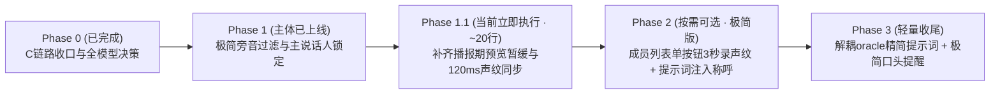

# 产品架构收敛、声纹识别与后续开发计划（2026-11-25 极简版）

> **最高产品与研发原则：**
> 1. **“先极简、只在极简兜不住的关键处加一点点复杂度”**：优先用最小可工作的方案解决 80% 以上的核心痛点（零配置、零新增页面、零冗余存储）；只有在真实时序或物理边界上极简方案兜不住时，才针对该临界点做最小化的局部增强（几十行级），坚决拒绝过度设计。
> 2. **彻底取消服务端静态意图词表，所有语义决策交由大模型**：联网搜索（`enable_search: true` + 模型内置 Search Agent）、跨会话记忆选择（`SelectMemory`）、音乐控制（`PlanMusic`）全部由大模型自主决策；慢轮垫话（`rescue.go`）完全按真实响应时间触发，不靠词表猜测。
> 3. **主线唯一锁定 C 链路（千问原生 Realtime 端到端语音）**：管理后台已将 A 链路标记为“已停用”并禁止选择，B 链路仅保留现有代码作冷备，不再投入维护精力。
> 4. **工程与硬件边界不变**：唯一支持微雪 ESP32-S3 2.16（固件 2.5.4+），管理端与小程序仅使用真实 API，所有运行依赖、测试与服务部署均在云服务器执行。

---

## 一、 已完成基线（Phase 0 已验收 + Phase 1 主体已上线）

### 1. Phase 0：C 链路收口、去词表全模型决策与停顿重说优化（✅ 已完成，提交 `44d6564` / `4809fa8`）
- **移除 4 处静态意图词表（净删 338 行硬编码词表）**：
  - 已删除 `search_gate.go`、`rescue.go`、`memory.go`、`music.go` 中的全部静态意图词表，所有语义判断交由大模型完成。
- **垫话（`rescue.go`）隔离与纯时间驱动**：
  - 垫话音频只进 `rememberEchoPCMLocked`（供防回声自打断比对），不进 `rt.asr.Feed`，彻底消除垫话对 `assistant_spoken_prefix` 与跨会话记忆的污染。
  - 已起播的短垫话（`≤9` 字 / `≤1.8s`）播完当前短句再进正文；仅在距话尾 `1850ms` 且距主会话 Open `1350ms` 仍未出首包时按真实耗时触发垫话。
- **跨段停顿携带与重说音文同步去重（`session_input.go`）**：
  - 用户说话中途停顿（`≤2s`）自动合并前半句文本与 PCM，尾随呼吸/咳嗽空转写自动回退保留前半句。
  - 用户停顿后从头重说时（`>=3` 字前缀匹配，自动剥离首尾犹豫语气词），同步丢弃前半句废话文本与 `carryPCM` 音频，并将未起播（`!Begun && Sent == 0`）的空打断轮次从 `s.history` 折叠移除。
- **双端统一回声自打断防护（`session_echo.go`）**：
  - `xiaozhi`（微雪）与 `mac_native`（Mac 终端）统一启用 `overlapped` 播放期弱预览扣留与起播首字回声变体拦截。

### 2. Phase 1 主体：极简旁音过滤、主说话人锁定与 A 链路收口（✅ 已上线，提交 `3f7a9dc` / `27a6ad3`，云端版本 `speaker-phase1-20261125-r2`）
- **管理后台 A 链路收口（`VoiceRoutes.vue`）**：
  - 前端已将 A 链路标记为“已停用”并禁用选择按钮，仅开放 `C`（推荐默认）与 `B`（冷备）。
- **声纹引擎生产接入且静默运行**：
  - 补齐 `internal/speakerlive/reason_test.go` 的 `//go:build linux` 构建标签；
  - 解除 `server.go` 的 `speaker_test_requires_memory_only` 限制，云端正式服务已挂载 `--speaker-binary` / `--speaker-model` (`eres2net.onnx`) / `--speaker-sha256`；
  - 生产会话（`MemoryOnly == false`）在服务端内部静默完成声纹聚类，不向客户端下发测试专用的 `speaker_observation` 控制帧；helper 未配置或异常时自动 fail-open 放行。
- **极简两层旁音过滤（零配置、不落盘）**：
  1. **远场低能量同步拦截（0ms 开销）**：`hasLowEnergySignal`（`minSpeakerRMS = 0.005`）直接拦截远场电视声与背景碎语（`bystander_low_energy`），近场正常音量短指令（`<1.5s`）正常放行。
  2. **会话主说话人自动锚定（`speakerAnchor`）**：每轮会话首个非 `overlapped`（未播音）、近场能量达标且声纹返回明确临时标签（`guest_1`）的正常轮次自动锁定 `speakerAnchor`；锁定后拒绝其他说话人（`guest_2..8`）的插话与长句（`bystander_speaker_mismatch`），会话断开即销毁。

---

## 二、 下一步开发计划（严格遵循“先极简、仅在关键漏洞处加一点点复杂度”）

### 1. Phase 1.1（当前立即执行）：补齐“极简兜不住”的 1 处时序漏洞（仅需 ~20 行代码）
- **为什么极简实现在这里兜不住**：
  1. **流式预览抢跑**：小满正在播报（`overlapped == true`）时，若旁边另一个人（`guest_2`）大声说话（超过 `RMS 0.005`），Qwen Omni 会在**那个人还没说完**（`speech_stopped` 尚未触发、声纹尚未计算）时先推流式预览（`previewInput`），导致在声纹算出来之前就先把小满的播报掐断了。
  2. **异步推理 40~80ms 时序差**：`speech_stopped` 触发 `speaker-lab` ONNX 推理是异步的（约 40~80ms），若最终 ASR（`finishInput`）比声纹结果早到 30ms，`finishInput` 会因 `p.speakerState` 尚为空而漏放 `guest_2`。
- **只加“一点点复杂度”的最小化修补方案（`session_input.go` & `speaker_observation.go`）**：
  1. **播报期预览暂缓切音**：当已锁定主说话人（`s.speakerAnchor != ""`）且小满正在播报（`p.overlapped`）时，只要流式预览不是显式叫停（`decision.reason != "stop_request"`）且声纹结果未出（`p.speakerState == ""`），在 `previewInput` 暂缓切音（返回 `awaiting_speaker_check`，完全复用现有 `awaiting_echo_check` 机制）；用户喊“停 / 别说了”依然 0 延迟立刻打断。
  2. **终态最多等待 120ms**：在 `finishInput` 中，若已锁定 `s.speakerAnchor` 且本句已送入 `speaker-lab` 队列但结果未回，最多等待 **120ms**；一旦拿到 `guest_2` 立即丢弃且不打断播报，若超时或失败则立即 fail-open 放行，绝不卡死对话。

---

### 2. Phase 2（按需可选）：家庭成员认人——砍掉 80% 复杂度后的极简方案
> **产品决策门禁**：Phase 1.1 完成后，小满已经具备“谁先开口跟它聊，本轮就锁谁、不被电视和旁人插嘴打断”的完整能力。
> - 如果不需要小满跨天自动喊出“奶奶/妈妈”，**声纹功能在 Phase 1.1 即可完全收官**。
> - 如果需要跨天认出家庭成员，**严禁开发复杂的三步录音向导页、多样本质心融合和分人隔离记忆库**，只采用以下极简方案：

- **砍掉的过度设计**：
  - ❌ 不做独立声纹管理页、不做“读三段指定台词”的多步录音向导；
  - ❌ 不做历史对话音频回溯绑定（避免在记忆快照里存声纹向量）；
  - ❌ 不拆散现有的设备记忆库（不搞按人隔离的复杂检索系统）。
- **极简实现（Minimal Implementation）**：
  1. **一个按钮录 3 秒**：直接在现有的【家庭引导页 -> 家庭成员列表】每一行旁加一个 **“录声音（3秒）”** 按钮，采集一条 3 秒语音，调用 `speaker-lab` 提取 1 个归一化向量，直接存在该家庭成员现有的结构体/配置里。
  2. **一行提示词交由大模型决策**：会话建立或首句识别匹配到某成员（余弦相似度达标）时，只在 `composeReplyPrompt` 末尾追加一行 `[当前说话人：奶奶]`。怎样称呼、用什么语气、关联哪条家庭记忆，**100% 交给大模型自己决定**。

---

### 3. Phase 3（轻量收尾）：解耦旧测试、提示词瘦身与极简提醒
1. **解耦 `oracle.py` 并精简系统提示词**：
   - 解除 `internal/realtimestate/testdata/oracle.py` 对系统提示词常量的逐字节硬编码比对；
   - 将现有 3200 tokens 的冗长系统提示词瘦身至 `~1800` tokens，只保留核心人设与安全边界，减少首包耗时并降低模型记混指令的概率。
2. **极简家庭备忘/提醒**：
   - 不做复杂的 Cron 定时调度引擎或后台推送系统；
   - 只在家庭配置里维护一个简单的“待提醒事项列表”（可由网页添加或对话时顺带记下），在每次开启对话时把未完成的 1~2 条提醒注入上下文，由大模型在打招呼或对话自然间隙顺口提醒。
