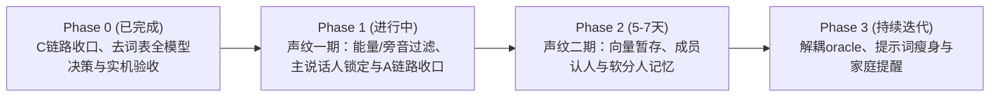

# 产品架构收敛、声纹识别与后续开发计划（2026-11-25 更新）

> **核心决策：**
> 1. **主线唯一锁定 C 链路（千问原生 Realtime 端到端语音）**：暂不强求声音克隆，停止 A 链路（Omni→文字→CosyVoice）的维护与复测，管理后台隐藏/禁用 A 链路选项，B 链路仅保留现有代码作冷备。
> 2. **彻底取消服务端静态意图词表，所有语义决策交由大模型**：联网搜索（`enable_search: true` + 模型内置 Search Agent）、跨会话记忆选择（`SelectMemory`）、音乐控制（`PlanMusic`）全部由大模型自主决策；慢轮垫话（`rescue.go`）完全按真实响应时间触发，不靠词表猜测。
> 3. **声纹识别作为核心增量**：复用现有 `internal/speaker` 与 `internal/speakerlive` 底座，在 Go 服务端上行链路分两期落地“旁音过滤 / 主说话人锁定”与“家庭成员识别 / 分人记忆”。
> 4. **工程与硬件边界不变**：唯一支持微雪 ESP32-S3 2.16（固件 2.5.4+），管理端与小程序仅使用真实 API，所有运行依赖、测试与服务部署均在云服务器执行。

---

## 一、 现状评估与已完成基线（Phase 0 已验收通过）

### 1. 已上线并验证的核心能力（截至 `4809fa8` / `rescue-fix-20261124-r5`）
- **播放事实账本（`internal/realtimestate`）**：通过微雪 I²S DMA / Mac CoreAudio 回执 + `OutputASR` 对齐 `assistant_spoken_prefix`，遵循“设备实际播了多少，模型才算说了多少”，打断后续讲不串台。
- **垫话（`rescue.go`）隔离与纯时间驱动**：
  - 垫话音频只进 `rememberEchoPCMLocked`（供防回声自打断比对），不进 `rt.asr.Feed`，彻底消除垫话对 `assistant_spoken_prefix` 与跨会话记忆的污染。
  - 已起播的短垫话（`≤9` 字 / `≤1.8s`）播完当前短句再进正文，消除半截字硬切。
  - 移除所有搜索猜测词表，统一按真实响应时间（距话尾 `1850ms` 且距主会话 Open `1350ms`）决定是否播报垫话。
- **跨段停顿携带与重说音文同步去重（`session_input.go`）**：
  - 用户说话中途停顿（`≤2s`）时自动携带前半句文本与 PCM，尾随呼吸/咳嗽空转写自动回退保留前半句。
  - 用户停顿后从头重说时（`>=3` 字前缀匹配，自动剥离首尾犹豫语气词），同步去重前半句文本与 `carryPCM` 音频，并将未起播（`!Begun && Sent == 0`）的空打断轮次从 `s.history` 折叠移除。
- **双端统一回声自打断防护（`session_echo.go`）**：
  - `xiaozhi`（微雪）与 `mac_native`（Mac 终端）统一启用 `overlapped` 播放期弱预览扣留与起播首字回声变体拦截。
- **移除 4 处静态意图词表（`4809fa8`）**：
  - 已删除 `search_gate.go`（`searchFreshWords` / `searchMetaRecallWords` / `noSearchGroups`）、`rescue.go`（`rescueEarlySearchWords` / `rescueQuestionOpens` / `rescueQuestionEnds`）、`memory.go`（`memoryRecallWords` / `crossSessionRecallWords`）、`music.go`（`musicIntentWords`）共 338 行硬编码词表，全部交由大模型决策。
- **微雪与 Mac 双端 C 链路统一**：
  - 云端微雪设备（`dev_ce26243f0d2f0b8019bfe45796307b48`）持久化路由已切为 `C`（`rev=8`），Phase 0 验收通过。

---

## 二、 后续阶段核心方案（Phase 1 ~ Phase 3）

### 方案 1：管理后台 A 链路收口
- **生产默认唯一锁定 C 链路**：管理后台前端与配置接口仅开放 `C`（默认推荐）与 `B`（冷备）的切换，禁用/拒绝将设备新设为已退役的 `A` 链路，防止误触切回 `A`。

### 方案 2：声纹识别分两期落地（复用 `internal/speaker` & `internal/speakerlive`）
声纹识别全部在 Go 服务端收音侧（16kHz 上行 PCM）完成，与 C 链路天然契合（CPU 推理耗时 <40ms，不拖慢首包），且**不引入任何文本关键词表**：

1. **第一期（Phase 1）：旁音过滤与会话主说话人锁定（Bystander Rejection & Session Anchor）**
   - **解除测试限制与接入正式服务**：
     - 补齐 `internal/speakerlive/reason_test.go` 的 `//go:build linux` 标签；
     - 放开 `internal/speakerlive/observer.go` 中测试期 `maxClips = 32` 和 `5 * time.Minute` 的硬限制，支持长会话持续观察；
     - 解除 `internal/realtimelive/server.go` 中 `speaker_test_requires_memory_only` 对正式会话启用 `cfg.Speaker` 的限制，并在 `cmd/realtime-output-live/main.go` 接入可选的 `--speaker-binary`、`--speaker-model`、`--speaker-sha256` 启动参数；helper 未配置或异常时自动降级为放行，永不阻塞正常对话。
   - **远场低能量旁音拦截与 `1.5s (24000 采样)` 最短时长解耦**：
     - `speaker_observation.go` 对 `<24000` 采样（1.5 秒）返回 `too_short`，而日常短口令多在 `0.6~1.4s`。
     - 将**能量门控**与**声纹聚类**解耦：在 `session_input.go` 计算有效语音帧 RMS 能量（耗时 `<0.1ms`），直接拦截远场电视声与极低能量背景旁音（`input_rejected: bystander_low_energy`），近场正常音量的短句（`<1.5s`）正常放行。
   - **主说话人锚点（`speakerAnchor`）锁定与播放期防旁人插话打断**：
     - 主说话人锚点仅在**非 `overlapped`（未播音）、近场能量达标、声纹观察返回明确临时标签（如 `guest_1`）且该轮最终通过准入生成正常回复**时锁定；
     - 在小满播音期间（`p.overlapped == true`）收到新输入时，若当前会话已锁定主说话人锚点（如 `guest_1`），而本段输入声纹明确识别为其他说话人（`guest_2..8` != `speakerAnchor`）或远场低能量（`low_energy`），则拒绝打断当前播报（`input_rejected: bystander_speaker_mismatch`）；对于主说话人本人或近场 `<1.5s`（`too_short`）的短指令则正常放行打断。

2. **第二期（Phase 2）：家庭成员声纹库、身份注入与分人记忆**
   - **声纹向量暂存与历史对话点选绑定**：
     - 改造 helper 在有效观察轮次返回归一化 `[]float32` 声纹向量（约 1KB，不可逆推原始语音），随 `memoryTurn` 暂存于 7 天/24 轮私有快照中；
     - 用户在管理端/小程序“近期聊天/记忆”点选某轮绑定家庭成员（如爸爸、妈妈、孩子）时，后端复制该轮已存的归一化向量至家庭成员声纹档案（`0600` 私有存储）。
   - **提示词身份注入**：匹配成功后，在 `session.go` 的 `composeReplyPrompt` 尾部注入 `[当前说话人：妈妈]`，让 C 链路模型自然带出称呼并按成人/儿童调整语气。
   - **同库打标 + 软加权分人记忆**：
     - 存储层仍按 `DeviceID` 统一维护 24 轮快照，在 `memoryTurn` 新增 `SpeakerID` 标签；`memory_selection.go` 由大模型结合 `SpeakerID` 优先匹配当前说话人的个人记忆，同时兼容家人围坐共聊续讲。

### 方案 3：解耦旧测试、提示词瘦身与主动关怀（Phase 3）
- **提示词瘦身须先解耦 `oracle.py` 差分测试**：
  - 解除 `internal/realtimestate/testdata/oracle.py` 对系统提示词常量的逐字节比对耦合，再将 3200 token 系统提示词精简至 `~1800` token。
- **陪伴核心业务闭环（主动提醒与关怀）**：
  - 在家庭端（小程序/网页）及语音对话中接入轻量“家庭提醒/备忘”（老人吃药、孩子放学、生日提醒），结合声纹识别在目标成员唤醒时主动提醒。

---

## 三、 分阶段开发进度清单（Roadmap）

### Phase 0：C 链路单线收口、`rescue.go` 缺陷修正与全模型决策（✅ 已完成）
- [x] `speakRescue` 下发音频隔离 `OutputASR`，消除已播账本与跨会话记忆污染。
- [x] 优化 `streamPCM` 切出逻辑，已起播短垫话完整播完再接正文。
- [x] 跨段停顿自动合并文本与音频，重说前缀音文同步去重并折叠未起播空轮次。
- [x] 开启 `mac_native` 与 `xiaozhi` 一致的播放期回声保护。
- [x] 移除 `search_gate.go`、`rescue.go`、`memory.go`、`music.go` 全部 4 处静态意图词表，所有语义决策交由大模型，垫话纯按真实响应时间触发。
- [x] 云端微雪持久化路由切至 `C` 并完成 Phase 0 验收。

### Phase 1：声纹识别一期（旁音过滤与防误打断）+ 管理后台 A 链路收口（🔄 进行中）
- [ ] **管理后台 A 链路收口**：管理后台前端与配置校验收口 `A` 链路选项，仅允许选择 `C`（默认）与 `B`（冷备）。
- [ ] **声纹 Observer 生产化改造（`internal/speakerlive` & `internal/realtimelive` & `cmd/realtime-output-live`）**：
  - 补齐 `internal/speakerlive/reason_test.go` 的 `//go:build linux` 构建标签；
  - 放开 `observer.go` 的 `maxClips` / `lifetime` 生产会话限制，支持长连接会话持续观察；
  - 解除 `server.go` 的 `speaker_test_requires_memory_only` 限制，并在 `cmd/realtime-output-live` 支持 `--speaker-binary`、`--speaker-model`、`--speaker-sha256` 配置。
- [ ] **上行输入能量与主说话人声纹门控（`internal/realtimelive/session_input.go` & `speaker_observation.go`）**：
  - Go 本地同步计算有效语音段 RMS 拦截远场 `bystander_low_energy` 旁音；
  - 在非 `overlapped`、近场能量达标且正常生成回复的轮次锁定会话主说话人锚点（`speakerAnchor`）；
  - 在 `overlapped` 播放期打断判定中，拦截明确非主说话人（`guest_2..8` != `speakerAnchor`）或 `low_energy` 旁音，放行主说话人及近场 `<1.5s` 短指令。
- [ ] **云端全量单测、竞态测试与部署上线**。

### Phase 2：声纹识别二期——家庭成员注册、认人对话与分人记忆（5~7 天）
- [ ] 升级 helper 返回归一化 `[]float32` 向量，随 `memoryTurn` 暂存于 7 天/24 轮私有快照。
- [ ] 新增家庭成员声纹档案存储与管理端/小程序“近期聊天点选绑定成员”接口。
- [ ] `composeReplyPrompt` 注入当前识别到的家庭成员称呼与角色。
- [ ] `memoryTurn` 附加 `speaker_id` 标签，支持分人记忆检索。

### Phase 3：解耦旧测试、提示词瘦身与主动陪伴（持续迭代）
- [ ] 解耦 `internal/realtimestate/testdata/oracle.py` 逐字节提示词比对并精简系统提示词（3200 → ~1800 tokens）。
- [ ] 家庭提醒与主动问候闭环。
