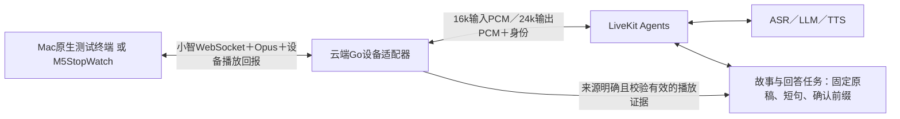

# 面向实际设备的语音与故事接续测试方案

2026-10-24。用户要求停止使用浏览器进行后续主要测试，采用符合实际使用的方案。本文替代此前故事方案中的浏览器验收路线；不表示原生终端、Go→LiveKit设备桥或故事检查点已经实现。本轮为方案调整，不修改服务代码、不切换正式8000入口、不刷手表。

**用户后续澄清：** 普通插话不要求立刻截断声音，而是停止旧内容下发、让终端排空已接收的旧音频，再播放新答案。测试行为以[柔和交接方案](2026-10-24-drain-handoff-design.md)为准，不再以清空本地播放队列或即时停声作为默认通过条件。

## 1. 已确认的问题与本轮变化

故事恢复起点错误已经在完全不经过浏览器的服务器合成输入测试中复现：模拟只播放约1.34秒，插话回答后却从“情节三”继续；当前服务端没有故事原稿与句级播放检查点。因此换客户端不能代替补齐[故事与回答内容任务](2026-10-24-story-reply-resume-design.md)。

用户要求的新路线照常执行：后续主要验收使用真实设备协议、原生音频及最终M5StopWatch实机。浏览器历史结果只保留为历史证据，不再继续用浏览器作为接续通过的依据。

此前“先Mac、最后手表”的分层思路仍可使用，但Mac需改为原生测试终端。是否现在直接使用手表取决于用户当前设备是否在身边且能接入；共同的服务器缺口可以先准备，不因终端可用性改变故事状态机。

## 2. 目标链路

所有模型、任务、设备适配和运行测试仍在云服务器。Mac只作为收音/播放终端、Git编辑环境及SSH转发，不在Mac搭建语音后端，不复制模型Key或正式手表长期凭据。

Mac原生和手表共享的是协议、音频格式、任务状态及控制行为；音频硬件、回声消除和回报来源分别验收。原生Mac通过不能代替手表AEC、I2S或扬声器实测。

## 3. 当前有哪些、还缺哪些

| 内容 | 当前事实 | 新方案如何使用 |
|---|---|---|
| LiveKit语音链路 | 已有连续PCM入口及自定义AudioOutput | 作为设备适配器后面的同一运行时，不另写一套模型链路 |
| 手表与旧Go入口 | 已有小智协议、Opus、playback_progress_v1及I2S回报代码；旧路径有历史现场证据 | 复用经核对的协议和位置验证逻辑，不将旧Qwen后端的通过结果冒充新LiveKit通过 |
| Go→LiveKit设备适配 | 当前internal/devicebridge未实现 | 必须先补齐；不能把手表直接指向现有浏览器PCM端点就声称接通 |
| Mac原生音频终端 | 未实现 | 需要真实麦克风、扬声器和播放回调；不是换个命令行外壳继续模拟计时 |
| 故事原稿/短句检查点 | 尚未实现 | 按已提出的内容任务方案补齐，再以故事和普通解释为主要验收用例 |
| cmd/smoke | 已有合成WAV、真实Opus协议收发 | 保留为服务器协议辅助检查；它不播放到硬件，不能当作原生客户端或实机证据 |

## 4. 与手表一致的协议和采样坐标

- 使用小智hello、listen、abort、tts控制及实际二进制Opus数据；保持输入/输出身份、连接代次和单调播放ID。
- 上行16kHz单声道Opus；帧长按固件实际hello协商（现有服务支持20/40/60ms），不得未核对固件就写死为同一帧长。
- 下行24kHz单声道Opus、60ms一帧，与现有手表播放回报路径一致；Go从LiveKit PCM编码，终端解码后播放。
- 保存原短句PCM范围与设备24k采样坐标的对应，覆盖Opus编解码延迟、最后帧补零及Mac硬件采样率转换。以受控标记音频校准，不能按包数或时长粗略均分原文。
- 已有cmd/smoke的解码器输出16k，不能未经修改就将其样本数量按24k设备回报解释；新终端需明确24k输出或有可验证的转换。
- 所有接续均采用连续完整短句前缀；音频发送完、tts stop、解码结束或入播放队列均不直接代表实际播放完成。

## 5. 两种终端的播放证据

### 原生Mac分层测试

采用macOS原生音频接口（AVAudioEngine/CoreAudio），持续收音，系统语音处理能力可用时启用其回声消除；实际能力和设备配置随测试记录，不称为ESP-SR验收。

播放进度来自系统播放完成通知/输出时间与采样位置，并记录输出延迟的校准结果。不能把scheduleBuffer成功、数据被消费或固定sleep结束当成扬声器完成。无法给出有效位置时回报unknown，任务保守重读当前句。

Mac使用独立的回报basis，例如coreaudio_playback，并与Mac测试设备身份协商绑定。现有ParsePlayback只接受basis=i2s_dma；不能为复用解析器而让Mac伪装成I2S。新设备适配器需明确区分并校验两种来源，正式手表的i2s_dma语义保持不变。

### M5StopWatch最终验收

使用现有真实麦克风、扬声器、唤醒、软件AEC及DMA完成回报。上报session_id、playback_id、sample_rate=24000、played_samples、valid、state及basis=i2s_dma。连接/播放代次、位置单调性、发送上界和最终状态均由Go校验。

I2S DMA完成仍不是逐字对齐或物理声学停声测量；需要独立校准及实际听感/声学测试。不能用Mac回报替代这一层。

## 6. 按实际使用方式测什么

主场景统一为故事和普通解释：只唤醒一次，后续持续说话、自动判断话尾；播放中直接开口插话，不手动发送结束或按停止键。

1. 播放保存的故事原稿，在已知第2句中间触发插话，问一个独立问题；分别构造“第2句仅部分下发”和“第2句已完整接收”的两种缓存状态。
2. 服务端封口旧下发，本地已收到的旧音频保持播放到排空，新问题的回答随后播出；主故事原稿保持，确认前缀以旧输出排空后的最终回报为准，新答案不得推进它。
3. 说“继续讲刚才的故事”“把刚才没讲完的接上”等自然表达：若最终只播完第2句部分则重读原第2句，若排空后第2句已经完整则从第3句开始；再顺序完成后文。
4. 再次在后续句子中途插话，恢复使用最近一次合法排空结算位置；第一轮迟到回报不能覆盖它。
5. 换为一段普通问题解释，执行相同流程；不用数数作为主要通过样例。

自动化先用固定三句、已知PCM边界的故事建立确定性断言，再用真实LLM生成的有界故事验证内容保持。至少覆盖句中、句尾、句间、连续两次插话、不同口语表达、网络在途帧、丢回报、旧回报、合成失败、断线及放弃。每次比较原文版本、客户端接收/播放范围、已确认句子、当前句、恢复句及新答案开始时刻；须证明已收旧内容没有被清掉、新答案没有抢播，不只判断“有声音”“模型说能继续”或话题相似。

## 7. 自动测试、真实收音、声学测量分别报告

| 测试 | 方式 | 可以证明 |
|---|---|---|
| 任务/协议自动回归 | 云服务器已知原稿、真实Opus和故障注入 | 状态机、音频映射及旧事件防护；不是麦克风或硬件实播 |
| 原生Mac端到端 | 合成输入在原生终端编码前注入，原生扬声器真实播放和回报 | 设备协议到模型再到原生音频的链路；输入仍标synthetic，不能写成真人收音 |
| 真人连续讲话 | Mac或手表麦克风，扬声器输出，播放中自然插话 | 真实收音、自动分轮、双讲和可听接续；需要真实近端声音 |
| 声学位置校准 | 已知输出标记＋独立录入/环回，记录采样与延迟 | 测量输出/停声偏移；录音来源、AEC状态及标记源必须记录 |
| 手表实机 | 同一后端、真实Opus、DMA回报及实际麦克风/扬声器 | 产品设备路径；单独验收手表AEC、唤醒、解码和声学效果 |

自动合成插话可以批量执行，但不能因为它与真人发言走同一后端就声称声学双讲通过。同一输出参考里的声音可能被AEC消除，真实近端插话或独立声源的验证不能由软件注入替代。

默认不落盘真人录音或正文；自动合成输入/输出证据放服务器私有目录，不进Git。诊断保留内容单位ID、代次、样本数、来源及确认状态；如确需真人录音，另行说明用途并取得授权。

## 8. 接入与实施顺序

1. 先补服务器内容任务/短句播放映射，用已有失败故事基线作为回归；此项不依赖浏览器或终端类型。
2. 接Go设备适配器，验证小智协议、Opus、块/句范围和取消/回报，不直接改正式8000的设备后端。
3. 若手表当前可用，准备隔离测试入口后接实机；若暂不接手表，先制作Mac原生终端走同一设备适配链路。Mac经仅本机可达SSH转发访问云端测试入口，使用短期测试凭据，模型Key仍只在服务器。
4. 实机接入前核对现有网络入口、设备鉴权和后端隔离方式，再给出具体接入配置；当前没有已实现的Go桥和已验证的新实机入口，不能先换手表地址、覆盖正式token或扩大公网端口。若需新的受保护入口，先完成可审阅配置及回退方案。
5. 执行三句原稿→真实故事/解释→连续插话→故障注入→声学/手表分层验收，按来源分别发布结果。

优先复用现有收音与协议，不为测试引入另一套语音模型后端。更换测试终端与修复服务端故事检查点是两个明确任务，二者都完成后才可宣布符合实际使用的故事接续通过。
