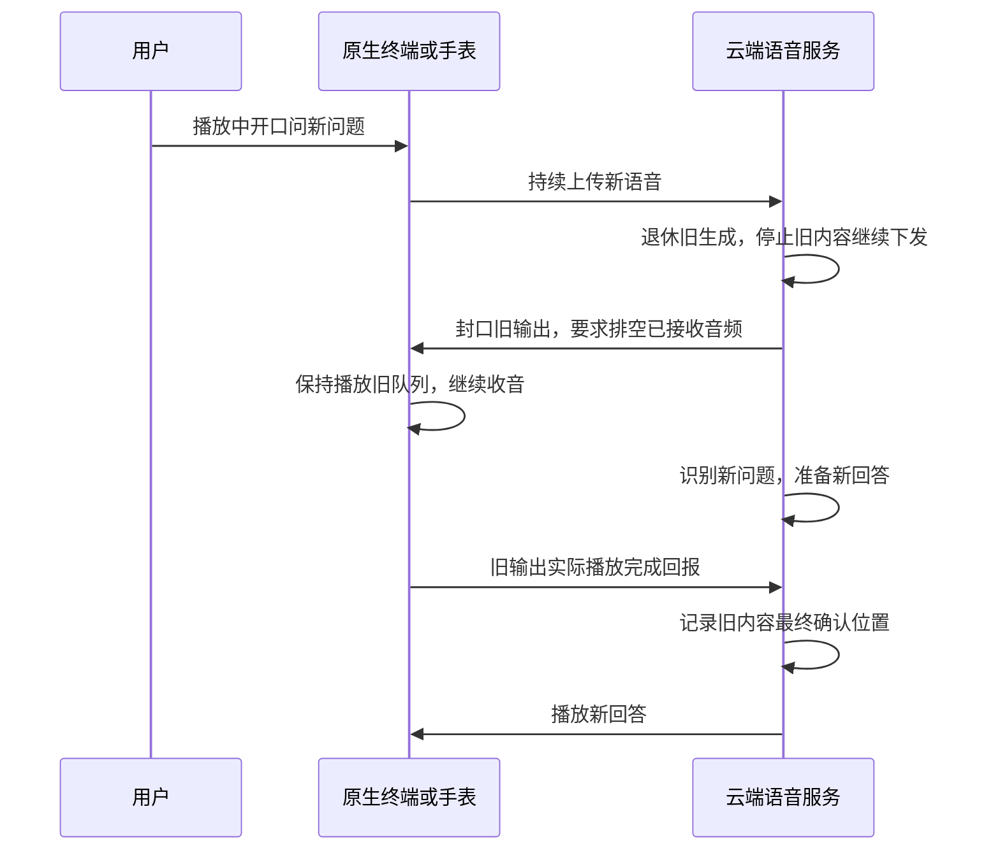

# 语音插话采用排空旧音频后的柔和交接

2026-10-24。用户明确：不要求插话时立即截断旧声音；服务端收到打断信号后停止继续发送旧内容，本地把已经收到的旧音频播完，再播放对新问题的回答。允许一定回复延迟，以避免已发送内容被清空。这是本轮最新行为定义，替代此前默认“立即取消并清空客户端播放队列”的设计。本文为方案，当前运行代码尚未改变。

**最新低延迟细化：** 用户进一步要求交接延迟尽可能短，采用[低延迟交接方案](2026-10-24-low-latency-handoff-design.md)。常态发送窗口目标改为约240～360ms、初始额度上限600ms（均待测），新答案可提前进入隔离待播区，由终端排空旧输出后本地放行。下文的“等服务器收到最终回报再发新音频”和1～2秒窗口仅保留为早期/兼容方案，不再作为优先设计。

## 1. 目标行为

用户听到：原来的话自然播完已经送到终端的部分，随后接上新问题的回答。后续说“继续刚才的故事”时，恢复保存的原稿未完成部分。

“排空”只针对本次旧输出已被终端接收的有限音频，不意味着把整个故事讲完才回答，也不意味着把服务器所有生成稿都算作已经听到。

## 2. 四种进度必须分开

| 进度 | 含义 | 能否作为用户已听依据 |
|---|---|---|
| generated | 已生成的故事/回答文字 | 不能 |
| prepared | TTS已准备的PCM | 不能 |
| sent/accepted | 已发出/已被终端接收的音频 | 仍不能，需播放确认 |
| played | 终端有效回报的实际输出前缀 | 可据来源与校准结果确认完整内容单位 |

正常连接下，旧输出封口和数据使用有序发送路径，终端校验接收范围。客户端排空后的played才用于更新原任务检查点；服务器生成或合成但未下发的后文仍保留为待播原稿。

## 3. 服务端怎么改

1. 新语音起始时，禁止旧生成继续入发送队列，取消其剩余模型/TTS工作；已经固定的原稿保留。单一发送者建立旧输出的封口屏障，明确最后实际下发序号/采样范围，阻止迟到旧帧越过屏障。
2. 给终端发送排空/正常封口语义，不发送默认的清空缓冲命令。网络中在途旧帧属于封口之前的合法范围，按序收齐；封口后的旧帧拒绝，不能混入新回复。
3. 继续ASR和新回复准备。优先方案允许新答案提前进入终端隔离待播区，绑定有效交接授权，旧音频排空后本地放行；最终播放回报异步回服务器记账。兼容模式才在服务器收到排空回报后下发新音频。新回复被新的插话取代时，取消尚未播放的旧答案。
4. 旧播放身份在排空完成前继续有效。新的发言代次会使旧生成/旧工具失效，但不能同时使合法的旧音频最终播放回报失效。
5. 内容任务进入`draining`，接收旧输出有效完成回报后更新连续完整前缀，再进入`paused`。新答案使用独立身份，不能推进故事游标。
6. 明确分开“生成被打断”和“音频被截断”。即使SDK SpeechHandle标记interrupted，只要固定内容单位确已完整播完，其播放证据仍可由任务账本确认。不能机械沿用当前计数回调的“handle interrupted就一律不推进”规则。

LiveKit的取消可能调用AudioOutput.clear_buffer，当前适配器会发送audio.cancel清空客户端。本方案需要在适配层区分生成取消、排空封口与立即停止，并把SDK生命周期结算和任务实际播放账本分开验证；不是只修改界面按钮或重写提示词。

## 4. 终端怎么改

- 同时收音和播放；插话后保持旧队列，不能因为进入监听状态就ResetDecoder或丢弃已接收音频。
- 收到旧输出排空封口后，播放到已接收范围末尾，再回报合法身份、最终样本前缀及finished。不得用入队成功或固定sleep冒充排空完成。
- 旧输出排空前不混播新答案。优先采用隔离待播区和有效授权的本地交接栅栏；服务器回报确认仍用于权威任务记账，不能因本地已经切换就伪造播放事实。不能支持新能力的终端才使用服务器等待排空回报的兼容模式。
- 当前手表代码遇到带interrupted含义的tts stop会重置解码队列，默认中断入口也需复核。因此现固件不能未经验证就宣布支持柔和交接；需要可协商的排空能力及实际回报测试，不能简单复用原清空命令。
- Mac原生使用CoreAudio来源的播放证据，手表使用I2S DMA来源，各自保留来源标记；不得相互冒充。

## 5. 防止排空导致长时间等回复

当前服务允许较大的音频待播上限，不能直接让它成为新交接策略的常态。发送需要增加基于终端消费的背压/额度：限制下发超前量，更多预取音频留在服务器。

初始1～2秒窗口已被低延迟需求更新：按新方案先测试约240～360ms常态窗口及600ms额度上限，测量抖动/欠载后再调整；这不是当前已达到的指标或物理尾部保证。原稿准备和服务器缓存可以更长，不得因为TTS生成快就全部堆到本地。报告区分：停止旧下发延迟、剩余本地播放时间、新答案准备时间和真正开始回答的时间。

如果排空回报丢失/无效，不能靠计时猜它已结束并直接混播新答案。进入明确的播放状态未知/连接恢复流程，保留原稿和已确认前缀；正常交接以有效回报为准。

## 6. 内容不丢仍需要原稿与句级账本

柔和交接可避免“本地已经收到但被强制清掉”的音频丢失，却不能单独解决原稿定位：停止发送时最后一个短句仍可能只下发了一部分，生成稿也可能远超已下发范围。

因此继续采用固定原稿、短句音频范围和连续完整前缀。排空后第1～3句完整，第4句只收到并播出部分，则保存第4句未完成；后续继续保守重读原第4句。允许少量重复，不能跳过未确认后文，也不能把模型生成到的第8句当成已播到第8句。

若希望交接也尽量落在自然句尾，可在后续增加“当前短句完整下发后封口”策略，但它会在收到信号后再发送有限尾部，区别于用户本轮指定的“停止继续下发、排空已接收内容”；不在首版悄悄改变这个定义。

## 7. 新测试如何判定成功

使用[原生终端/实际设备测试路径](2026-10-24-device-voice-test-design.md)，浏览器不再作为主要验收。先已知三句原稿，再故事和普通解释，重点检查：

1. 插话后旧输出的发送序列封口，封口后没有迟到旧帧继续追加。
2. 客户端已接收的旧音频没有因普通插话被清空，实际排空前缀与有效接收范围一致；未收到的原稿不伪记为已播。
3. 新答案已经准备也不得与旧内容混播，其第一段播放必须晚于旧输出排空完成。
4. 故事原稿保持，最终句级检查点匹配排空后的实际确认前缀；恢复使用该位置，不能使用最初检测插话时的旧位置。
5. 重复插话会替换待答的新问题，不复活旧生成/旧工具；正在排空的旧播放身份仍能正确结算。
6. 覆盖网络在途帧、丢回报、无效回报、合成失败、断线和明确结束；失败不算作平滑交接通过。
7. 测量和限制排空等待时间，不以“必须立即停声”作为普通插话的通过标准；物理声学效果仍需终端对应的实际音频验证。

只有用户明确要求立即停止/结束、断线清理或音频故障时，才使用单独的强制停止路径，不能把该路径作为普通插话默认行为。
