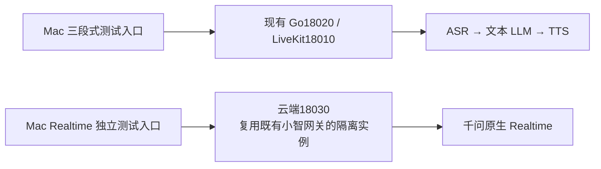
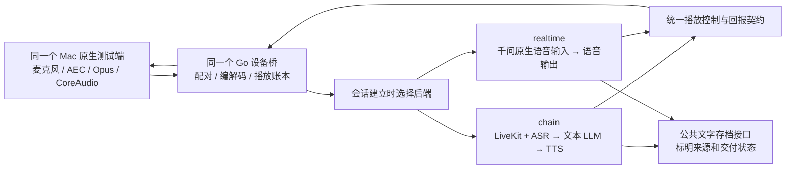

# 语音链路独立体验对比与后续双后端设想

日期：2026-10-24。状态：用户已批准独立体验对比方案并要求开发；是否需要双后端集成，待测试后再决定。随后补充现有Realtime已部署并接入小智，本轮优先复用该网关与协议。

用户最新要求：首要任务是与现有三段式链路进行体验对比。Realtime 尽量独立，不为接入既有历史、会话记录、任务接续等能力先做统一架构；确认确有必要使用双链路后，再讨论集成。

## 0. 当前有效方案：先独立体验，再决定是否集成

本节覆盖下文原集成规划中的冲突要求。第1～9节保留为后续参考，不是当前开发清单；其中“必须同一设备桥”“统一存档”“双后端长期共存”“随后增加协作模式”等不再作为本轮前提或既定结论。

### 0.1 比较对象与实现边界

- 三段式沿用当前可用版本，保留其现有聊天、准备回应、任务接续及记录行为；不为了本轮对比重构正在使用的服务。
- Realtime复用已部署的小智/Qwen原生网关代码，建立独立服务器测试实例18030；进程、配置、设备身份与会话均隔离，不占用原8000正式入口的设备名额。已核对原入口有1个活动会话且上限1，不为Mac测试重启或切换原服务。
- 音频直接输入原生模型、直接输出模型声音；沿用原Realtime网关现有会话内背景、任务规则和中断重连行为，不新做语音核心。对比结果包含这些应用逻辑，不能解释为未加网关的纯模型评测。
- 不接三段式 ASR、文本模型、TTS、准备回应、历史查询工具、会话记录回灌、内容控制器、故事原稿或检查点；不共享模型会话、任务状态，也不作自动分流或失败回退。
- 同一台Mac、麦克风、扬声器和现有原生AEC/Opus/CoreAudio代码复用，以减少设备差异；独立客户端对接旧小智协议，不统一设备桥、LiveKit会话或播放账本。Mac不伪装旧协议要求的I2S播放证据，只在客户端记录CoreAudio完成。
- Realtime 的收发、取消和资源队列须能正常工作，旧回答不得混入新回答；固定稿精确恢复、跨会话记忆及原生截断效果不足，作为待观察的能力边界记录，不以接入三段式补齐为体验测试前置条件。
- 运行依赖、服务与运行时测试仍在云服务器；Mac只负责代码/Git与原生测试终端。多人识别继续暂停。

建议测试结构：

两条链路交替使用，不同时收音或发声。旧8000小智设备入口仍独立存在。实施计划见[独立测试计划](../plans/2026-10-24-independent-realtime.md)，实际部署与测试结果另见[验证报告](../../verification/2026-10-24-independent-realtime.md)。

### 0.2 对比方法与出口

- 目标是比较当前两条实际链路的交谈体验，不预设哪条更好，也不为功能对齐引入一轮集成工程。
- 同一设备、相近环境、相同测试场景，交替使用；各自新建会话，用相同开场信息开始，不向 Realtime 注入既有三段式档案。三段式若实际读取了历史，单独标记该样本，避免混入无历史条件下的比较。
- 重点体验：回答是否自然、等待是否可接受、会不会抢话、插话后是否回答新问题、连续追问是否接得上、讲故事被打断后如何续讲，以及长时间使用是否稳定。
- 记录用户话尾、首次反馈、实质答案首播和旧音频结束时间。三段式已有独立准备回应，不能把准备回应首播当成正文提速；音色偏好与内容理解分别评价。
- 播放和轮次策略允许沿用各自有效实现，并记录差异；不为追求表面统一先移植 drain/任务协议。结果归属于这两条具体实现，不泛化成模型架构必然优劣。
- 只保留独立、最小必要的测试指标和错误证据；如需文字复盘，记录独立保存并区分生成稿与实际播放未知，不接公共记录本、不回灌模型。原始真人录音不新增持久保存。
- 先打通独立Realtime收音、播放、连续问答与插话，再进行真人体验对比。原生截断/续讲不足作为测试结果报告；不新增跨后端历史修复或会话重建工程。既有Realtime代码已经有中断重连逻辑，保留并在结果中标明，不能冒称每轮始终在同一原生连接中完成。
- 对比完成后，根据实际收益与不足讨论继续使用哪条链路、是否都保留、是否确有必要集成。公共记忆、统一记录、统一播放协议和场景协作届时重新评审，不自动进入开发。

---

> 以下第1～9节是此前的双后端集成设想，暂缓执行；与第0节冲突时，以第0节及用户最新决定为准。

## 1. 目标与当前事实

产品目标首先是自然的家庭陪伴交流，同时保留故事、朗读和数数的固定内容与可恢复进度。对比测试用于了解各自适用场景，不以删除其中一种后端为出口。

当前代码有两条相关路径：

| 路径 | 已有内容 | 本方案需要补齐的部分 |
|---|---|---|
| Mac 原生终端 → Go 设备桥 18020 → Python/LiveKit 18010 | Fun-ASR → qwen-plus → Qwen TTS；CoreAudio 回报、drain 交接、内容检查点和文字存档 | 同一入口选择语音后端、后端身份与对比元数据 |
| 原 Go 网关 8000 → 千问原生 Realtime | `internal/qwen/` 原生协议客户端、设备接入及旧网关会话代码 | 接入当前原生测试端的协议适配；共享测试和记录边界 |

三段式代码默认模型为 `fun-asr-realtime`、`qwen-plus`、`qwen3-tts-flash-realtime`，音色 Cherry。Realtime 首个验证候选为既有原生接口使用过的 `qwen3.8-omni-flash-realtime`、音色 Tina；最终以服务器受保护配置及实际调用记录为准，不把别名解释为固定权重版本。

已有原生 Realtime 代码不等于当前 Mac 客户端可以直接连到 8000：当前客户端要求 drain/staging、播放块身份和 CoreAudio 回报契约，不能只改一个端口就视为兼容。

本方案不提前改变正在开发的会话记忆、普通对话与文字存档实现。开始实施前，重新阅读交接文档和最新 main，基于实际完成状态调整接线。

### 1.1 长期共存与兼容性要求

用户再次确认：三段式与 Realtime 长期共存，新增后端不能以替换或削弱现有三段式为前提。

- **保留完整三段式**：ASR、文本 LLM、TTS 的完整会话模式继续可独立使用，普通聊天也可选择；不会只剩下供 Realtime 调用的 TTS 模块。
- **原入口和默认行为兼容**：没有显式选择后端的旧客户端仍使用 chain；不改变既有模型、音色、会话记忆、原稿恢复、文字存档和播放策略。
- **配置与故障隔离**：Realtime 使用独立的模型/端点/音色配置覆盖项；需要兼容读取旧配置时只读，不写回三段式配置。Realtime 未配置、未开通、连接失败或停用时，chain 仍可启动并正常使用；不预先建立无关 Realtime 连接。
- **明确选择，不暗中替换**：用户选择哪一种，就使用哪一种；失败明确提示，首版不静默切到另一后端，也不重复向两边提交同一输入。
- **共用基础能力，分别管理会话**：设备接入、播放账本与存档接口可复用；输入/输出代次、模型连接、在途请求和各自能力分别管理。公共组件的兼容性由回归验证保障，不能仅凭接口未变就认定无影响。
- **场景协作是附加模式**：后续自动分流增加第三种使用方式，原有“完整三段式”和“完整 Realtime”始终保留。场景表是默认策略建议，不是对任一模式的功能限制。

## 2. 方案选择

| 方式 | 优点 | 代价与结论 |
|---|---|---|
| **同一原生客户端、同一设备桥、可选择的后端** | 收音/AEC/编解码/播放器一致，便于对比，也能逐步形成公共能力 | 需要新增 Realtime 会话适配；推荐作为第一阶段 |
| 分别连接旧 8000 和新 18020 | 可利用两条已有路径 | 客户端协议和播放策略不同，结果同时混入网关差异；仅适合作为诊断参考 |
| 第一阶段直接自动按场景切换 | 接近最终使用方式 | 同时引入识别场景、状态交接和重复输出问题，不利于查明体验差异；放在独立后续阶段 |

采用第一种。先提供两种可手动选择的完整测试模式，再增加场景协作。LiveKit 是框架，三段式和端到端是模型调用路线，不把它们当作同一层的选择。

## 3. 第一阶段：双后端独立对比

### 3.1 测试端选择

- 原生窗口增加“链式语音 / 端到端 Realtime”选择，保留原来的开始/结束操作。
- 只允许在停止状态选择；切换先结束当前会话，再创建明确的新会话。首版不在正在说话或播放中热切换。
- 服务端在 ready 中回显实际 backend、请求模型别名、音色和能力；客户端显示当前模式，不能只显示本地选择值。
- 未选择时保留现有 chain 默认，避免改变正在使用的测试行为。
- 每次会话只向一个用户语音后端发送输入，不同时生成两份回答。

### 3.2 服务端接线

Go 设备桥继续拥有配对、Opus、设备会话和实际播放坐标。配对请求可选择有限枚举 `chain/realtime`，一次性票据绑定设备与后端；客户端不能提供任意上游地址、模型 Key 或修改后端凭据。

Python 服务在公共入口创建对应会话：

- `chain`：复用现有 LiveKit 会话与内容控制器。
- `realtime`：新增专用千问原生 PCM 会话适配，直接转发输入音频、消费模型输出音频，不经过 `qwen-plus` 再生成一次回答。

两个会话对接现有生命周期：启动、持续输入、播放回报、显式停止和关闭。内容快照、原稿恢复等能力分别声明；Realtime 首版不能因为接口字段相似就宣称具备固定稿恢复能力。

Realtime 适配优先沿用已经核对过的千问原生协议经验，复用音频、输出和存档公共组件。旧 Go 会话主干不整包搬进 Python，也不把一次性审计脚本直接当生产插件。第一阶段不强制增加 LiveKit Realtime 插件包装；以后若确有统一 SDK 生命周期的收益，再单独评估。

原因：此前固定版本的 OpenAI Realtime 插件与千问存在事件名称、采样率和请求关联差异，换 base_url 并不能完成适配。该事实见[既有验证](../../verification/2026-10-23-livekit-comparison.md)。

### 3.3 模型和轮次

Realtime 的输入保持原始处理后音频，输出使用模型直接生成的 PCM。接口附带的输入转写可用于文字存档，不把转写文字改送文本模型后仍称为端到端。

三段式保持现有轮次配置；Realtime 使用供应商实际支持并验证过的轮次检测。两边都记录有效 VAD/轮次设置，不强行让不兼容的字段相等。模型自带 realtime 名称不等于已经验证自然插话或全双工行为。

模型音频通过有界队列和短 PCM 帧接入统一输出协议，首帧可用后即可播放，不先收齐整份回答。收上游事件、处理取消、发送设备音频各自有界，不能因播放背压令控制消息失去响应；超额或超时明确失败，不静默丢音频或盲目重发模型请求。

## 4. 播放、记录和上下文的边界

### 4.1 公共播放规则

两条后端都使用同一 Go/CoreAudio 播放事实、块身份、输出代次和有界缓存。第一轮对比沿用现有 drain 策略：停止旧下发，已经起播的少量音频排空，未起播旧输出可撤销；新输出等待依赖结算。

Realtime 不能借新增路径悄悄改变现有硬停止或播放语义。若之后测试立即清空策略，将其作为独立变量，分别记录，不能把播放策略改变产生的差异归因于模型架构。

现有 `DrainOutput` 能以无内容绑定的方式接收 PCM，可作为公共输出候选。复用前须验证实时流、多块封口、12 秒块上限、背压、取消和新回答的连续生命周期；长回答按有界音频块分割，不把网络块当句子或已播文字边界。

### 4.2 公共文字记录

沿用现有服务器私有文字存档接口与保留策略，补充 backend、模型别名、音色等必要身份。生成文字、完整播放、部分播放和 unknown 分开；不新增另一份绕过清理的正文副本，不保存用户原始音频或把正文写入普通日志。

Realtime 的生成转写通常没有可靠逐字播放坐标：

- 整个响应正常结束，且全部对应音频有有效完整播放证据时，才能按经过验证的响应归属记录完整交付。
- 被中断时，不能按已播时长比例截出“已听文字”；可以保存生成稿，并明确实际已播文字未知。
- 模型 truncate 是否有效必须实测。取消成功不能作为远端历史已截断的证据。
- 若远端保留了未播内容，采用明确的会话重建与保守文字背景恢复策略；其中的额外延迟和声音上下文损失作为测量项，不隐瞒成无缝恢复。

A/B 对比默认分别创建干净会话，使用等价的初始人设和记忆设置。已有记录的可用范围一致；跨后端共享历史只传用户真实输入、已确认交付及明确标记的未知信息，不把未播生成稿当助手已说完。

### 4.3 任务状态的唯一来源

现有 Python 内容控制器继续拥有原稿、单位和检查点，Go 继续拥有设备播放坐标。本次新增后端不同时进行任务域迁移；此前设想的 Go 任务模块如需实施，另作独立设计。

Realtime 后端不维护第二份故事游标，也不能通过自然语言自行把一个未知断点升级为已知。未来跨后端的暂停、恢复、放弃和清空，必须回到同一任务 owner 和版本校验。

## 5. 后续阶段：按场景协作

双后端独立通过后，再增加第三种“场景协作”模式，保留两种独立测试模式。建议初始分工：

| 场景 | 建议路线 | 状态要求 |
|---|---|---|
| 日常闲聊、情绪交流、临时问答 | Realtime | 保持自然音频输入与直接语音输出 |
| 故事、朗读、明确范围的数数 | 固定内容任务 → TTS | 原稿和终点固定，完整单位回报推进检查点 |
| 故事中插话问问题 | 暂停任务，Realtime 回答旁支 | 旁支不推进故事进度 |
| 用户说继续 | 任务 owner 读取最新检查点 → 原稿 TTS | 不重新创作，不猜起点 |

场景协作中，Realtime 可作为对话输入入口，通过受约束的工具请求创建/暂停/继续内容任务。任务执行时复用文本生成、确定序列和 TTS 能力，不需要把同一段用户声音再做一遍 ASR。

切换遵循：识别当前输入身份 → 任务命令校验 → 旧输出代次停止/结算 → 获取唯一输出权 → 新后端输出。创建任务后抑制默认 Realtime 续答，避免两路都说“好的”或互相取消。

原任务保留相同内容版本；旁支带独立输出身份；继续必须读取最新检查点。工具错误、权限失败和内容准备失败均给出明确结果，不能默默换后端重试同一个已提交请求。

首次场景协作先使用显式模式/有限工具动作，不在第一阶段增加通用意图分类器。自动分流的准确率、额外耗时、误切换恢复和跨后端清空要单独验收。不同模型/TTS 的声线可能不一致，要现场比较，不能预设切换听不出来。

### 5.1 先选择模式，再判断本轮动作

三种模式的边界必须明确：

| 用户选择 | 后端规则 | 是否按场景自动分流 |
|---|---|---|
| 完整三段式 | 所有正常输入仍走 ASR → 文本 LLM → TTS，并使用已有任务能力 | 否 |
| 完整 Realtime | 所有正常输入仍由原生语音模型理解并回答 | 否；长内容也由它生成，但不承诺固定稿精确恢复 |
| 场景协作（后续阶段） | 默认 Realtime 对话，明确的固定内容请求交给任务执行器 | 是，只对经过校验的有限动作分流 |

手动模式选择优先于场景判断。“共存”不意味着所有会话都强制进入混合模式；也不能因为用户在 Realtime 对比中要求故事，就偷偷改走三段式而污染测试结果。

场景协作中的核心条件是：**本轮是在自然交流，还是在执行一份需要保持原稿、完整范围或恢复进度的内容。** 不以关键词数量、预计回答秒数或一句话里有没有“故事”作为唯一开关。

### 5.2 场景协作的路由优先级

收到近端说话起点时，先按现有声学/播放策略让出当前输出；不等待语义分类才开始停旧下发。随后结合本轮真实输入、模式和任务快照，按以下顺序处理：

| 优先级 | 条件 | 动作与去向 | 例子 |
|---|---|---|---|
| 1 | 本轮明确要求暂停、放弃或替换，且目标可确定 | 任务 owner 校验后改变状态；需要新回答时再授予输出权 | “暂停一下”“这个故事不要了，换一个” |
| 2 | 本轮要求继续/从头/指定位置，且存在唯一可确定的相应任务 | 使用该任务的原稿、版本与检查点播放；恢复点来自状态 | “继续刚才的故事”“从三十七数到原来的终点” |
| 3 | 本轮明确要求创建完整故事、朗读指定原文或执行有范围的序列 | 建立固定内容任务，准备原稿/确定序列，再由 TTS 播放 | “讲一个三句话的故事”“把这段文字读完”“从一数到五十” |
| 4 | 暂停任务存在，但本轮是在提新问题或讨论原内容 | Realtime 回答旁支，保留原任务；回答后等待，不自行续播 | “一加一等于几”“故事里狐狸为什么这样做” |
| 5 | 没有明确的任务动作，属于聊天、情绪表达或普通问答 | Realtime 直接回应 | “我有点难过”“你觉得今天过得怎么样” |
| 6 | 意图、目标或范围不足以确定 | 先做简短澄清，不创建/替换/恢复任务 | 两份任务都暂停时只说“继续”；没有原文却说“读一下那个” |

表中的话术只是样例，实际动作由本轮语义及状态共同决定。“这个故事很好听”不是创建任务；“先别继续”不是恢复；引用、转述和假设里的命令不授权改变任务。

“继续”还要检查：任务是否存在、是否已完成/放弃、原稿是否可用，以及是否有多个可能目标。已有检查点时系统自行读取，不要求用户再报告起点；无任务时不凭空创建，已完成时不越过原终点。普通 Realtime 回答被打断但没有固定稿检查点时，只能明确提供语义续答或重述，不能伪报精确恢复位置。

### 5.3 谁作判断，谁有执行权

场景协作默认由 Realtime 理解用户的原始音频，在已公布的有限工具范围内提出任务动作。不为每轮预先额外调用一个文本分类模型，也不把同一段音频同时交给完整三段式和 Realtime 竞相回答。

模型只提出意图，路由协调器/任务 owner 作最终校验：当前输入身份及来源有效、动作与模式相容、目标可确定、内容和范围合法、任务版本最新、旧输出正确停止/结算。任务身份和权威版本由服务端绑定，不接受模型任意编造。分类不明或校验失败时澄清/报告具体失败，不默认覆盖旧任务。

这不是一个预设“置信度大于 0.8 就切换”的规则。首版使用可验证的动作、参数与状态约束；若以后引入分类评分，阈值要基于真实混淆样本与误切换代价验证，不能凭经验数字代替依据。每轮记录所选模式、动作、路由原因和状态版本，便于复现；正文仍遵循私有存档边界。

一次典型流程是：Realtime 闲聊 → 用户要求故事 → 固定原稿 TTS → 用户插话问问题 → 原任务暂停、Realtime 回答 → 用户说继续 → 同一原稿首个未完整单位恢复。路由切换不改变原稿和终点。

## 6. 对比测试设计

第一轮比较的是两条实际产品链路。现有 drain 链式实现会等待完整回答稿，再准备句级 PCM；Realtime 新路径流式播放。必须把这种实现差异写入报告，不能把结果泛化为所有三段式都只能这样工作。

共同条件：同一 Mac、麦克风、扬声器、AEC、网络、Go 编解码、PCM 规格和播放策略；相同测试题目、相近回答长度与初始上下文。Tina 与 Cherry 不一定可统一，音色偏好和交互节奏分开评分。顺序交替进行，不同时发声。

| 维度 | 用例与记录方式 |
|---|---|
| 等待感 | 简短问答至少各 10 轮；记录话尾、首个服务端 PCM、客户端首播分别对应的时间 |
| 接话节奏 | 半句停顿、长思考停顿、嗯/啊等附和、话没说完又补充；记录抢话与无故等待 |
| 插话 | 短停播词、普通新问题、轻声、复述机器人用词；记录漏识别、误停和旧声音结束位置 |
| 情绪和表达 | 同一句话用不同语气说，笑声、安慰、轻声交流；由用户评价理解和回应，不把自然音色等同于情绪理解 |
| 上下文 | 多轮指代、追问、被打断后问上一句、断开重连；特别检查未播内容是否污染背景 |
| 故事和数数 | 独立记录原稿/终点、部分单位重读和多次插话恢复；Realtime 纯模式无可靠边界时明确能力限制 |
| 稳定性与成本 | 两边各至少 15 分钟连续使用、快速重连、供应商失败和超时；保存实际 usage、失败数和费用口径 |

合成输入先验证协议和身份；真人麦克风用于主观与声学验收。未经用户另行授权，不为测试持久化真人原始录音。

服务器取消 ACK、客户端收到排空通知、CoreAudio 最后旧回调及外部听到停声是不同指标。分别记录；没有外部声学测量时不能宣称物理停声延迟。逻辑采样上限也不是声学上限。

各 10 轮可发现明显问题，不能代替大样本分位数或成功率估计。记录原始样本和范围，不用少数样本宣称 P95、稳定领先或模型必然更好。对比报告保留失败，按别名和实际测试时间标记结果。

## 7. 实施阶段与出口（本轮不执行）

1. **开发交接后基线核对**：确认另一会话的提交和现有行为；检查公共接口、服务器有效模型与权限。运行依赖、服务和测试仍在云服务器，Mac 只作代码/Git和测试端。
2. **Realtime 适配探针**：证明真实音频输入/输出、采样率、连续问答、取消后新回答、事件归属、超时与重连；不能用握手通过替代完整语音通过。
3. **同端双后端选择**：配对绑定后端、ready 回显身份、原生模式选择、统一播放与文字记录；原链路回归通过，执行上述对比。
4. **场景协作独立评审与实现**：依据测试结果确定路由和声线；验收主任务→Realtime 旁支→同一原稿恢复、再次插话、放弃和清空。
5. **手表独立验收**：Mac/CoreAudio 结果不能替代 M5 的 AEC、I2S、扬声器或实际播放检查点；正式切换另按设备验收和回退流程执行。

第一阶段交付条件：同一个客户端能选择并连续使用两种模式；持续收音与插话后新回答成立；界面和记录显示真实后端；旧代次音频不复活；文字记录不混淆生成和播放；对比结果可追溯。两种后端都保留。

**共存回归门槛：** Realtime 完全未配置、配置错误/供应商拒绝、取消后重连和主动停用四种条件下，现有 chain 的启动、普通多轮问答、插话后新回答、固定稿恢复及文字存档仍通过。旧客户端省略 backend 的行为保持 chain；单独选择 chain 时不创建 Realtime 模型连接。上述检查在服务器执行并留下结果后，才能称为兼容新增；本设计本身不构成“实现后零回归”的证明。

## 8. 本轮范围与后续交接

本轮仅新增本设计草案，不修改现有运行代码、部署入口、模型配置、固件或正在开发的文件，也不执行付费模型调用。既有 8000 正式入口和当前独立测试链路不是本设计的自动切换目标。

本方案评审通过并收到后续开发授权后，再基于另一会话交接后的 main 编写具体实施计划；按仓库约定直接 main，运行时工作在服务器。不把本方案文档当成已实现或已验收能力。

相关当前入口：[开发交接](../../DEVELOPMENT_HANDOFF.md)、[LiveKit 服务](../../../services/livekit-agent/README.md)、[设备桥](../../../cmd/livekit-device-gateway/README.md)、[原生客户端](../../../tools/native-voice/README.md)。

## 9. 后续公共能力：多人对话与声纹

**当前状态：用户已暂停这一模块的开发，方案仅保留记录。当前实际有几个人发言，都按同一个逻辑用户处理，沿用共享上下文、文字存档和任务状态。以下内容为产品稳定后可重新评审的未来设计，不是当前实施范围，也不是双后端接线的前置条件。** 恢复需要用户明确提出，不能因另一会话交接完成自动启动。

用户新增多人参与、已登记说话人识别及受控声纹登记需求，单独设计见[多人对话与声纹方案](2026-10-24-speaker-identity-multiparty-design.md)。公共说话人模块供两个后端复用，不以重做或替换完整三段式为前提。

最新规则：新人加入时直接正常交流，不自动保存声纹，也不主动邀请登记。只有已登记且本轮可靠识别的人明确发起，并取得目标本人同意后，才可持久保存模板。未登记或拒绝登记者仍可通过本会话临时标签参与多人交流；回复对象、任务归属和个人记忆使用范围各自校验。

该模块是后续独立阶段，默认关闭；不把只会锁定某个目标声音的供应商增强能力当成多人识别，不把声纹匹配直接当成敏感操作授权。本轮仍只更新设计文档。

后续增加识别总开关，对两个后端分别比较开启/关闭的性能与效果。获准留存的聊天文字扩展为类似群聊的消息结构，带人物归属和回复对象，支持后台按人/会话查询和模型按人检索；历史未知人物不自动归入设备主人，文字留存与声纹授权继续分开管理。具体边界见多人方案第7.5～7.7节及第8.4节。
