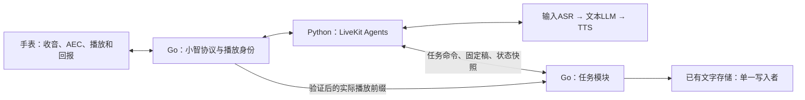

# LiveKit实时语音与任务接续：职责和接口细化

2026-10-24。承接[服务器端LiveKit架构](2026-10-24-server-livekit-design.md)。本文细化用户已确认的“唤醒一次、连续对话、随时插话；旁支回答后继续原内容”，本轮为设计文档，未部署新后端、引入Eino依赖或修改固件。

## 1. 用户能看到的行为

- 待机时先唤醒一次；对话期间直接开口。空闲超时回到待机，重新交谈需要再次唤醒。
- 讲故事被插话打断后，先回答新问题。用户说“继续”，接着讲保存的故事，允许重读被打断的当前一句，不遗漏后文。
- 数到8完整结束、9尚未完整播放时被打断，恢复从9到原终点50，不能从生成稿末尾50继续到51。
- 插话多次，使用最近一次有效播放位置。旁支回答结束不自行恢复，等待用户的继续指令。
- 正常证据齐全时不要求用户报告起点。设备回报异常时保守重读最早尚未确认的单位；若原稿/归属也不可恢复，说明问题并请求选择，不能编造精确位置。

首版仍限定一台手表、一份未完成主任务、一个当前语音输出。普通问答、设备设置不各自建立长期任务；旁支不建立任务栈。

## 2. 两层的含义

**实时语音层就是LiveKit Agents运行时。** 它接收音频、调用输入ASR、组织当前轮大模型与TTS、发现插话、取消旧输出。服务器上的Go接入层继续对接小智协议和设备回报。独立LiveKit Server/WebRTC SFU不加入本阶段必需依赖。

**任务层是应用里的业务模块。** 它保存“原来要做什么、原文是什么、确认完成到哪里、现在是否暂停”。不是另一套语音引擎，也不要求另开服务器。

LiveKit的`Agent`与我们说的“故事任务”不是同一个概念。首版一个语音Agent可承接普通问答与故事播放，不为每个故事创建一个Agent或一套模型会话。

## 3. 任务层的六项职责

| 职责 | 保存/处理内容 | 例子 |
|---|---|---|
| 原请求与目标 | 匹配真实输入身份的请求、内容类型、原终点 | “从1完整数到50”，终点始终是50 |
| 原稿 | 稳定编号的句子/数字、内容版本 | 故事第1～12句；数数第1～50个数字 |
| 播放账本 | 内容单位与音频范围、播放身份的对应 | 第4句结束对应此播放块的某个采样位置 |
| 暂停状态 | 当前主任务、暂停原因、最近有效完成前缀 | 第3句完成，第4句未确认完整 |
| 恢复选择 | 继续、从头、指定起点、放弃、替换 | “继续”选择第4句，旁支问答不改原稿 |
| 持久化与清理 | 已保存检查点、恢复、期限、清空/放弃标记 | 进程重启后仍可接着原稿；清空后不能复活 |

这六项可以放在一个Go任务模块内，通过小接口与Agents通信。它们不意味着六个服务，也不增加家庭日程、人格、向量记忆或摄像头业务。

## 4. Eino放在哪里

Eino的官方能力包括Agent取消、TurnLoop抢占及检查点恢复，可承接任务流程编排。参考[官方快速入门](https://www.cloudwego.io/docs/eino/core_modules/eino_adk/agent_cancel_and_turnloop_quickstart/)。框架检查点保存程序状态；手表播放位置必须作为经过验证的业务数据写进去。

本项目有两种局部实现选择：复用Go代码形成小型任务状态模块，或在该模块内部用Eino组织准备/暂停/恢复流程。**首个接续闭环推荐复用现有Go状态与存储；Eino保持为任务模块的可替换实现，暂不成为必需依赖。** 原因是首版只有一份主任务，当前首要缺口是内容到播放的对应，已有任务版本、旁支归属和存储可复用。引入Eino并不能代替这项验证。

如果随后验证Eino，使用本文同一组任务输入与验收样例，验证它能否减少实现而不产生第二个状态源；验证前不改正式依赖。不启用Eino TurnLoop同时管理语音轮次，不复制整份LiveKit ChatContext进Eino，不把Eino自行恢复执行当作用户已经说了“继续”。停止扬声器不等待Eino节点、模型分类或磁盘写入。

## 5. 谁能修改什么

| 数据/行为 | 唯一负责方 | 其他组件如何使用 |
|---|---|---|
| 收音、VAD、当前模型调用与语音取消 | LiveKit Agents | 任务模块接收结果/取消通知，不重新判断声学插话 |
| 小智播放块ID、设备连接代次、Opus编解码 | Go设备接入层 | Python先绑定输出身份再发PCM |
| 原稿、目标、主任务状态、完成前缀与版本 | Go任务模块的单一事件循环 | Agents发送带输入身份的命令，读取快照 |
| 实际播放证据 | Go校验设备回报后写入播放账本 | Agents字幕、模型文字、TTS生成完成均不能升级播放证据 |
| 文字落盘、清空、保留期 | 现有Go存储owner | Python不另存正文或可恢复备份 |
| 当前模型对话背景 | LiveKit Agents | 根据Go最新任务快照和已确认播放前缀更新 |

保留旧原生后端回退，单个设备连接只选一个后端。新接续模块不继续依赖`internal/qwen`的原生实时事件。

## 6. 最小任务数据

采用新schema，与旧版仅存原请求的暂停任务区别开。以下是设计字段，不是已有代码接口：

| 字段 | 含义/约束 |
|---|---|
| `task_id`、`engine`、`schema_version` | 任务身份；新链式后端标记；版本化解析 |
| `original_input`、`kind`、`goal` | 原请求及真实输入身份；story/count；数数起终点 |
| `content_revision`、`units` | 固定内容版本；从1开始编号的不可变短句或数字 |
| `state_revision`、`state` | 每次有效状态变更递增；准备/播放/结算/暂停/完成/放弃 |
| `plan_revision`、`execution_plan` | 当前执行计划版本及有序单位ID；正常为全部单位，用户指定37时为数字37～50对应的单位 |
| `confirmed_count` | 当前执行计划中连续完整播放的单位数，0表示本计划尚无单位被确认 |
| `active_output` | 当前设备会话、输出代次、播放块与内容单位范围 |
| `last_observation` | 回报来源、有效性、采样前缀、是否最终结算；可明确unknown |
| `resume_override` | 用户明确要求从头或从某处恢复；不标成实测位置 |
| `updated_at`、删除代次 | 保存与过期依据；抵御清空后旧写入/旧回报恢复任务 |

恢复单位由`execution_plan[confirmed_count]`推导，不再保存另一份可独立漂移的“下次起点”。正常计划下，`confirmed_count=3`恢复第4句，`confirmed_count=8`恢复数字9。继续沿用同一计划；明确从头/指定起点才建立新计划、递增plan_revision、将confirmed_count置0。用户要求从37开始，则新计划首项为数字37，原终点仍为50；跳过的1～36不标成已播。旁支不改变执行计划，旧计划回报不能写新计划进度。

只有confirmed_count小于计划长度时才能取下一个单位；等于长度即已完成。此时“继续”明确告知原任务已结束，不生成51或故事外的新段落。

沿用7天、128条文字、每条512字符、恢复背景最多12条、快照总计1MiB。任务稿最多4096字符/128单位；超限请求拒绝或明确缩短后重建，不静默裁掉故事结尾却宣称完成。纯文字落盘，PCM仅有界驻留内存。

## 7. 原稿如何产生、如何播报

数数由任务模块生成确定的数字序列及终点，不靠大模型临场续数。故事由同一链式运行时的文本模型生成完整有界草稿；校验、编号并成功保存后再开始播报，保存后不因旁支问题重新生成。完整准备需要的时间单独测量，不能借用普通短回复的首包延迟。

内容播放使用LiveKit的指定文字播报路径，而非让模型根据“继续讲”重新创作。固定源码的`AgentSession.say(text, ..., add_to_chat_ctx=...)`允许这种控制，[源码](https://github.com/livekit/agents/blob/7a7547e442aaf9cf6f6cab54dd5db6f7cfb5a964/livekit-agents/livekit/agents/voice/agent_session.py)。任务播放初始选择`add_to_chat_ctx=False`，由经过设备证据裁定的文字前缀更新模型背景，防止生成稿预先变成“已说过”。普通短回复仍由Agents正常生成。

一次输入只批准一条输出路径：普通回答或固定稿播放。创建/恢复任务工具返回后，要抑制默认模型续答，不能出现“这就开始”后没有内容、同时两路TTS或相互取消。具体hook按锁定SDK验证；源代码里存在`say()`不等于这个集成已经通过。

## 8. 从文字映射到实际播放

一个内容单位可以跨多个Opus帧；一个设备播放块可以覆盖多个内容单位。**内容单位、SDK flush、固件tts stop分别建账，不能强行当作同一个边界。**

1. TTS确实提供可靠时间信息时，将其与对应PCM、内容版本一起校验。SDK字幕同步的估计结果不能直接作手表播放断点；不同供应商时间信息能力不同，参考[官方文字同步说明](https://docs.livekit.io/agents/multimodality/text/#tts-aligned-transcriptions)。
2. 无可靠时间信息时，按已知短句/数字分别合成，记录各单位实际PCM的结束边界，再顺序衔接音频。允许有界预取；预取完成不推进任务进度。每个数字都需要可验证边界，不能把整段1～50按字符数或语速均分。此路径的合成次数、段间停顿和费用必须测量，不预设满足体验目标。
3. 将TTS PCM坐标转换为24kHz设备播放块坐标，涵盖重采样、Opus编解码延迟、最后60ms补零。保留已校准的不确定范围，用保守下界判定单位完成。
4. 只推进从开头连续成立的完整前缀。单位1～3有证据，单位4未知、单位5有证据时，仍只确认到3。
5. `valid=false`或回报超时保留已确认的完整前缀，其后的内容仍未完成；不能把unknown解释成整段已播，也不能撤销已经验证的前缀。

优先接通句子边界即可满足故事恢复；不要求逐字接在半个字后继续。数数必须验证数字边界。I2S完成表示数字音频发送完成，仍需现场听辨验证映射、编解码偏移及实际停声。

## 9. 插话到恢复的时序

1. 主任务正在播放。近端人声触发Agents取消；立即作废旧输出代次、清理待播PCM并通知设备停播，继续接收用户开头。
2. 主任务进入`settling`。设备旧块的最后回报最多结算到中断起点后250ms；旧块只更新自己的前缀。停止路径不等待这一步。
3. 输入ASR给出带身份的最终文字。旁支回答生成前读取最新任务快照；结算超时则使用已知保守前缀及unknown标志。主任务保留为`paused`。
4. 回答“一加一等于几”。旁支音频有独立输出身份，不增加故事完成前缀。回答完继续等待，不自动播放故事。
5. “继续”的最终文字到达后，读取最新`state_revision`，选择首个未完整完成的单位，分配新输出身份并接续原稿。恢复前版本变化就重新读取，不使用旧缓存。
6. 再次插话，按新输出段映射累计到原稿位置；第一次播放段的迟到回报不能覆盖最新段、已放弃任务或新内容版本。
7. 最后一个内容单位被有效确认后才进入`completed`。TTS结束/发送完毕不能提前完成。

误触发插话的短时恢复由Agents自身机制处理；真正的新问题会保留暂停任务直到用户继续。两种情况分开测试，不能用误触发恢复代替任务接续。

## 10. 跨层最小接口

复用同机受保护WebSocket，不另开公网接口。任务命令与音频命令分开，有身份和有界队列。命令只由受信运行时提出；原稿、模型输出和引用内容不是可执行命令。

公共信封包含`protocol_version`、`device_session`、`input_id`或`output_epoch`、`sequence`；涉及任务时包含`task_id`、`content_revision`、`plan_revision`及`expected_state_revision`。Go捕获/校验这些身份，不让模型填写或选择权威ID。expected_state_revision用于任务命令的乐观校验；普通播放进度按已绑定的计划/输出身份处理，不能因为其他有效进度已令state_revision增加就一律丢弃。

用户输入同时保留来源。设备唤醒检测及其缓存音频只负责进入会话，问候不建立可恢复主任务；不能靠转写是否等于“你好小智”判断来源，避免同音字再次形成伪任务。task.create只接受本轮完整、非唤醒、未截断的真实请求。混合唤醒词与后续指令只有在独立语音请求边界清楚时才接受，否则重新收取请求，不把缓存整段当原任务。

| 消息 | 方向 | 内容与结果 |
|---|---|---|
| `task.create` | Python→Go | 原输入、kind、goal、完整units；返回持久化成功的任务快照或具体错误；重复input_id不重复建任务 |
| `task.command` | Python→Go | 有限动作`resume/restart/resume_from/discard/replace/query`；校验当前输入/版本，返回最新状态与允许播放的单位范围 |
| `task.snapshot` | Go→Python | 单调版本、原目标、连续完成前缀、状态及精确性；首次生成、旁支回答前和恢复前主动同步 |
| `output.bind` | Python→Go→Python | 先申请并确认设备playback_id及内容范围；未绑定的PCM拒绝入队；普通旁支明确不归主任务 |
| `output.cancel` | 双向控制 | 指定旧输出代次，立即停止并作废；重复请求幂等，完成旧取消不影响新输出 |
| `playback.observed` | Go→Python | 来自已校验设备回报，带播放身份、valid/unknown、前缀及终态；映射到SDK播放生命周期，不由Python自造 |

`replace`先停止/作废旧任务，再创建新任务；新稿准备失败时旧任务仍保持已放弃状态，不悄悄复活。每个命令都要有有限等待与失败结果；版本冲突重新读快照，不能直接重放旧命令。分类结果只表达动作意图，实际写入由Go事件循环执行。

## 11. 对话上下文与检查点

模型背景区分三类信息：用户真实说过的话、机器人已确认播过的文字、任务原稿/状态。未播原稿可作为“待执行任务数据”引用，不能当作助手已经说完的历史消息。最近旁支与主任务稿分开，避免回答数学题覆盖故事。

任务播报按本文第7节关闭自动全文入历史，由前缀快照更新；普通短回复仍需验证自定义AudioOutput的播放位置与同步文字是否可信。没有可靠文字边界时，宁可标成部分播放，不用全文冒充已说内容。

每完成一个单位异步保存检查点，暂停/恢复/放弃也保存；磁盘完成与内存进度明确区分。服务故障后只从成功落盘的前缀恢复，允许保守重读。磁盘失败时当前对话可继续，但要标记“重启恢复不可保证”，不能返回保存成功。重连/重启只恢复任务数据，用户说继续后才播放。

清空先使旧输入、输出和写入代次失效，再清理ChatContext、任务与已有存储；只有删除回执成功才确认清空成功。复用既有清空授权及保留期，不让Eino、Python或回退后端留下另一份可恢复正文。

## 12. 与当前代码的关系

当前已有`internal/gateway/playback_progress.go`的设备播放验证、`task_routing.go`的输入/任务版本约束、`records.go`及`internal/recordstore`的有界存储。它们可提供测试样例与独立逻辑；不把依赖旧Qwen事件的session方法直接搬进Python，也不整包复制旧会话编排。

后续任务域代码计划放`internal/contenttask/`，只处理纯数据命令/事件；适配器放既定`internal/devicebridge/`与`services/livekit-agent/`。原稿、单位映射、命令及恢复各自有清楚接口，但首个可执行计划仍是[SDK接入门槛](../plans/2026-10-24-livekit-stage-zero.md)。这些目录目前是计划位置，不表示已经实现。

## 13. 实施顺序与验收

按以下顺序推进，前一步验证结果决定下一步代码计划：

1. **SDK契约**：先执行已有P0探针；再补指定文字播报、关闭自动全文入历史、抑制工具后重复生成、取消旧输出后允许新输出的真实SDK验证。不用mock结果声称这些集成已通过。
2. **模型能力**：分别验证现有账号的输入ASR、文本LLM、TTS；检查PCM采样率、终态、取消和实际时间信息，确定第8节边界来源。
3. **任务模块**：用三句已知原稿/短数字序列和合成播放回报验证状态、账本、版本及持久化，不先依赖模型自然语言记忆。
4. **完整链路**：原稿→TTS→Go编码→模拟设备→回报→上下文；主动注入旧回报、丢回报、超时、重采样/补零和存储失败。
5. **手表验收**：普通问答/音量亮度通过后，故事10轮、1～50数数10轮，包含句中/句尾插话、连续两次插话、旁支再插话、重连、重启及放弃/清空。分别记录实际最后完整句/数字、恢复点与终点。

必要测试断言：第三句中途插话重读第三句；第三句完整而第四句未完则从第四句；8完整而9未完则9～50；用户指定37后按37～50的新计划推进，不把1～36伪报已播；从头再来后游标重置而原稿不变；旁支答案“2”不改数数游标；旧回报不能令9变50；断开/重启不得自行开讲；未知证据不跳内容；清空、放弃或替换后旧命令不可恢复内容。

字段、协议、纯数据测试通过只能证明相应环节。SDK集成、供应商权限、服务器资源、真实设备播放映射、现场听感各有证据。准确自动接续以手表验收为准，不用“采用LiveKit/Eino”代替结果。
