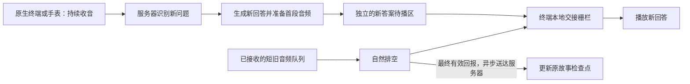

# 低延迟、保留已接收音频的插话交接方案

2026-10-24。用户最新目标：普通插话不立即清空本地旧音频，但交接延迟越短越好。本文细化并更新[排空交接方案](2026-10-24-drain-handoff-design.md)，内容保存沿用[故事与回答方案](2026-10-24-story-reply-resume-design.md)，测试沿用[实际设备方案](2026-10-24-device-voice-test-design.md)。本轮仅方案，不代表相关协议、终端、固件或时延指标已实现。

## 1. 行为和优先级

正常插话时：停止旧内容继续下发，保留终端已接收的旧音频，排空后接上新答案。以短缓冲和并行处理缩短等待，不通过丢弃已接收内容来换速度。

必须同时满足三项：内容不丢、旧新声音不重叠、第一段实质回答尽早开始。“好的，我想一想”等占位语不作为响应速度达标的第一段回答。

这不是等整个故事讲完。服务器的原稿/预取缓存可以较长，允许送往终端的未播音频必须短；两者分别限额。

## 2. 推荐结构：短发送窗口＋并行准备＋终端交接栅栏

同一受保护连接传输有序的旧输出封口、交接授权和带身份音频。新答案先进入独立待播区，不能与旧内容混入同一无身份FIFO，也不能因为收到新tts start就ResetDecoder丢掉旧PCM。“保留已接收旧内容”指当前已授权播放的原输出；尚未放行的新答案缓存可被更晚的新问题作废，不强迫用户听完已经过时的待答内容，也不将其标成已说过。

终端只在下列条件全部成立时放行新答案：旧输出已经按封口范围排空；新答案首段可播放；新答案获得的交接授权仍属于当前有效会话/发言，未被作废。已经得到这个授权的终端，不再等服务器收到排空回报后又回一个“现在可以开始”，避免该情况下多等一轮网络往返。

新旧播放/解码状态必须隔离；旧内容仍排空时，新Opus包可以先存独立的有界待播区，按序交接后再切解码状态。不能通过重置旧解码器为新流腾位置。若新发言取消了待播答案，作废其授权并删除尚未播放的新答案，已经合法接收的旧排空范围仍可结算。

## 3. 让旧音频保持很短

发送按终端消费速度取得额度，而不是按云TTS生成速度直接发送。统一24k逻辑坐标，对当前原输出的所有有效块合计，采用保守未确认音频上界；新答案待播区另行限额，不与原输出混算：

`old_outstanding_seconds = Σ(各旧块已发送或预留采样 - 各块有效确认播放采样) / 24000 + 校准不确定性余量`

该上界需要覆盖应用待发送队列、网络在途、终端接收/解码/播放队列及已校准的输出延迟；不能只限制某一个用户态队列。发送额度由单一owner在入队前预留，最终回报校验后释放，防止并发发送穿透上限。旧输出封口后不再新增旧额度，迟到TTS帧不能越过封口屏障。

首轮拟定参数如下，均为待测初值：

| 参数 | 建议初值 | 用途 |
|---|---|---|
| 正常未确认下发窗口 | 240～360ms | 保留几帧缓冲，目标让旧音频在用户说新问题期间排空 |
| 窗口初始硬上限 | 600ms | 含在途及回报滞后的保守额度；不是物理停声时间保证 |
| 下行帧长 | 沿用设备24k/60ms Opus | 常态窗口约4～6帧，上限约10帧；最后补零和编码延迟仍计账 |
| 有效播放进度回报周期 | 约50～100ms，最终回报立即发 | 控制额度滞后；手表现有实现需核对/调整，不能假定已支持 |
| 新答案首段待播缓存 | 约120～240ms，短答案完成可更少 | 降低交接后的解码/起播等待；与旧内容分开限额 |

网络抖动大时，可以在已声明的上限内调节窗口。不能为消除卡顿悄悄积压数秒旧音频，否则插话体验会退化。若600ms以内无法持续稳定，先报告网络/设备结果并重新权衡上限，而非同时宣称低延迟、无卡顿已达标。

额外音频预取留在服务器，仍受既有有界内存限制。小发送窗口不要求云TTS每隔60ms重新合成，也不增加按帧模型调用。

## 4. 排空期间并行处理新问题

1. 播放期间持续收音并保留AEC参考。近端语音被确认后立即停止旧内容继续入发送队列，封口旧输出；不等新问题说完才开始这一步。
2. ASR在用户说话时持续处理。终端排空旧音频与新问题识别并行，不要求“等旧音频播完再开始识别”。
3. 用户话尾可靠确认后，启动新回答LLM并尽早准备第一段完整、实质性短回答。首版仍优先简短完整回答；不能为抢首字把不确定的ASR中间结果当最终意图，触发多次收费生成。
4. 首段通过身份校验后可提前下发到新答案待播区，连同有效交接授权。终端满足本地栅栏后起播，剩余回答继续按消费额度输送。
5. 若短问题的处理时间长于旧缓冲剩余时长，旧队列会先排空；此时瓶颈是ASR/模型/TTS，继续压缩旧缓冲收益有限，应单独优化这些耗时。

必须用真实SDK验证：旧生成取消不得串行阻塞新输入识别和回答准备；AudioOutput.clear_buffer不能继续默认发送清空命令。必要的SDK生命周期收尾与权威实际播放账本分开处理，不能向SDK或任务模块伪报一个未测量的播放完成位置。

## 5. 延迟怎样计算和报告

以用户新问题说完的时刻E为基准，定义：

- R：旧音频在E之后还需排空的时间，若已排空则为0。
- A：新答案第一段到达终端并可播放相对E所需的时间。
- S：旧已排空且新音频就绪后，终端放行到实际输出的调度耗时。

目标关系为：`回答起播延迟 ≈ max(R, A) + S`，而不是把排空时间、识别、生成、合成和额外交接往返全部串行相加。A包含话尾确认、ASR终态、LLM、TTS与传输，不能把它们排除后宣传总响应很快。

例：旧内容还剩300ms，用户新问题说了1秒，旧内容可在用户话中排空。只要识别与生成并行，话尾后通常不再增加这300ms排空等待；实际答案仍须等待模型准备完成。这是时序示例，不是当前实测指标。

首轮验收目标：

| 指标 | 初始目标 | 证据要求 |
|---|---|---|
| 服务端确认插话→旧发送封口 | 目标不超过120ms | 用服务端单调时钟记录，另报语音检测本身耗时 |
| 实际旧音频尾部 | 常态希望约200～500ms | 以终端实际播放时间为准，报告上分位数；不把600ms额度上限当声学保证 |
| 旧已排空且新音频就绪→新答案输出 | 目标不超过100ms | 同一终端时钟/硬件来源测量，不能混用未同步的两台时钟 |
| 短问题话尾→第一段实质回答 | 优化目标P50约1.5秒以内、P95约3秒以内 | 目标待真实模型和网络验证；每次报告样本数及ASR/LLM/TTS分项，云端慢不能掩盖 |

长故事最初完整原稿准备单独计时，不将它与简短插话回答混合统计。首版继续保存完整有界故事稿；不为满足首字指标改成无法保证原稿一致性的临场续编。普通短回答可以很短，先完整固定该短答再播；完整长回答的准备/首段延迟需另行报告。

## 6. 内容记忆与交接身份

继续区分generated、prepared、sent/accepted、played。原稿、内容版本、每个短句的PCM范围、连续完整播放前缀为权威数据。

服务端退休旧生成和工具，但旧播放身份在合法排空期间保持有效。旧输出最终回报即使在新答案已经开始播放后才到达，也只能更新其绑定主任务的合法前缀，不能覆盖新答案或新内容版本。生成的SpeechHandle被标记interrupted，不单独否定真正完整播完的单位。

终端本地交接不等于服务器已收到播放确认。最终回报带身份/序号幂等重发并取得确认，服务器只据有效证据推进任务；若尚未收齐就遇到“继续原故事”，先同步实际状态，不使用猜测位置。

若终端已收到半句并将它播完，原句仍未完整，后续恢复保守重读该句；若排空后整句完整，则从下一句恢复。新问题的回答不推进主故事。任何缓存驱逐、断线或失败都不能将未播原稿标为完成。

## 7. 终端与异常策略

主测试继续采用原生Mac/最终M5StopWatch，经同一小智WebSocket/Opus→Go设备适配→LiveKit路径，不恢复浏览器主验收。

需要协商短窗口回报、排空封口、新答案待播与本地交接能力。没有这些能力的旧终端，不能直接假定支持本地提前交接；可以在明确标记的兼容模式中等服务器收到排空回报后再发新音频，但该模式的额外往返需单独报告。

手表现有中断入口/tts interrupted stop会清解码队列，需按新能力调整并验证；不能把现固件说成已支持。Mac回报来源为CoreAudio，手表为I2S DMA，来源及声学校准分别记录。

断线、排空状态未知、授权作废或音频故障时，不强行将新答案与未知旧音频重叠。保留原稿和已确认前缀，进入明确恢复流程。用户明确要求立即停止/结束时，使用独立的硬停止动作，普通插话仍遵循保留已接收音频的规则。

## 8. 实施与测试顺序

1. 内容任务＋短发送额度：先已知三句原稿、真实Opus和实际播放回报，证明额度覆盖在途/设备队列，原稿不会因取消生成丢失。
2. 排空与新回答并行：验证LiveKit适配器不清已收内容、新ASR/回答准备不被旧播放串行阻塞，先取得可复现的延迟分解。
3. 原生终端交接栅栏：新增隔离的新答案待播、授权和本地切换，比较等待服务器回执放行与本地栅栏两种模式，证明确实减少关键路径往返且不重叠声音。
4. 真实云模型＋故事/解释：复用合成输入，测试自然插话、短问答、继续原稿、连续两次插话和待播答案作废；再进行真实收音/扬声器场景。固定音频协议测试与真实云端付费测试分开，调用数量和预算在执行计划明确，不自动重试未知结果。
5. 在正常和增加RTT/抖动的网络条件下测P50/P95、音频欠载、实际尾部、内容确认正确性；不通过无限加大缓冲隐藏卡顿。
6. 最后手表实机验证协议、唤醒、AEC、Opus/I2S及声学交接。Mac通过不替代手表证据。

验收同时要求：已接收旧内容不被普通插话清空；新答案不抢播；迟到帧/工具/回报不越界；主故事恢复匹配排空后的实际前缀；延迟按完整时间口径统计。功能正确性与速度分别报告，目标未达到时保留失败和瓶颈，不写成已完成。
