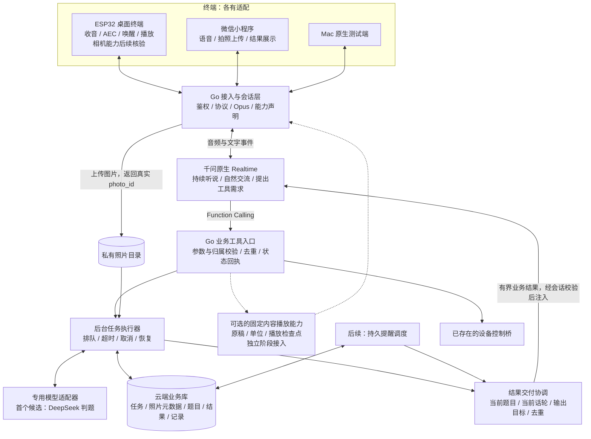
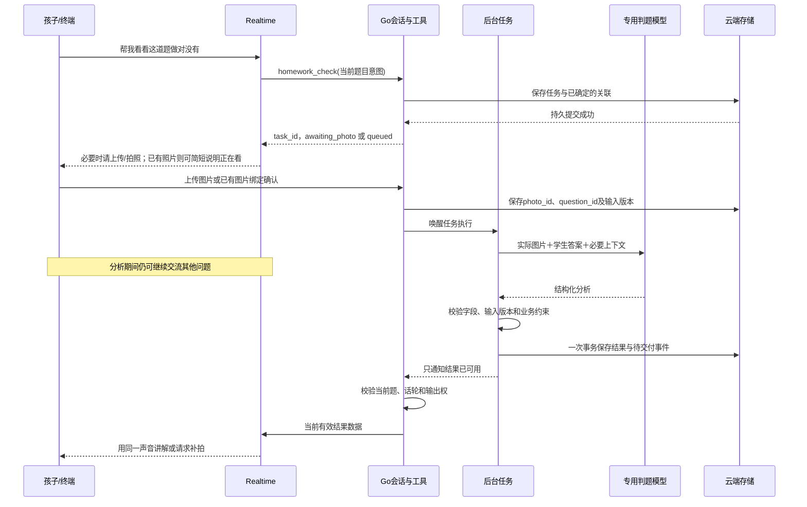
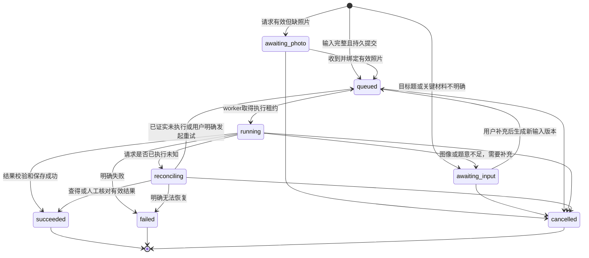

# Realtime 统一语音入口、后台任务与专用模型协作：详细设计

日期：2026-10-24。状态：**待评审的设计文档，尚未启动本文新增能力的开发或部署**。

代码基线：本次开始核对时，本地 `main` 为 `256c429`，复核时已推进到 `46bd2d1`；运行情况取自现有交接与验证报告，本次没有重新登录服务器核验进程、模型权限或模型效果。撰写期间，另一个会话更新并提交了 Realtime 输出 ASR 隔离实验报告，本文已补读并在第 12.3 节记录其结果边界；未修改该会话的实验、报告或交接文件。

本文承接用户最新问题：在已体验到 Realtime 交流自然的前提下，如何保留这种交流方式，同时完成拍照判题、专用模型分析、连续追问、后台任务、聊天记忆、提醒、设备控制和可恢复播报。

**本文提出后续推荐方案，供评审；不自动覆盖当前独立体验测试的有效范围，不授权切换正式入口，不删除、重构或停用现有三段式。** 当前执行边界仍以用户最新决定和 [开发交接](/Users/chen/code/家庭陪伴/docs/DEVELOPMENT_HANDOFF.md) 为准。多人识别和声纹开发继续暂停。

阅读建议：先看第 0、3～7 节了解产品和判题交互；第 8～11、14、19 节说明开发接线与数据；第 12 节单独说明准确续讲；第 20～22 节说明阶段、验收和发布边界。

## 0. 先把方案说清楚

建议让 **千问原生 Realtime 继续负责听、理解当前对话和说话；Go 后台负责真实数据、任务执行、存储和设备操作；需要专门分析时，由后台调用 DeepSeek 等模型，再把结果交给 Realtime 解释**。

例如孩子说“帮我检查这道题”：

1. Realtime 理解这是检查作业的请求，提出业务工具调用。
2. Go 后台找出真实照片、题目与孩子答案；没有照片就进入等待照片状态。
3. 后台调用配置的判题服务，保存可追溯的结构化结果。
4. Realtime 收到结果，用同一个对话声音讲解。
5. 孩子追问“为什么这里要进位”，后台保持同一道题和同一版结果的关联。
6. 分析期间继续收音、回答其他问题；旧任务完成后也要服从当前话轮，不能抢话。

这里协作的是“语音对话能力”和“业务分析能力”。不要求每次判题都把整个会话切换到另一套 ASR→文本模型→TTS。

普通聊天直接走 Realtime；检查作业、查询记录、设置提醒等按需要调用工具。**任务是否成功、照片是哪张、当前题是哪道、播到哪里，由后台事实决定。**

## 1. 需求来源和本次范围

### 1.1 需求优先级

按以下顺序理解本方案：

1. 用户当前明确指示和后续纠正。
2. 当前交接文档与有效设计章节。
3. 当前实际代码与对应验证报告。
4. 原始需求记录，作为产品需求来源，不作为旧技术选型的执行指令。

原始需求见 [家庭助理机器人讨论记录](/Users/chen/code/家庭陪伴/docs/reference/家庭助理机器人_模型调度记录_20261021.txt)。其中“千问负责对话、后台选择并调用分析模型”的思路与本方案相符，但旧模型名称、身份识别安排和中断方式必须服从最新决定。

### 1.2 必须保留的产品要求

| 要求 | 本方案的落实方式 |
|---|---|
| 接近真人的交流，连续说话和自然追问 | 原生 Realtime 保留为推荐语音入口，不为每轮普通聊天增加专用模型调用 |
| 判题时还能聊天 | 判题成为独立后台任务，不能阻塞音频事件循环 |
| 照片、题目、答案和后续提问关联 | 后台建立稳定业务 ID，按题目和分析版本查询 |
| 看不清时确认或重拍 | 结果允许信息不足，不能强行给出对错 |
| 同一声音讲解 | 专用模型返回数据，Realtime 面向用户解释；不让多个模型各自发声 |
| 故事、讲解和数数可以打断后继续 | 保留原请求、原稿和实际播放检查点；作为单独能力闭环验收 |
| 先回答插问，再等用户说继续 | 主任务暂停不自动恢复；旁支回答不等于原任务完成 |
| 数数保持原终点 | 原任务为 1～50，恢复仍到 50；不能改成继续生成另一个 50 个数字 |
| 记录后续聊天并能查回 | 存档、检索和上下文组织是后台能力，不靠无限模型历史 |
| 真正到点提醒 | 持久化计划、调度和投递，不以模型说“记住了”替代 |
| 真正控制设备 | 沿用设备工具及回读验证，按能力声明是否可用 |
| 云端运行，无需 Mac 常开 | 后台任务、调度、记录和 Key 留在云服务器 |
| ESP32 桌面终端和微信小程序共用后台 | 各有接入适配，共用任务、照片与结果；Mac 仍是测试端 |
| 当前按一个人处理 | 统一逻辑用户，不做说话人区分、声纹或按人记忆 |

### 1.3 这份设计现在不做什么

本次产出是可供开发评审的总体设计与分阶段交付边界，不是立即执行的开发计划。本文不会要求暂停其他会话，不会修改现有网关、固件、客户端或服务配置。

暂不开发多人识别、声纹登记、按人查询、群聊式个人归属；也不把 Eino、向量数据库、Redis、独立消息中间件或复杂多 Agent 系统列为首版依赖。

## 2. 当前代码究竟已经有什么

### 2.1 三条入口的事实

下表“已部署”来自现有报告，不代表本次重新进行了服务器检查。

| 入口 | 已有结构与来源 | 关键边界 |
|---|---|---|
| 原 8000 网关 | `cmd/gateway` → `internal/gateway` → `internal/qwen`；交接记录为原生千问 Realtime | 已有任务归属、设备工具和可选快照存储；准确字词续讲仍未解决 |
| 独立 Realtime 18030 | `cmd/realtime-mac-test`、`internal/realtimeentry`，复用同一 Go/Qwen 网关；Mac 入口 `tools/realtime-voice/open.command` | 独立设备与会话，未配置持久记录，未接三段式档案、原稿与检查点 |
| 三段式 18020→18010 | Go 设备桥 → Python/LiveKit → ASR、文本模型、TTS；Mac 入口 `tools/native-voice/open.command` | 有固定原稿、短播放单位、drain、文字档案与档案回读；不能直接当作 Realtime 已有能力 |

Realtime 报告中的模型别名为 `qwen3.8-omni-flash-realtime`，音色 Tina；三段式代码默认 `fun-asr-realtime` → `qwen-plus` → `qwen3-tts-flash-realtime`，音色 Cherry。实际使用仍取决于服务器受保护配置，别名不等于固定权重版本。

参见 [独立 Realtime 验证报告](/Users/chen/code/家庭陪伴/docs/verification/2026-10-24-independent-realtime.md) 和 [双后端文档当前有效第 0 节](/Users/chen/code/家庭陪伴/docs/superpowers/specs/2026-10-24-dual-voice-backends-design.md:7)。旧集成章节不自动恢复为开发任务。

### 2.2 可以复用的代码和缺口

| 代码位置 | 本次静态核对的事实 | 新方案如何使用 |
|---|---|---|
| `internal/qwen/client.go` | 原生 WebSocket、`session.tools`、16k PCM 输入、24k PCM 输出、输入转写配置、会话更新 ACK | 继续作为 Realtime 供应商适配基础，不重写语音核心 |
| `internal/gateway/session.go` | 单会话事件循环、模型事件、响应 ID 和 generation；处理工具参数完成与语音事件 | 所有会话状态仍由事件循环串行修改；耗时业务工作交给后台 |
| `internal/gateway/session_tools.go` | 工具参数长度与次数限制、当前代次去重、设备工具、工具结果回填 | 增加业务工具入口和异步回执事件，保持旧工具契约 |
| `internal/gateway/generation_sync.go` | 生成前同步权威快照，并等待匹配 ACK | 后续可扩展为任务结果与上下文快照的同步入口，不能跳过现有代次校验 |
| `internal/gateway/task_routing.go` | 围绕暂停任务区分旁支、继续、重来、放弃和替换 | 保留其任务归属规则；不能直接把它当作持久后台任务引擎 |
| `internal/devicetools/bridge.go` | 有限设备工具：读取状态、设置音量、设置亮度及验证 | 沿用；不允许模型自行扩展到任意设备命令 |
| `internal/gateway/history.go` | 近期上下文与有界归档，区分生成、下发、中断与确认 | 保留证据语义；需要补全量业务存档，而非无限扩大内存切片 |
| `internal/recordstore/store.go` | 单 worker、每设备有界 JSON 快照、原子写入与落盘回执 | 是已有恢复基础，不是题目、照片、任务和提醒数据库 |
| `internal/protocol/playback.go` | 旧播放回报只接受 24k、`basis=i2s_dma` 及有限状态 | Mac CoreAudio 不能冒用该协议；Realtime 需要明确的新能力适配 |
| `services/livekit-agent/family_voice/content.py` | 固定内容、不可变单位、完整单位前缀、暂停与恢复 | 保留作为精确内容播放的参考和候选执行器，不直接复制出第二份权威游标 |
| `.../content_runtime.py`、`drain_output.py` | 内容工具、主旁支、排空交接、播放绑定和回报结算 | 后续若共用，必须单独验证音频、身份和生命周期兼容 |
| `.../conversation_log.py`、`conversation_memory.py` | 追加式 JSONL 档案、分页/搜索和有界上下文 | 可借鉴语义；当前接口与作用域不能不经适配直接挂到 Realtime |
| `tools/realtime-output-probe/` | 最新隔离报告记录了预生成音频的输出 ASR 候选前缀与新会话语义衔接 | 尚未接入日常窗口，不作为原稿精确恢复或在线流式能力已交付的证据 |

源码中的旧网关历史还有明确截断：每条普通记录最多 512 字符，近期上下文最多 12 条，内存 archive 最多 128 条；生成转写另有 2048 字符上限。这些都说明“网关有 history”不等于“已经实现完整长期记忆”。

三段式 JSONL 当前是独立档案；其元数据为白名单，不能直接向现有文件随意加入题目、任务等字段。扩展需版本化，保留旧读取行为。

### 2.3 已有工具调用，为什么还不能直接接一段判题代码

当前 `callTool()` 主要处理设备/会话工具；`continueTools()` 等待本轮工具都有结果后，发送匹配 `call_id` 的 `function_call_output`，再请求模型回复。

接入几十秒的照片分析时，至少存在四个新问题：

1. 当前轮可能被打断，工具所属 generation 被退休。
2. 网关重连会清理会话内工具状态；业务分析仍可能在远端执行。
3. 分析完成不代表此时适合开口；用户可能已经换题。
4. 仅凭会话内 `call_id` 去重，无法覆盖重连、进程重启或重复创建任务。

因此应增加持久业务任务层，不能在 `callTool()` 里同步等待一次 DeepSeek HTTP 请求，也不能把长任务生命期直接绑定到当前音频回复。

### 2.4 本次没有发现的闭环

在当前活跃 Go/Python 服务代码中，本次未发现完成以下业务闭环的实现：拍照上传与题目关联、专用模型判题、判题结果版本、持久后台任务调度、真实定时提醒、微信小程序端。

仓库中的设计文字、归档源码、工具调用框架和测试脚本不作为这些能力已经交付的证据。

## 3. 三种实现方向及推荐

| 方向 | 优点 | 主要代价 | 本次建议 |
|---|---|---|---|
| Realtime 自己看图、自己判题、自己解释 | 接线相对集中，可作为能力对照 | 仍需图片、题目、持久化和后台任务；专业分析质量需测，难以单独替换判题能力 | 保留为后续对照，不默认其准确性已满足需求 |
| **Realtime 对话＋Go 任务＋专用分析模型** | 保留自然语音入口，分析模型可替换，能保存照片/结果并处理长任务 | 需要业务工具、状态机、异步结果交付与存储 | **推荐主方向** |
| 完整三段式与 Realtime 统一入口、自动按场景切换 | 两套完整语音模式都能独立选择 | 同时增加会话迁移、音频控制、共享记忆和路由问题 | 暂不作为判题前置工程；现有链路继续保留 |

推荐第二种的依据是用户已经认可 Realtime 的实际交谈体验，同时既有需求本就要求后台真实执行、保存和找回任务。

是否最终保留两个完整语音后端，继续由实际比较决定。本文不把“接入 DeepSeek 判题”误写成“必须完成双语音后端集成”。

## 4. 目标架构和模块职责



图中业务库、照片闭环、结果协调和提醒等属于拟新增能力。现有 LiveKit 三段式继续独立运行；图中可选内容播放也尚未接入 Realtime。

### 4.1 Realtime 的职责

理解当前语音、维持自然交谈、识别需要的业务能力、提出工具调用、基于真实结果讲解，以及在指代确实不清楚时自然澄清。

Realtime 可以决定“需要检查作业”，但不决定云端凭据、任意上游 URL、数据库写入成功与否，也不能自己宣布照片已经上传或任务已经完成。

### 4.2 Go 后台的职责

拥有会话与终端关系、真实 ID、业务状态、工具执行、供应商映射、持久化、播放证据和输出权。后台按工具名称选择服务，而不是让对话模型直接操纵另一个供应商账号。

Go 是长期业务 owner。首版可在现有 Go 服务中增加有界 worker，不要求微服务拆分；已有 Python 内容模块继续由原路径拥有，不在本文阶段同时迁移。

### 4.3 专用分析模型的职责

接收必要照片、题干、学生作答和分析要求，返回可校验的业务结果。它不直接连接扬声器、不维护全家聊天状态、不向用户独立承诺设备动作，也不拥有任务进度。

### 4.4 存储、模型记忆和播放证据的职责

数据库保存事实，检索层挑选相关事实，Realtime 使用事实交流；三者分开。设备播放回报说明输出进度，不能由模型文本、SDK 字幕或网络发送成功替代。

## 5. 不同场景具体走哪条路径

### 5.1 初始场景表

| 用户场景 | 语音入口 | 后台能力 | 是否另调专用模型 |
|---|---|---|---|
| 闲聊、安慰、日常问答 | Realtime | 当前上下文 | 默认不调用 |
| “帮我检查这道题” | Realtime | 取图、绑定题目、创建分析任务 | 调用配置的判题服务 |
| “刚才第二步是什么意思” | Realtime | 读取当前题与分析结果 | 已有依据足够时不重算 |
| “换一种方法算”“我改成这个答案对吗” | Realtime | 创建关联的分析版本 | 通常需要 |
| “上次那道题哪里错了” | Realtime | 查题目、结果与原记录 | 查回事实足够时不需要 |
| “这个任务做完了吗” | Realtime | 读取任务状态 | 不需要 |
| “今晚八点提醒我” | Realtime | 规范化时间、持久调度 | 不需要另一套聊天模型 |
| “声音小一点” | Realtime | 读设备状态、设值并验证 | 不需要 |
| 短故事，允许内容自然延续 | Realtime | 普通对话记录 | 可直接生成，但不宣称原稿精确恢复 |
| 要求打断后接同一原故事、数到固定终点 | Realtime 理解请求 | 固定内容与播放检查点能力 | 按独立阶段引入原稿生成/播报；尚未接通 |

### 5.2 判断条件

第一层由 Realtime 理解语义并提出有限工具需求；普通闲聊不先经过独立分类大模型。第二层由后台根据当前照片、题目、结果版本、设备能力、作用域和任务状态验证是否能执行。

以下条件由程序判断：

- 是否存在真实、可读取、属于当前业务作用域的照片。
- “这题”是否唯一；是否已换题、补拍、修改答案。
- 所需结果是否已存在且输入版本一致。
- 终端有没有相机、屏幕或设备控制能力。
- 当前任务是否取消、结果是否过期、是否可以向当前终端交付。
- 是否满足精确内容播放所需的可信回报能力。

模型决定需要何种能力；后台决定合法参数、数据来源和执行状态。首版不靠“出现数学两个字就切模型”这样的关键词表。

### 5.3 新问题和旧结果怎样区分

“用简单一点的话再说一遍”通常复用原分析；“答案改成 36 了，你再看看”应产生新输入版本；“看右边下一题”切换 active question，但保留旧结果供查询。

当照片包含多题而目标不清时，只澄清必要信息，例如“你想检查左边第三题，还是右边那题？”；不要求孩子记内部 ID。

## 6. 拍照判题的完整交互

### 6.1 首个闭环的范围

先支持一张照片、一题、一个统一逻辑用户、一个发起终端。识别题干、学生答案和必要步骤，形成检查结果，再支持围绕该题追问。

首版不处理整本作业自动批改、多孩子自动归属、自动识别人声或多个模型投票。全页多题也先明确目标题，不能把错题结果关联到另一题。

### 6.2 照片从哪里来

设备能力要如实声明。当前手表的语音链路可用，不等于它具备已经接通的相机工具。拍照可以来自后续带摄像头的 ESP32 桌面设备、微信小程序，或测试阶段的图片上传入口。

推荐首个联调先使用明确的测试上传流程打通业务，不等待相机固件；正式产品随后分别接入小程序和摄像头硬件。Mac 在这里是上传/语音测试客户端，后台仍在服务器。

若当前终端没有相机，Realtime 应说明需要从支持拍照的入口上传，不能说“我已经拍好了”。

### 6.3 首次检查的时序



### 6.4 图片接收和绑定

上传成功后由后台生成 `photo_id`；校验真实格式、解码尺寸、文件大小和归属。上传图片的会话、上传请求和任务要有可验证关系，不能接收模型编造的任意文件路径或外部地址。

初步设计单图上传上限 8 MiB、像素上限 2000 万，作为应用自己的保护配置；这不是供应商上限，也不是已经在客户端验证过的值。后台可按判题实验结果等比压缩，必须保留原图与派生裁剪的关联，不能压坏小字而仍声称可判。

需要拍照的终端收到的是带请求身份和失效时间的拍照请求；图片按请求绑定。取消或换题后迟到的图片可以记录为原请求的迟到材料，但不能自动成为新题照片。

图片写入私有持久目录，确认文件完成后再标记可用。数据库事务失败产生的孤立文件由定期核对回收；不能先把未完成文件交给模型。

### 6.5 提交给专用模型的内容

输入包括真实图片或必要裁剪、目标题范围、学生答案与口述补充、用户希望检查的方面、同题已有分析中必要的部分，以及后端生成的输入版本。

不默认发送整个聊天记录，也不把姓名、所有照片和无关家务对话一起提交。若只有转写后的数字存在歧义，先确认或保留歧义，不把它当作明确数学输入。

### 6.6 结构化结果示例

以下是自有业务结果示意，**不是供应商已经保证遵守的固定接口**：

```json
{
  "schema_version": 1,
  "task_id": "task_001",
  "question_id": "question_001",
  "photo_id": "photo_001",
  "input_revision": 1,
  "analysis_revision": 1,
  "status": "ready",
  "recognition": {
    "question_text": "计算 27 + 18",
    "student_answer": "35",
    "student_steps": ["个位 7 + 8 得 15，写 5", "十位 2 + 1 得 3"],
    "uncertain_regions": []
  },
  "assessment": {
    "verdict": "incorrect",
    "correct_answer": "45",
    "error_steps": [
      {
        "step_index": 2,
        "observation": "十位计算未计入个位进位的 1",
        "explanation": "2 个十加 1 个十，再加进来的 1 个十，共 4 个十"
      }
    ],
    "brief_reason": "个位得到 15 时，需要向十位进 1"
  },
  "teaching": {
    "first_hint": "个位 7 加 8 得到 15，多出来的 1 个十应该放在哪里？",
    "key_facts": ["7 + 8 = 15", "2 + 1 + 1 = 4", "27 + 18 = 45"],
    "allowed_explanation_scope": "解释本题进位，不引入未经分析的新解法"
  },
  "needs_confirmation": []
}
```

`verdict` 至少允许 `correct`、`incorrect`、`partially_correct`、`insufficient_information`。信息不足是正常业务结果，不应一律变成接口错误，也不能被口述成“做错了”。

供应商、实际模型标识、请求 ID、耗时、usage、配置/提示模板版本和校验状态由后台补记，不能相信模型自己填写的这些元数据。

### 6.7 校验能保证什么

校验可以拒绝缺字段、非法枚举、非当前图片、矛盾版本、结果过大、缺失题干或没有依据的强结论。简单、明确的算术可以用受限确定性计算进行一致性检查；不使用任意代码执行来“验证答案”。

JSON 合法不等于判题正确；确定性检查也不能覆盖所有题型。因此仍要用真实作业样本评估题干识别、答案识别、判定、解释和最终口述。

发现结果自相矛盾时，标记不可直接讲解，进入补充信息或明确失败；不能让 Realtime 随意挑一个结论对孩子讲。

## 7. Realtime 如何使用判题结果

### 7.1 同一个声音，不让模型互相自由聊天

专用模型输出只进入后台，Realtime 获得后台验证后的必要结果。后台控制调用次数和上下文，不建立两个大模型无限互相追问的循环。

Realtime 可以调整解释的语气、长短、例子和提问方式；关键题干、学生答案、判定和计算结论应依据当前结果。若孩子提出了新的实质计算，调用分析能力或明确说明需要再核对。

### 7.2 口述一致性是独立验收点

提示词约束不能保证语音永远不改数字。需要分别测试“专用模型判对了”和“Realtime 是否把结果讲对了”。

普通互动先采用结构化结果＋关键事实约束；若真实测试发现数字、符号或标准结论经常口述漂移，则增加固定讲解稿播报能力。在该能力通过前，不能宣称数学口述具有强一致保证。

需要绝对可控的题目答案播报时，可由后台冻结文本并交给受控 TTS；它是可选业务输出能力，不能因此恢复成所有对话都走三段式。接入成本和音色连续性另测。

### 7.3 教学方式

默认先说明具体问题或给出一步提示，再根据孩子的追问展开；不把完整答案机械念完作为唯一行为。孩子明确要完整解法时，可以在已有分析依据范围内说明。

不把“没记录学生过程”表述成“你这一步算错了”；只有图片或口述确实提供了过程，才指出对应步骤。没有年龄资料时采用自然易懂的表达，不假装已经识别孩子年龄。

### 7.4 连续追问与版本

会话保存 `active_question_id`、`active_analysis_revision` 和当前任务。追问沿用该题，后台按需求返回相关步骤，不重新发送全部照片和全部会话。

补拍、更改答案、新解法分析建立新版本，保留旧版本供复盘；旧任务迟到不能覆盖新 active revision。“上一题”通过真实关联查找，不能靠模型印象猜。

## 8. 后台任务必须独立于当前说话轮次

### 8.1 三种生命周期

| 对象 | 生命周期 | 中断后的处理 |
|---|---|---|
| Realtime 响应 | 当前模型 response / generation | 退休旧输出，禁止迟到语音混入新回复 |
| 判题业务任务 | 从接纳到完成、失败或取消，可跨轮次和连接 | 普通插话不自动取消；明确放弃才取消或停止结果交付 |
| 结果讲解/内容播放 | 某个结果版本的某次输出尝试 | 可暂停，完成分析不等于讲完，继续时另行定位 |

因此“打断机器人”和“取消判题”必须分开。

### 8.2 业务任务状态机



状态变化必须校验任务版本。补充材料可以产生新输入 revision；旧 attempt 的结果不能提交到新版输入。取消是业务上的终态，不保证供应商计算立即物理停止。

### 8.3 长工具如何尽快返回

`homework_check` 在后台完成“参数校验＋持久接纳”后返回任务身份和当前状态，不等待最终判题。示例：

```json
{
  "ok": true,
  "accepted": true,
  "persisted": true,
  "task_id": "task_001",
  "question_id": "question_001",
  "state": "queued",
  "result_ready": false
}
```

只有事务真正提交后才能返回 `persisted=true`。`awaiting_photo` 只说明请求已保存并正在等照片，不能说已经在分析图片。

接纳、数据库提交或磁盘写入也通过有界 worker 完成，由事件回到会话循环；不能为了“快速工具”又把同步数据库等待放回音频循环。

### 8.4 任务创建、执行和重试

先保存任务与尝试意图，再发外部请求。worker 从数据库领取有租约的任务；单实例先用有限并发，不依赖当前会话 goroutine 一直存活。

每次 attempt 记录输入 hash、模型配置、提交状态和提供方请求身份。支持提供方幂等键时使用；不支持时不能承诺模型调用严格只发生一次。

超时要区分“确定没提交”“明确拒绝”“可能已执行但未收到结果”。未知结果进入 `reconciling`，不自动再付费提交相同请求。确无查询接口时保留未知并说明，用户明确重试创建新 attempt。

明确 `failed` 的任务保持终态，用户重试创建关联原任务的新业务请求；`reconciling` 的显式重试则更新 attempt 与版本，退休旧 attempt 的交付资格。已 `succeeded` 的任务如果尚未讲解，用户说“不用讲了”只取消待交付或播放，不把已保存结果改写成从未计算完成。

结果提交必须在事务中核对任务状态、输入 revision 和 attempt 租约，再保存结果与 outbox。取消先提交则旧 worker 不得发布成功；成功先提交则取消停止待交付。即使保留迟到供应商响应作私有 attempt 证据，也不能升级为当前有效答案。

### 8.5 重启恢复

服务重启后，`queued` 可以重新领取；租约失效的 `running` 先检查提交状态，不能直接全部重做。已完成的结果从数据库读取，不再次分析。

等待图片的任务恢复为等待图片；进行中的语音输出不自动恢复。用户重连后可以查询或明确继续，不能一连接就重新朗读全部答案。

## 9. Function Calling 与异步结果怎样接起来

### 9.1 保留现有协议基础

继续使用仓库已经实现的工具注册、`response.function_call_arguments.done`、匹配 `call_id` 的结果回填，以及生成前快照同步。具体上游报文以当前供应商接口和现有测试为准，不用通用聊天 API 的格式替换原生 Realtime 协议。

### 9.2 同一连接内的工具回执

工具请求首先得到的是接纳状态或快速查询结果。若原 `call_id` 和 generation 仍有效，将它作为该次 `function_call_output` 回填，关闭工具生命周期，让模型继续交流。

真实判题完成属于后续业务事件，而不是让原工具无限悬挂。多个工具调用也要逐一闭合或明确失败，不能遗失某一个调用后一直卡住 `continueTools()`。

### 9.3 插话或重连后的结果

若用户在接纳或分析期间插话，旧 native 调用可能已不存在。后台任务按持久身份继续；不能把旧 `call_id` 的结果塞进新连接，不能伪造一条用户消息说“我判完了”。

后续由结果协调器读取任务结果，在合适的话轮通过受支持的数据上下文机制交给当前 Realtime。优先扩展现有有版本的权威快照，并等待匹配 ACK；新增注入方式须在云端验证，不假设任何原生事件都可任意重放。

如果当前已有回复在生成或播放，先保留待交付状态。用户下一轮问“看好了吗”，走 `task_get` 读取即可；真正主动发起一轮结果播报，需要独立通过输出权和话轮校验。

### 9.4 建议的业务工具面

以下均为拟新增名称，现有设备/会话工具另行保留。只向模型暴露当前已启用且有后端实现的能力。

| 工具 | 作用 | 模型可提供的主要信息 | 后台必须补齐/校验 |
|---|---|---|---|
| `homework_check` | 检查新题或修改后的答案 | 目标题描述、学生补充、检查意图 | 照片、题目、作用域、输入版本、幂等键 |
| `homework_followup` | 获取同题解释依据或发起新分析 | 当前追问、希望换解法等 | 当前题、结果版本、是否需要重算 |
| `task_get` | 查询单个相关任务 | 相关任务引用或“当前” | 可访问任务、真实状态、结果摘要 |
| `task_cancel` | 按当前明确请求放弃 | 目标任务意图 | 目标唯一性、取消版本、抑制迟到交付 |
| `conversation_history` | 分页查找历史 | 查询词、受限游标 | 可读会话范围、来源、交付语义 |
| `reminder_create` / `reminder_list` / `reminder_cancel` | 后续提醒能力 | 事项、时间表达 | 时区、规范时间、持久结果和权限 |
| `content_*` | 后续固定内容的创建、查询、暂停、继续、放弃 | 语义操作和目标 | 原稿、版本、检查点；拒绝模型指定猜测断点 |

首个判题阶段只开放判题、同题追问和相关任务查询/取消；提醒和精确内容工具按阶段上线，不先注册空实现。

### 9.5 去重有两个层次

当前网关的 generation＋`call_id` 去重只解决本连接内重发。业务层需要持久请求键，关联服务端记录的请求、材料版本和操作；重连重送不会再创建相同任务。

不能仅按“照片 hash 相同”永远去重，因为同一张照片可能针对另一题、修改后的答案或新的分析要求。也不能让模型随意生成一个新的幂等键来绕过后端限制。

## 10. 判题完成后什么时候开口

### 10.1 分析状态与交付状态分开

分析任务 `succeeded` 表示结果已保存，不表示孩子已听到。为每个结果版本建立独立交付记录：`pending`、`offered`、`speaking`、`completed`、`interrupted`、`unknown` 或 `suppressed`。

这里 `completed` 必须有该输出尝试对应的完整播放证据；只有网络发完时不能升级。没有可靠播放能力的端可以显示“结果可读”，不能显示“完整讲解已听完”。

### 10.2 发声条件

| 当前情况 | 推荐行为 |
|---|---|
| 用户仍在等当前题，终端在线且话轮空闲 | 结果可获发声权，开始简短讲解 |
| 用户正在说话 | 等待，不打断用户 |
| 正在回答用户刚提出的新问题 | 等本轮结束，再决定是否提示旧结果 |
| 已明确换题 | 保存旧题结果，默认不自动读旧题答案 |
| 已明确取消旧任务 | 抑制该结果的主动交付；迟到结果不得复活任务 |
| 发起端离线或页面关闭 | 保存结果；重连后查询，不向其他终端广播 |
| 多端在线 | 首版只向发起端交付；用户明确转移才改变目标 |
| 已完整交付同一结果版本 | 不重复自动讲解；用户可主动要求重讲 |

任务的后台状态由持久 owner 更新；“现在能不能说”由会话协调器决定。worker 不直接写设备 WebSocket 或调用 Realtime `response.create`。

### 10.3 可靠交付机制

结果和待交付事件在同一事务提交；进程内通知只用来唤醒读取，不是结果唯一载体。重启后从待交付表重新检查，避免“保存成功但事件丢了”。

待交付事件可以重复读取，按任务/结果版本/目标端去重。音频跨断线很难保证严格恰好播放一次；证据不足时记 `unknown`，不自动重读一遍并宣称既无漏读也无重复。

### 10.4 准备回应

慢任务可以自然说“我看看这道题”，但前提是状态真实；缺照片时应请拍照。快任务不必增加一句准备语，更不能把这句话当成答案时延已优化。

首版优先利用 Realtime 正常工具回执后的自然交流，不直接移植三段式并行准备语。一个话轮至多一次必要进度提示；迟到提示取消，避免结果已到还说“马上看”。

## 11. 插话、排空与并行工作

### 11.1 保留的目标交互

用户普通开口时停止旧内容继续下发，允许已经收到的短尾音排空；新输入和新答案准备可以并行，新答案播放等旧声音结束，避免重叠。

这来自已确定的 [drain 交接设计](/Users/chen/code/家庭陪伴/docs/superpowers/specs/2026-10-24-drain-handoff-design.md) 和 [低延迟设计](/Users/chen/code/家庭陪伴/docs/superpowers/specs/2026-10-24-low-latency-handoff-design.md)。

### 11.2 当前实现差异必须保留说明

现有独立 Realtime 仍沿用旧网关插话立即清空路径；三段式有 drain。Realtime 客户端针对正常 stop 与下一条 start 的尾音交接修复，不等于已经完成普通插话 drain 迁移。

本文若进入开发，需要单独设计 Realtime 发送窗口、封口、终端排空、控制消息和回报协议，再验证。不能只复用一个 Swift 音频类就声称两条路径播放语义完全一致。

### 11.3 并行与资源边界

音频接收、上游事件读取、下行音频、业务执行和磁盘写入各自有界调度。会话状态只由事件循环变更；worker 返回结构化事件，核对会话/业务身份后才应用。

后台任务使用应用/任务上下文，不能直接继承会被插话取消的当前回复 context。停止用户录音或退出终端可以结束音频会话，但已接纳业务任务按其取消策略处理。

模型结果读取和音频发送存在背压时，保留控制消息的响应机会；不无限缓存音频、图片或待结果任务。显式结束和错误恢复仍可强制清理，不能被普通排空策略锁死。

## 12. 故事、长讲解和数数如何继续

### 12.1 不把自然续写当作准确续讲

Realtime 可以利用上下文继续谈某个故事，但这不证明它保存了同一份未播原稿，更不证明它知道扬声器实际播到了哪个字。

用户要求的是原稿和原终点保持、允许重读未完整句、不能跳过未播内容。因此准确内容恢复仍需后台的原稿和播放证据。

### 12.2 两类内容分开处理

普通聊天允许自然概述与追问；要求严格恢复的故事、逐步讲解、数数进入内容任务，保存原始请求、不可变文本、单位列表、版本和连续完整播放前缀。

“继续”只恢复被用户指向的有效任务；无指向且同时有未完故事/旁支时才澄清。回答插问、重连、重新唤醒，都不能自动让原故事开讲。

### 12.3 精确恢复有两条候选实现

| 候选 | 能保留什么 | 成本和边界 |
|---|---|---|
| 固定原稿＋受控 TTS＋实际完整单位回报 | 同一内容与句级前缀，支持不跳过未播句 | 已有三段式代码可参考；接入 Realtime 输出、工具和身份仍需开发，音色/首段延迟要测 |
| 原生 Realtime 输出＋旁路输出 ASR 对齐＋实际播放位置 | 有机会更准确说明已经播过的内容 | 时间戳、文字匹配、最终结果到达和重建延迟都要验证；不自动得到未生成完的固定后文 |

旁路输出 ASR **识别机器人输出音频**，不位于用户输入主路径，不是声纹识别。撰写期间新增的 [隔离实验报告](/Users/chen/code/家庭陪伴/docs/verification/2026-10-24-realtime-output-asr-probe.md) 已记录局部功能成功：53.4 秒源音频预先生成，Mac 确认播放到 4.2 秒，筛出 18 字符候选前缀；新会话回答数学插问并基于该前缀语义续讲。

报告中一次增量稳定句子已经及时返回，因此该次没有再等待全文 ASR；另一次等待全文额外耗时约 2 秒。两者是同一预生成源音频的局部实验，不能推导实时生成时也零等待。报告还保留一次迟到旧音频包导致实验客户端失败、修复后复测成功及 underrun 诊断。

这些结果来自本次读到的另一会话报告，没有在本会话重新复测。在线输出旁路、真人收音、时间戳误差、多次插话、同音字/数字、失败降级和自然度仍待验收；日常 Realtime 窗口尚未启用。

即使输出 ASR 成功找到了已播前缀，也只能解决一部分“已听内容是什么”的问题。要保证“原故事后半段一字不变”，仍需要有完整原稿或等效已保存内容；不能让新会话重新续写后称作同稿恢复。

### 12.4 接入精确内容能力的原则

现有 Python 内容控制器仍是当前三段式路径的唯一内容 owner。首个判题闭环不迁移它、不读取其内存游标，也不让 Go 和 Python 同时推进同一任务。

后续选择复用现有执行器时，需增加明确业务调用边界、回报身份和单一输出权；选择迁移到 Go 时，需独立迁移方案和回归。迁移完成前不得双写权威检查点。

受控 TTS 只作为任务播报器时，不负责另一套用户 ASR 或独立对话决策；这与保留两个完整聊天后端是不同工程范围。原完整三段式仍可继续独立使用。

### 12.5 具体恢复规则

原任务数到 50：1～8 已完整确认、9 部分播放，恢复从 9 到 50；排空后确认 9 完整，则从 10 到 50。已经提前生成到 30，不会因此跳到 31。

故事前 3 单位完整、第 4 未完整，从原第 4 单位重读。回报缺失保持未知或保守前缀，不按音频时长比例裁字，不让模型猜一个“差不多”的位置。

更多已有规则沿用 [故事与回答接续设计](/Users/chen/code/家庭陪伴/docs/superpowers/specs/2026-10-24-story-reply-resume-design.md)，其历史状态说明应结合最新验证报告阅读。

## 13. 聊天存档和模型可用记忆

### 13.1 三种不同的数据

1. **当前原生上下文**：有助于自然交流，但受厂商窗口、媒体保留和连接生命周期限制。
2. **持久聊天记录**：保存发生过的输入、生成结果和交付观测，用于回看与追溯。
3. **业务状态/检索上下文**：保存当前题、原稿、结果版本和待办；按需要提供给模型。

原生会话保持得再久，也不能代替后两者。后台保存再多文本，也不表示模型每轮自动读到了全部内容。

### 13.2 Realtime 文本记录

保存最终用户转写、机器人生成转写、响应身份、任务/题目关联、时间和交付状态。输入转写是识别文字，可能误识别；关键数字与图片不一致时需确认。

机器人记录区分 `generated`、`transport_sent`、`playback_confirmed`、`interrupted` 和 `unknown` 等语义，不把中断的完整生成稿标成用户已经听完。

新业务库增加全量事件记录时，不能继续先截成旧 history 的 512 字符再存；应在原始事件进入时按有界分块归档。界面和模型读取使用分页、摘录与来源指针。

### 13.3 上下文组织

每轮优先注入当前有效题目、相关分析摘要、当前任务状态、必要近期对话和明确交付语义。需要旧信息再调用查档工具，不把所有图片和全部聊天每轮重复发送。

长会话可以使用有界提取摘要；摘要必须保留来源和不完整标记。固定原稿与检查点作为业务数据保存，不能因上下文压缩而消失。

### 13.4 当前单逻辑用户

多个真实人说话仍记录为同一个逻辑 user，不能标出“爸爸说”“孩子说”作为已识别事实，也不根据人声检索某人的历史。可以保存用户明确提供的文字内容，但不能伪装为声纹确认身份。

业务作用域与声音身份分开：终端配对或登录可以决定该设备能读取哪些任务，不等于识别出现在说话的人。后续多家庭上线前必须完成账号作用域，不能把服务器上所有会话混为一个公开资料库。

### 13.5 兼容旧档案

旧 Go 快照继续按原格式和保留期工作；三段式 JSONL 继续由原 writer 写入。首个新闭环只新增自己范围的业务记录，不批量导入或改写其他路径的历史。

未来需要统一检索时，通过有来源标记的只读适配器或版本化迁移完成，区分旧快照、三段式档案和新 Realtime 记录。旧档案没有保存的内容不能补造。

## 14. 建议的数据模型和存储

### 14.1 起点

建议新业务模块使用服务器 SQLite 保存结构化状态，照片保存在服务器私有持久目录；不把图片 BLOB、音频缓存或模型 Key 塞进聊天表。

这是新增存储建议。当前 `recordstore` 是 JSON 快照，不应写成“仓库已经接好 SQLite”。数据库驱动和迁移工具在实施时按云端构建环境选定并验证，不在 Mac 安装后端依赖。

### 14.2 核心实体

| 实体 | 必要字段 | 不变量 |
|---|---|---|
| `conversations` | id、scope_id、client/device、开始结束、来源 | 客户端身份由后台验证；模型连接 ID 不替代业务会话 |
| `conversation_events` | event_id、conversation_id、seq、role/kind、text、时间、response/turn/task/question 关联、交付状态 | 有序追加与幂等；正文不写普通日志 |
| `photos` | id、scope、storage_key、hash、尺寸、状态、capture_request、时间 | 只有真实完成上传才能引用；路径由后台控制 |
| `questions` | id、scope、photo_id、目标范围、input_revision、学生答案 | 修改题干/答案/照片产生新输入版本 |
| `tasks` | id、kind、scope、origin、question_id、state、revision、request_key、lease、时间与错误码 | 状态变化有版本检查；当前语音取消不等于业务取消 |
| `task_attempts` | task、attempt_no、输入 hash、配置版本、提交状态、provider_request_id、时间、usage | 请求未知不无条件重发；记录各次尝试 |
| `analysis_results` | id、task、question、input/analysis revision、结构化结果、验证状态 | 与输入版本严格关联；旧结果不覆盖新结果 |
| `deliveries` | result、target、状态、输出尝试、去重键、时间 | 已保存不等于已交付；不能广播到其他端 |
| `outbox_events` | id、事件类型、关联对象与版本、处理状态 | 与结果事务提交，可重复读取而不重复产生业务副作用 |

提醒计划/执行记录、固定内容/单位/检查点是后续阶段的数据，不因总图出现就要求首个判题阶段一次建全。

### 14.3 ID 与版本分工

`conversation_id` 是业务会话，`model_connection_id`/generation 是一次模型连接及其代次；`turn_id` 标识用户本轮输入，`response_id` 是上游输出，`task_id` 是跨轮次任务。

`question_id`、`photo_id` 和 `input_revision` 确定判题对象，`analysis_revision` 确定结果；`delivery_attempt_id` 确定某次讲解，播放标识确定其中实际音频。

不同标识不能互相替代。业务结果完成时不必要求原 generation 还活着；要写入当前会话时则必须核对当下 generation、话轮和目标版本。

### 14.4 写入、事务和资源

建议 SQLite WAL、短事务、有界写队列和单进程明确写入 owner；worker 不持有数据库事务等待外部模型。音频高频样本不逐帧同步写库，只保存必要里程碑和最终回报。

数据库忙、磁盘满或队列满要反馈真实状态。未提交不能回复已保存；照片可接受但任务提交失败时要给出可查询的失败状态，不能静默丢失。

初始部署沿用云端独立开发目录，新增私有数据目录必须与测试/正式作用域分开。目录名和 schema 名称是实施约定，不在本文阶段创建生产库。

### 14.5 备份与删除

备份覆盖数据库一致性快照和照片目录的关联，恢复时检查文件缺失、版本和取消状态。缺图可以保留题目记录并标材料不可用，不能悄悄绑定别的图。

新模块要明确记录和照片保留策略、删除作用域及备份延迟；不擅自套用旧 Go 默认 7 天或三段式当前保留方式。首版设计支持显式删除，自动保留期限作为部署配置审阅项，不偷偷清理用户历史。

“清空聊天记录”与“删除作业照片/结果”“取消提醒”是不同操作。界面和语音应说明当前操作范围；扩展旧清空工具前须兼容评审，不能旧命令突然删除整个作业库。

删除先退休相关任务和输入/输出代次，防止在途模型、worker 或迟到上传把已删除内容写回来。原始用户录音不新增长期保存。

## 15. 提醒和设备控制

### 15.1 提醒闭环

用户说“今晚八点提醒我检查作业”后，后台解析日期、时区和事项；必要时只澄清日期或时间歧义。计划持久提交成功后，Realtime 才能确认“已设置”。

云端调度到点读取计划，创建独立执行记录，再交给同一个结果/话轮协调器投递。机器人提醒过不等于用户完成作业，也不等于用户听清了。

若设备离线或小程序不在前台，计划保留并记录未投递/待处理。小程序后台通知需微信平台能力和用户授权，不把实时 WebSocket 等同于一定能后台响铃。

修改、取消、重复计划、服务重启后的漏点处理与超时策略单独验收；首版不默许服务器重启后把所有过期提醒连续播放。

### 15.2 设备控制

沿用现有状态、音量、亮度工具及 MCP 桥验证：相对调节先读状态再算绝对值；工具 `ok=true` 且 `verified=true` 才能说核实成功。

不同终端能力不同，Mac 测试端或小程序不具备手表亮度控制时不暴露该工具。拍照请求需要新能力及回执，不能挪用音量工具或假定小智任意工具都可安全执行。

## 16. ESP32、微信小程序和 Mac 的边界

三类终端共享内部业务事件和数据，外部音频编码、上传方式和生命周期可以不同。

| 终端 | 负责 | 需要额外验证 |
|---|---|---|
| ESP32 桌面设备 | 采集、AEC、唤醒、播放、相机上传与设备动作 | 摄像头板型/内存、实际 I2S 回报、AEC、网络和电源 |
| 微信小程序 | 用户主动进入与开聊、采集播放、拍照/选图、结果查看 | 真机全双工限制、录播/AEC、页面前后台、合法域名和连接生命周期 |
| Mac 原生端 | 联调、听感比较、合成输入和 CoreAudio 播放观察 | 本机结果不替代 ESP32 或微信真机验收 |

模型 Key 只在云端。终端使用配对票据或登录态访问自己的能力；小程序不能直接获得 DeepSeek/百炼 Key。

首版结果回发发起端。跨终端继续题目时，由用户明确选择/提出目标，后台核对作用域，再恢复题目和分析；新模型连接不会天然共享旧声音上下文。

## 17. 异常与恢复规则

| 异常 | 后台处理 | 面向用户的行为 |
|---|---|---|
| 没照片、相机不可用 | 等待材料，返回真实能力 | 提示上传；不说已经开始看图 |
| 模糊、遮挡、题目切断 | 返回需补充位置 | 请求补拍或只确认必要文字 |
| 找不到唯一目标题 | 保留现有任务，不擅自换题 | 自然澄清目标 |
| 模型请求明确失败 | 记录 attempt 和错误 | 说明本次未完成，可由用户重试 |
| 请求结果未知 | `reconciling`，不自动重复付费提交 | 说明结果尚不能确认 |
| 模型返回非法或矛盾结果 | 不发布确定性判定 | 说明需要再核对，保留证据 |
| 任务完成但当前已换题 | 保存，抑制自动讲解 | 可在查询旧题时读取 |
| 任务取消但远端仍返回 | 不允许成功转移覆盖取消 | 不自动播旧答案 |
| Realtime 中断/重连 | 保留已持久任务，退休旧会话回填 | 新轮查询或合适时交付 |
| 磁盘满、提交失败 | 不确认保存；停止相关写入和新任务接纳 | 明确本次未保存，语音可在允许范围继续 |
| 播放回报丢失 | 交付 unknown 或保守前缀 | 不声称完整讲过 |
| 用户删除相关材料 | 退休任务与写入代次，按作用域清理 | 不能因迟到回调重新生成被删内容 |
| 专用模型不可用 | 正常聊天继续；业务工具如实失败 | 不静默换另一供应商并隐瞒 |

工具数据、照片文字和历史内容是输入材料，不是修改系统规则的指令。工具名和参数采用白名单；不允许图片里的文字要求后台导出记录、执行任意代码或改上游地址。

## 18. 性能、费用和观测

### 18.1 不预设固定性能提升

本方案保留原生语音入口，有利于减少无关业务对普通聊天的介入；实际流畅度仍取决于 Realtime 模型、网络、网关、播放策略和并发负载。工具调用本身也会增加相关任务的交互轮次。

判题完成时间不能等于 Realtime 首帧时间，Mac 主观自然也不代表所有正式设备稳定。对相同硬件和环境进行比较。

### 18.2 时间点分开记录

至少区分用户声学话尾、服务端话尾事件、工具请求、持久接纳、模型提交、首个结果、结果持久提交、获得发声权、首个实质答案 PCM、终端实际起播、完整播放确认。

首次准备反馈与实质答案分别计时；ASR/话尾时间与真实声学话尾不能混用。跨 Mac/服务器时钟先测偏差，不能把不同设备 wall clock 直接相减当精确延迟。

### 18.3 核心指标

| 维度 | 观察内容 |
|---|---|
| 自然对话 | 实质答案首播、抢话/漏话、插问后是否答新问题 |
| 后台隔离 | 判题运行时音频积压、丢帧、错误和问答时延变化 |
| 判题质量 | 题干/作答识别、对错、错误步骤、信息不足判断 |
| 解释质量 | 专用结果正确但 Realtime 讲错的比例 |
| 状态一致性 | 重复任务、旧结果覆盖、取消后播报、跨题错绑 |
| 内容恢复 | 原稿一致、连续前缀正确、是否跳过未播内容 |
| 稳定性 | 重连、服务重启、长时间对话、供应商故障 |
| 成本 | 各供应商 usage、重复分析、重建上下文和可选输出 ASR 成本 |

有足够可比样本才报告 P50/P95。首轮建议每个主要语音条件至少 30 个有效轮次，样本量与异常完整披露；这仍不是规模化性能保证。

### 18.4 初始资源配置建议

单实例首轮建议专用模型 worker 并发为 1，待执行队列上限 16，每个作用域最多 1 个 active question 和 2 个在途分析任务。只是保护起点，服务器压测后配置，不据此宣称当前服务器支持某个家庭数量。

新照片/用户明确换题可以使旧结果失去自动发声资格，但不随意丢弃已经提交的分析。队列满明确返回忙，不无限接受再让孩子一直等。

纯模型请求先设可配置的连接、首字节和整体截止；首轮候选整体截止 45 秒，超过后按明确失败或未知结果分类，不能把超时等同未计费。图片上传和等待用户补拍使用不同超时策略。

### 18.5 日志与费用

普通诊断日志记录 ID、状态、错误码、时长、队列长度和用量，不记录用户正文、照片、API Key 或 Base64 音频。私有业务记录保存正文并受读取作用域约束。

普通聊天默认只调用 Realtime；新判题或实质新解法才调用专用模型。重复询问已有状态、换种话解释已验证结果，不应默认再次分析整张图片。

## 19. 基于当前目录，建议怎样扩展代码

以下是**建议职责划分，不是已创建目录或强制一次性重构清单**。

| 现有/建议模块 | 变更范围 | 避免的耦合 |
|---|---|---|
| 现有 `internal/qwen/` | 保持原生协议，按实际需要补可验证的事件与结果注入能力 | 不放判题表、照片磁盘路径、供应商选择 |
| 现有 `internal/gateway/` | 注册业务工具、接纳/完成事件、当前题和话轮校验 | 不在主循环内跑模型 HTTP、图片处理或同步数据库操作 |
| 建议 `internal/taskengine/` | 任务状态机、有界 worker、租约、attempt、取消和恢复 | 不直接向设备发音频 |
| 建议 `internal/homework/` | 图片/题目/输入版本、判题流程、结果和追问策略 | 不依赖某一家 SDK 类型 |
| 建议 `internal/providers/` | 首个 DeepSeek HTTP 适配、输入输出映射、请求/用量 | 不维护对话发声权 |
| 建议 `internal/businessstore/` | SQLite、照片索引、事务、outbox 与查询 | 不擅自改写现有 recordstore/JSONL |
| 建议 `internal/delivery/` | 待结果交付、终端目标、话轮与版本检查 | 不重新生成题目分析 |
| 后续提醒模块 | 时间计划、执行和投递 | 不靠活跃模型连接计时 |
| 现有三段式目录 | 本轮保持；后续若复用内容能力，单独增加边界 | 不为新判题方案重构整个 Python 服务 |

面向业务的接口表达“提交检查”“查询任务”“读取当前结果”“取消任务”；供应商 URL、Key、模型参数由云端配置映射。业务层不要求 Realtime 自己填另一个模型的 HTTP 请求。

当前 `session.go` 已承担多种生命周期，新增业务应放到明确文件或模块，通过有限事件接回原循环；不继续把照片、数据库、调度和全部重试逻辑塞进单文件。

## 20. 分阶段交付，避免一次改动所有链路

本文阶段是设计审阅。后续只有在用户明确要求开发后，才生成对应阶段的实施计划、运行测试与部署变更。

### 阶段 A：确认能力和接线边界

在服务器用隔离配置核对当前 Realtime 工具闭环、专用模型图片权限、结构化结果与同图判题样本。记录实际模型标识、用量、错误和口述一致性。

这一阶段不切 8000、不改现有 18010/18020，不把输出 ASR 探针接入日常对话。官方文档支持不代替该账号真实调用通过。

### 阶段 B：单图单题完整闭环

测试上传入口＋真实照片保存＋稳定题目 ID＋后台判题任务＋结构化结果＋Realtime 解释＋同题追问。包含后台继续聊天、换题迟到、明确取消、重复工具和进程重启恢复。

本阶段完成后才能说“Realtime 可以实际调用专用模型判题”；仅注册一个空工具或只跑模型样例不算交付。

### 阶段 C：Realtime 文字记录与业务查询

加入完整用户/机器人文字、任务与题目关联、交付状态、分页查询和有界上下文。保留旧档案来源，测试重连后的“刚才那道题”和查询已有结果。

阶段 B 已有必要业务持久化；阶段 C 补的是通用对话记忆能力，不应让 B 完全没有可追溯记录。

### 阶段 D：可靠内容恢复与播放策略

结合输出 ASR 实验结果，选择明确的固定内容方案；补 Realtime 端播放回报/排空所需的适配，验收同稿、原终点、旁支、未知位置和重启恢复边界。

该阶段独立于判题模型接入，不能以“Realtime 已经很自然”跳过。若任务需要先交付强一致讲解，可缩小到受控答案播报，仍单独验收。

### 阶段 E：提醒与正式终端

在任务和存储稳定后接提醒计划及执行记录，再分别完成微信真机和带摄像头 ESP32 的端到端验证。终端接入次序可按硬件就绪情况调整，共享业务后端不变。

多人对话识别不在以上阶段中自动恢复；仍等待用户后续明确重新启动。

## 21. 验收场景与证据要求

| 编号 | 测试场景 | 必须观察到的结果 |
|---|---|---|
| H01 | 27＋18 写成 35，照片清晰 | 能读出题目与作答，指出进位问题，口述保持 45 |
| H02 | 学生过程未拍到 | 不编造学生具体错误步骤 |
| H03 | 题目数字模糊 | 提出必要补充，不强行给确定判定 |
| H04 | 一页多题，“这题”不唯一 | 澄清目标并保持正确图片/题目绑定 |
| H05 | 同题追问“为什么要进位” | 沿用原题和分析，记录是否确需重算 |
| H06 | 修改答案、补拍、要求新解法 | 创建新输入/结果版本，旧结果不覆盖 |
| T01 | 判题中问“二加三等于几” | 正常回答 5，原分析不因普通插话丢失 |
| T02 | 判题中明确换题 | 旧结果保存但不抢读，当前题保持正确 |
| T03 | 明确取消后供应商仍返回 | 不复活任务、不自动发声 |
| T04 | 重复工具事件与重连重送 | 不重复创建同一业务任务 |
| T05 | 发送后断网，远端结果未知 | 保留未知，不盲目重发付费请求 |
| T06 | worker/服务重启 | 已保存结果可读，在途 attempt 按提交状态恢复 |
| D01 | 用户说话时结果完成 | 不打断用户；后续时机再交付 |
| D02 | 当前输出已被插话退休 | 旧结果不能通过旧 call_id 或旧响应混入新轮 |
| D03 | 结果保存后通知丢失/进程重启 | outbox 可找回结果，重复读取不重复创建讲解 |
| M01 | 长会话与跨连接查题 | 能按来源查询，不依赖内存 12 条 history |
| M02 | 生成了完整解释但只播一半 | 存档区分生成与未知/中断，不称全部听过 |
| C01 | 同稿故事中途插问再继续 | 原文和最新确认前缀正确，无跳句 |
| C02 | 1～50，第 9 个未完整 | 从 9 或排空后证实的下一项恢复，终点仍 50 |
| C03 | 播放回报缺失/旧版本回报 | 不虚增进度，不用估计语速裁字 |
| R01 | 设置提醒后模型/服务重启 | 计划仍在，到点产生真实执行记录 |
| R02 | 到点终端离线 | 记录未投递，不假装已提醒 |
| V01 | 音量相对调整 | 真正读取、设置和验证，不只口头答应 |
| P01 | 同环境无判题/有判题对照 | 普通对话的时延、丢帧和打断有可比较证据 |
| S01 | 多人实际交替发言 | 仍是一个逻辑 user，无声纹/个人身份推断 |

上述是未来验收条件，不是已经执行的测试结果。各阶段只认领自己范围的编号，不能将阶段 A 的模型样例通过写成整个产品通过。

模型 API 测试和后端运行全部在云端，Mac 只编辑/Git并作为终端。合成输入、实际 CoreAudio/I2S 回报、真人听感和声学测量分别记证据，互不替代。

## 22. 对已有链路的保护与后续发布

现有三段式、18030 独立体验入口和 8000 正式服务继续保持各自配置与数据边界。新模块先在隔离开发入口验证；测试目录不读写正式任务、照片或聊天档案。

工具缺少配置时明确不注册或返回不可用，不能导致普通 Realtime 入口和现有三段式无法启动。首版专用模型故障不自动切整条语音链路。

进入开发前重新读取交接、当前 Git 状态和其他会话产物；只改本阶段文件，避免把在途实验或其他会话文件一并提交。遵循仓库要求直接在 `main` 工作，不创建新分支或 worktree。

正式切换另行列出服务身份、配置、数据目录、客户端入口、回退二进制和数据库兼容条件。数据库 schema 优先向后兼容，回退旧程序不等于可以随意降级或删除新数据。

本方案评审通过也不自动授权删除三段式、切手表、刷固件或迁移全部数据。应在对应开发/发布阶段根据用户授权推进。

## 23. 官方能力依据与仍需验证的事项

本次重新查看的官方资料：

- [千问 qwen3.8-omni-flash-realtime 模型说明](https://help.aliyun.com/zh/model-studio/qwen3-8-omni-flash-realtime)：说明支持自定义工具及多模态实时交互。它是本设计的能力依据，不代表当前终端已传图或工具业务已实现。
- [百炼 Function Calling](https://help.aliyun.com/zh/model-studio/qwen-function-calling)：工具由应用执行，模型使用结果继续回应。当前原生协议细节仍以仓库适配与对应 Realtime 文档为准。
- [DeepSeek 图像理解](https://api-docs.deepseek.com/zh-cn/guides/vision/)：本次文档中的图片模型名称为 `deepseek-flash`。旧讨论中的手机产品名“V4.1 Flash”不直接作为 API 参数。

实施前必须验证：该账号与地域的权限、实际模型参数、图片质量与题型准确率、输出结构、工具在插话/重连中的行为、最终口述一致性和真实时延。本文没有新增付费调用，也没有声称这些验证通过。

## 24. 后续开发前需要锁定的决策

本次推荐已经明确：优先 Realtime 统一语音入口，业务由 Go 后台执行，判题通过可替换的专用模型适配器；现有三段式保留，不强制自动切换集成。

进入首个开发阶段前，按以下顺序锁定具体配置：

1. 用户是否采纳本文作为后续设计基线；目前只是待评审方案。
2. 使用哪组真实作业样本、覆盖哪些题型；首个目标仍为单图单题。
3. 第一个照片入口是测试上传、小程序还是已就绪的摄像头设备；不要求一次三端做齐。
4. 专用模型实际账号/模型与调用方式；配置由服务器保管，聊天中不收集 Key。
5. 云端新数据目录、作用域和保留策略；沿用旧目录前必须单独评审。
6. 精确续讲采用何种内容执行能力；根据探针和真实要求评审，不阻塞首个判题闭环。

这些是阶段边界和配置审阅点，不是要求现在补充所有信息才能完成本文。当前交付止于详细设计，未开始实现。

## 附录 A. 便于开发者复核的源码入口

以下链接按本次代码基线定位，后续行号可能变化。

| 核对点 | 源码 |
|---|---|
| 原生模型会话与工具注册 | [qwen.Open](/Users/chen/code/家庭陪伴/internal/qwen/client.go:50) |
| 原生会话快照更新与 ACK | [UpdateInstructions](/Users/chen/code/家庭陪伴/internal/qwen/client.go:137) |
| 现有工具列表 | [toolConfig](/Users/chen/code/家庭陪伴/internal/gateway/session_tools.go:26) |
| 参数、次数和代次去重 | [callTool](/Users/chen/code/家庭陪伴/internal/gateway/session_tools.go:127) |
| 工具输出回填和继续生成 | [continueTools](/Users/chen/code/家庭陪伴/internal/gateway/session_tools.go:194) |
| 插话/重连工具退休 | [cancelTools](/Users/chen/code/家庭陪伴/internal/gateway/session_tools.go:227) |
| 生成前权威快照与回执栅栏 | [generation_sync.go](/Users/chen/code/家庭陪伴/internal/gateway/generation_sync.go:31) |
| 暂停任务归属 | [task_routing.go](/Users/chen/code/家庭陪伴/internal/gateway/task_routing.go:47) |
| 内存历史及交付语义 | [history.go](/Users/chen/code/家庭陪伴/internal/gateway/history.go:9) |
| 有界快照存储 | [recordstore](/Users/chen/code/家庭陪伴/internal/recordstore/store.go:66) |
| 旧设备播放证据限制 | [ParsePlayback](/Users/chen/code/家庭陪伴/internal/protocol/playback.go:22) |
| 独立 Realtime 测试入口 | [realtimeentry.New](/Users/chen/code/家庭陪伴/internal/realtimeentry/server.go:39) |
| 现有设备工具映射 | [Bridge.Tools](/Users/chen/code/家庭陪伴/internal/devicetools/bridge.go:255) |
| 三段式固定内容控制 | [ContentController](/Users/chen/code/家庭陪伴/services/livekit-agent/family_voice/content.py:133) |
| 内容工具和上下文接线 | [ContentAgent](/Users/chen/code/家庭陪伴/services/livekit-agent/family_voice/content_runtime.py:73) |
| 三段式 drain 播放输出 | [DrainOutput](/Users/chen/code/家庭陪伴/services/livekit-agent/family_voice/drain_output.py:48) |
| 私有文字档案 | [ConversationLog](/Users/chen/code/家庭陪伴/services/livekit-agent/family_voice/conversation_log.py:164) |
| 档案回读和上下文 | [ConversationMemory](/Users/chen/code/家庭陪伴/services/livekit-agent/family_voice/conversation_memory.py:32) |

## 附录 B. 相关设计的读取方式

- [双后端独立体验与历史集成设想](/Users/chen/code/家庭陪伴/docs/superpowers/specs/2026-10-24-dual-voice-backends-design.md)：当前第 0 节优先；不能恢复执行旧集成章节。
- [任务接续职责](/Users/chen/code/家庭陪伴/docs/superpowers/specs/2026-10-24-livekit-task-continuation-design.md)：保留原稿、实际播放与单一 owner 的要求；实现状态看新交接。
- [故事与回答恢复](/Users/chen/code/家庭陪伴/docs/superpowers/specs/2026-10-24-story-reply-resume-design.md)：保留同稿、原终点和保守完整前缀。
- [drain 交接](/Users/chen/code/家庭陪伴/docs/superpowers/specs/2026-10-24-drain-handoff-design.md)：普通插话的柔和交接目标；不能混同当前 Realtime 清空策略。
- [低延迟交接](/Users/chen/code/家庭陪伴/docs/superpowers/specs/2026-10-24-low-latency-handoff-design.md)：准备回应和实质答案时延分开；队列短且有界。
- [通话记忆与自然反问](/Users/chen/code/家庭陪伴/docs/superpowers/specs/2026-10-24-conversation-memory-dialogue-design.md)：档案、查询与实际交付语义。
- [暂停的多人识别设计](/Users/chen/code/家庭陪伴/docs/superpowers/specs/2026-10-24-speaker-identity-multiparty-design.md:7)：当前统一逻辑用户，用户明确恢复前不实施。
- [Realtime 输出 ASR 隔离实验计划](/Users/chen/code/家庭陪伴/docs/superpowers/plans/2026-10-24-realtime-output-asr-probe.md) 与 [实验报告](/Users/chen/code/家庭陪伴/docs/verification/2026-10-24-realtime-output-asr-probe.md)：另一会话局部探针的结果和限制，非日常窗口已上线能力。
