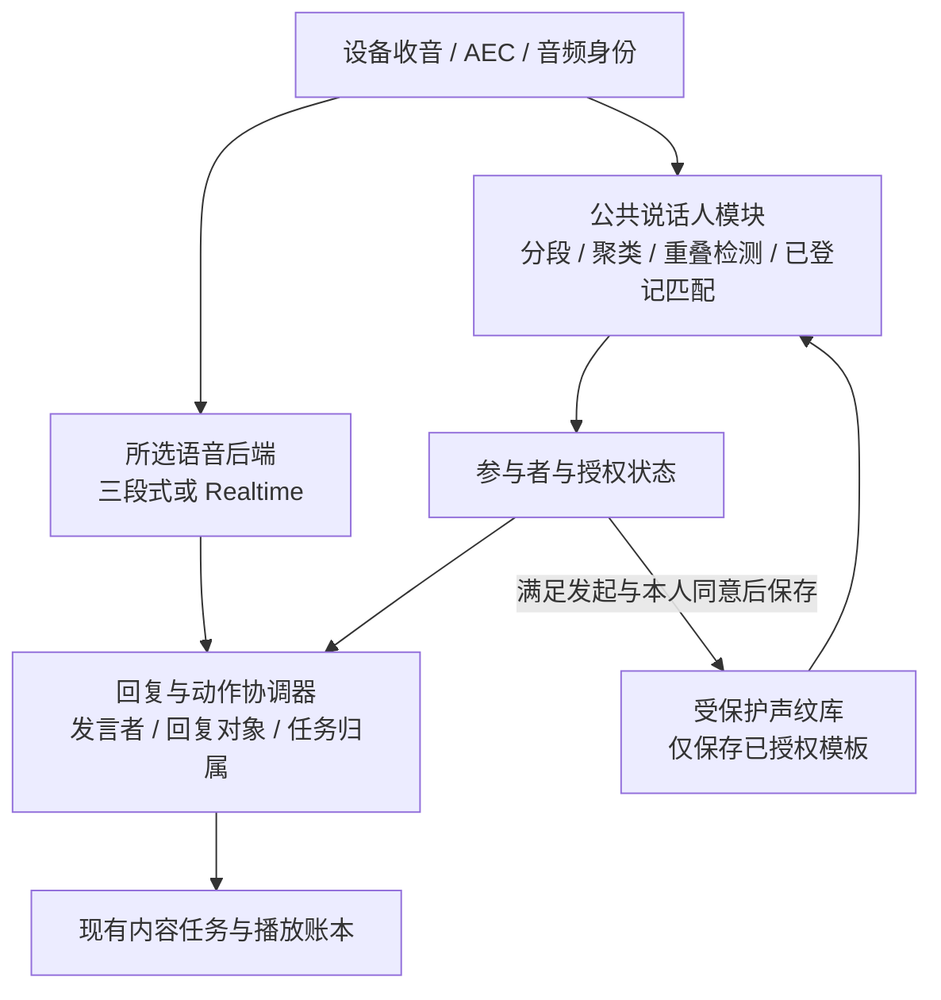

# 多人对话、说话人识别与受控声纹登记：设计方案

日期：2026-10-24。状态：方案保留，用户已明确暂停开发；待后续产品稳定、用户明确恢复后，再重新评审和排期。本文件不是当前实施指令，不安装模型或调用声纹服务。

关联方案：[双语音后端与分场景使用](2026-10-24-dual-voice-backends-design.md)。本模块计划供完整三段式、完整 Realtime 和后续场景协作共用，独立于具体语音后端。

## 0. 当前阶段决定：统一单用户，暂停多人识别

用户最新决定：多人识别相关设计先记录，等待产品稳定后再开发；当前不管实际有几个人参与，都按一个逻辑用户处理。

- 所有输入继续进入同一个 user 角色和共享对话上下文，不按真实说话人分流、建立个人记忆或拆分任务所有者。
- 不开发或启用说话人分段/聚类、已登记声纹匹配、新人登记、声纹数据库、识别开关及其开关对比、按人员区分的群聊记录/查询等本文件功能。
- 现有文字存档、模型回读和任务检查点继续按既有单用户方式工作；不为多人设计改动当前记录 schema。
- “统一单用户”是当前产品的处理方式，不代表已验证每句话都来自同一个自然人；不据此伪造实名 person_id 或把历史改写到某个真实人物名下。
- 本文件后续章节全部是保留的未来设计。另一开发会话结束、代码合并或公共接口具备条件，都不自动解除本次暂停。
- 后续恢复开发时，重新核对产品状态、最新代码和需求，再制定独立计划；本轮只更新文档，不停止其他会话正在进行的语音稳定性工作。

## 1. 最新需求与登记边界

用户明确要求：多人交流时区分是谁说话、给谁回答；已有声纹记录的人可尝试识别；陌生参与者可以自然加入对话。**新人加入时不主动询问是否登记声纹，也不自动保存声纹。只有系统内已有有效声纹、且本轮被可靠识别的人明确提出，才可启动指定新人的登记流程；被登记者本人同意后才能保存。**

早先“发现新人就主动询问身份、邀请登记”的设想已取消。没有登记意愿，不影响正常问答。

登记需要同时满足两个独立条件：

1. **有效发起**：已登记且本轮识别可靠的人，针对可确定的具体参与者，明确要求登记声纹。
2. **本人同意**：被登记者针对这次声纹用途和保存范围明确同意，且系统能把同意归属到该参与者。

发起者的要求不能代替被登记者同意；陌生人自己提出“记住我的声音”，也不越过用户规定的已登记者发起条件。没有满足两项条件时，保持临时参与者身份，不创建持久声纹模板。

## 2. 四项能力分别负责什么

| 能力 | 问题 | 输出与边界 |
|---|---|---|
| 说话人分段与聚类 | 哪段声音属于同一个人？ | 本会话临时 speaker 标签和音频区间，不等于真实姓名 |
| 已登记声纹匹配 | 该声音能否可靠对应已有记录？ | 匹配 person_id 或 unknown/uncertain；不强行选最相似者 |
| 参与者与登记管理 | 谁在参与？是否允许为此人保存声纹？ | 临时身份、有效登记发起、本人同意和模板生命周期 |
| 回复对象与任务归属 | 这句话对谁说？当前回答给谁？谁的任务在暂停？ | reply_to、是否在向助手发言、任务 owner 与可见范围 |

声纹识别用于区分和匹配说话人；声音复刻用于生成某种音色，两者不是同一功能。录入识别模板不默认授权克隆声音。

单麦只能从实际收到的说话中发现新声音，不能知道一个尚未开口的人走进了房间。未匹配既有模板也可能是短语音、感冒、距离或噪声导致，产品表述为“身份尚未确定”，不断言此人从未来过。

## 3. 公共架构与默认兼容

声纹模块是公共侧路，不取代输入 ASR、Realtime 或现有任务控制器。处理放在云服务器，Mac 仍只运行测试终端；不把模型环境或服务器凭据搬到 Mac。

功能默认关闭。未配置、超时或故障时，两条语音链路仍能以未知/临时说话人继续一般交流；身份相关的登记、私人记忆检索和个人任务改动不在未知状态下自动执行。不能因识别失败而拒绝访客聊天。

功能开启后采用有界内存处理当前会话的短音频和临时特征。未获登记条件时，不把访客音频、embedding、可跨会话匹配的标识或模板写入文件、数据库、日志或缓存备份。临时数据在会话结束或过期后销毁；不能以“还不是正式模板”为由持久保存预登记样本。

## 4. 参与者身份状态

身份与保存授权分开维护，避免把“知道名字”误当作“允许录入声纹”。

| 身份状态 | 含义 | 允许行为 |
|---|---|---|
| temporary | 本会话访客A/B等临时标签 | 普通交流、会话内轮次与回复归属 |
| self_named | 本人介绍了称呼 | 会话内使用这个称呼；不自动合并同名档案 |
| recognized | 足够质量的音频可靠匹配有效已登记模板 | 使用允许的身份信息；可作为本轮声纹登记发起者 |
| uncertain | 音频过短、候选相近、质量不足或结果冲突 | 使用中性称呼，必要时为具体动作澄清 |
| overlap | 同一时间多人重叠且无法可靠归属 | 不猜发言者或授权来源，请有关参与者分别说清 |

“访客A/B”首先是内部临时标签，无需每次播报。新人可直接提问；助手正常回应，不因新声音出现而插入一轮登记介绍或姓名问卷。

匹配阈值、候选间距和最小干净语音长度由后续同设备实验校准，不能直接沿用 SDK 示例的默认数字。迟到的匹配结果只更新所属音频区间，不能把最近一次识别出的姓名套给后续所有声音。

## 5. 受控登记流程

### 5.1 允许触发的条件

协调器同时检查：

- 发起者 person_id 有有效模板，未撤销，且本次真实输入的说话人已被可靠识别。
- 话语是当前直接请求登记声纹，目标为一个可确定的临时参与者；引用、转述、假设和“他叫小王”不构成登记请求。
- 请求绑定本轮 input_id、说话人证据版本、目标临时 speaker_id 和短期有效期限。
- 模型提出的登记工具请求通过服务端校验；模型不能自行填写有权发起者身份。

任意已登记且被识别的人都可发起，不额外把范围缩小为某个管理员。发起者识别不可靠时，不假装其已有权限，也不通过一句自报姓名跳过声纹条件。

“以后有新人都记下来”不构成对未来所有人的常驻录入授权。没有明确目标时先澄清本次目标，不开始批量采样。

### 5.2 有效发起后的状态机

1. **request_validated**：确认发起者和目标，生成一次性登记请求身份。
2. **await_subject_consent**：此时才向被登记者说明用途并征求本人同意，例如“如果你愿意，我可以保存你的声纹，以后方便认出你；你愿意吗？”
3. **consented**：目标本人明确同意，绑定本次 consent_input_id；旁人的“他同意了”、沉默、继续聊天或先前的同意不替代本次授权。
4. **collecting**：说明开始后采集足够的干净语音，只把同一人的有效片段用于本次登记；出现多人抢答或不确定归属时暂停。
5. **quality_check**：检查单说话人、信噪、时长、候选冲突和模板质量；失败则解释并让其继续作访客，可在本人仍愿意时重新采集。
6. **persisting**：原子保存模板、模型版本、同意范围和发起/同意证据。发起人和目标在保存前再次校验，防止取消或过期后迟到结果落库。
7. **enrolled**：持久化成功才确认已记住，并用独立后续语音检查匹配行为；不把写库成功当作识别质量已验收。

拒绝、撤回或超时进入 cancelled/declined；清除候选样本、待写模板和异步任务。目标继续正常聊天，不重复劝说，不降低对话能力。其他人的新请求不能覆盖目标在本会话的明确拒绝；只有目标本人明确改变意愿，才可重新询问。

只在本会话保留“不要再问”的临时状态，不为了跨会话认出拒绝者而私存其声纹。跨会话无法确认此人时仍正常交流；新人本来就不会被主动邀请登记。

### 5.3 首个成员与同名情况

系统还没有任何有效声纹时，不能满足“已登记者发起”条件。首个家庭成员需要另行设计一个明确、受信任的初始化入口，由本人主动开启并同意；不把第一位开口的陌生人自动登记。本方案不实现初始化界面或悄悄放宽此条件。

临时访客自报的名字与已有档案同名，不直接合并、覆盖或赋予该档案权限。新增与更新模板是不同操作；更新既有模板需要独立核对目标和授权，不能用新增流程替换他人的模板。

## 6. 多人场景下如何决定给谁回复

每轮至少带三个独立信息：`speaker`（谁说）、`addressed_to`（对谁说）、`reply_to`（助手准备回应谁）。知道是谁说话，不代表每句话都在对助手发问。

| 场景 | 回复与状态规则 |
|---|---|
| 已登记的小李向助手提问 | 回复小李；只使用本轮允许访问的个人背景 |
| 访客A向助手提问 | 正常回复访客A，不先要求登记，也不猜姓名 |
| 访客A直接介绍自己叫小王 | 本会话可称小王；没有有效登记发起时不问、不存声纹 |
| 小李与小王轮流提问 | 各轮绑定各自说话人，必要时称呼对象，避免把两人的“我”并到一份人物记忆 |
| 小李在对小王说话，没有向助手发问 | 不自动抢答；结合称呼、明确请求和近期轮次判断，模糊时保持克制 |
| 两人共同问一个问题 | 允许群体回答，标记共同回复对象 |
| 两人同时说话且不能可靠分离 | 不把混合内容拼成一个人的话；简短请其中一位先说 |
| 有人代别人问“帮小王解释一下” | 发起者仍是实际说话人；回复对象可为小王，不改写输入归属 |

只有单个扬声器时，“给谁回复”表示语义上的回应对象，不能保证只有该人听到。不要在多人环境仅凭识别出熟人就自动播报其私密历史。

## 7. 与故事任务、记忆和两条链路的关系

### 7.1 任务归属

任务增加创建者的会话参与者身份及可见范围；临时访客也可以拥有本会话任务，不要求先登记。公共故事与个人任务分开标记，声纹不是使用基本功能的门槛。

任何有效近端插话仍按播放策略让出当前输出。另一人插话提问只产生旁支，不覆盖原任务创建者、原稿、终点或检查点。“继续/从头/放弃”结合实际发言者、明确目标及任务可见范围校验；多人或多份任务无法唯一确定时澄清，不让新来的人一句“继续”串到另一个人的个人任务。

### 7.2 个人记忆与文字留存

人物声纹模板、个人资料、对话文字是不同保存范围，分别管理授权。已登记不代表可向任何在场人披露其全部历史；未登记也不代表没有本会话上下文。

未获文字留存同意的新参与者，设计默认仅作本会话临时对话，不把可归属的个人正文写入长期档案。声纹和文字留存分别设置：本人拒绝声纹但明确允许文字留存时，可按其文字授权保存；不能从一种授权推导另一种。登记授权的说明同时覆盖必要的结构化同意证据，不因此保存整段录音或开放所有聊天存档。这是未来功能的设计，不修改当前代码的存档行为。

多人同句、交叉发言、原文提及第三人及记忆摘要也要保留来源与授权范围；不能仅删除 speaker_id 而保留全部可识别正文，就宣称已经满足不留存要求。

声纹用作个性化和归属线索；不能把它直接升级为支付、开门或读取他人私密记录的充分授权。此类敏感操作继续使用各自明确的授权机制。

### 7.3 不阻塞自然交流的接线

音频按原路径持续送给所选后端；公共说话人模块并行产出带音频区间和版本的身份事件。不为确认每个名字而把所有对话改成等待完整分段的离线流程。

普通公开问答可以先用临时身份进行；登记、私人记忆和个人任务改动必须等到足够证据。若身份结果晚到，不把已经发给访客的回答事后记到另一个人的档案，也不追认已经执行的越权动作。

三段式将最终转写与音频区间对齐后携带说话人信息。Realtime 保留音频直入，并通过经过验证的上下文/工具适配传入参与者事实；不得只在 prompt 里写一句“识别说话人”就当作技术实现。供应商不支持可用的区间归属时，协调器独立保存 unknown，明确能力限制。

声纹模块故障或停用时继续一般交流。两种独立后端模式不因此被强制改为场景协作；共用人员信息也不意味着把同一音频同时送给两条完整对话管线。

### 7.4 声纹识别与通话流畅度

设计采用“音频持续上行＋说话人分析侧路并行”，而不是“识别人后再发送语音”。麦克风分帧后，所选语音后端持续收到输入；说话人模块消费同一时间轴的有界内存窗口，逐步更新当前发言者。

- **每轮维护归属，不逐包完整检索**：20ms 等传输帧是音频传输单位，不是一次声纹登记/比对单位。按有效人声窗口增量提取特征；发现换人、证据不足或临时归属需更新时再匹配有效模板，不对每个音频包重复完整库检索。
- **临时标签先行，姓名可稍后确定**：短时间内可先以“当前提问者/访客A”处理一般问答。一个短“嗯”或多人重叠可能始终没有足够身份信息，这不阻止继续交流。
- **有限复用识别结果**：同一说话人的连续发言可复用会话内证据；换人、重叠、长间隔或音频来源变化后须重新校验。不能因为上一句认出小李，就把后续所有发言都当成小李。
- **身份相关操作设局部门槛**：普通公开问答不等待实名；登记发起、本人同意归属、私人档案使用及个人任务改动必须等待可靠身份。证据未齐时不注入私人资料，也不播出基于特定个人私密历史的回答。超时保留 unknown 或澄清，不降低登记条件。
- **资源隔离与降级**：特征计算和检索使用有界队列/工作额度，不在设备音频读写与播放控制循环里同步执行重计算。模块拥堵时降低分析频率或返回 unknown；不阻塞上行音频，不把旧分析结果套到新一轮。

事件绑定 input_id、音频采样区间、临时 speaker_id 和身份版本。音频被正常发送不依赖声纹完成；身份变更只影响所属轮次及后续允许的动作。由于身份侧路与模型并行，先准备普通回答是允许的，但不得在身份不明时先使用私人背景、事后再补授权。

并行不能保证完全没有开销：CPU/内存竞争、首次模型加载、短语音证据不足、额外服务调用及受身份保护的操作都可能增加耗时。后续分别对两条后端比较模块开启/关闭，记录首个音频、客户端首播、说话人临时标签、最终身份及换人后的重新确认时间；还要核对误归属和 unknown 情况。测量前不承诺固定增加多少毫秒或零延迟。

产品优先级为：先保证持续收音、正常交谈与及时让出话轮；一般问答宁可暂时不知道姓名，也不让全部对话等待声纹检索。涉及登记或个人数据时，以身份与授权正确性为先。

### 7.5 识别开关与开启/关闭对比

原生测试端增加“说话人/声纹识别”总开关。首版在开始对话前选择，一次会话固定；停止后切换并建立新会话进行对比，避免把同一会话内的缓存或私人上下文带到关闭状态。

- **关闭**：停止公共说话人分析、临时声纹特征提取和已登记模板匹配，记录 `speaker_state=disabled`。没有其他明确可信来源时，消息显示“未识别发言者”，不能继续沿用之前识别的姓名。声音照常送给所选语音后端，普通聊天和已有记录规则继续工作。
- **开启**：允许会话内分段、临时标签及对有效已登记模板的匹配，仍允许 unknown/uncertain。开关只启用识别能力，不能自动打开新人登记；持久录入仍必须满足已识别登记者发起及目标本人同意。
- **不等于删除**：关闭不会删除已有已授权模板。撤销声纹、删除记录是单独明确操作；关闭期间不新建识别连接或在后台继续匹配。

两种语音后端分别比较开关关闭/开启，形成 chain-off、chain-on、realtime-off、realtime-on 四组。固定相同输入和相近网络/资源条件，记录有效配置、冷/热启动、首播延迟、CPU/内存、说话人归属、误认和 unknown。关闭组没有人物识别结果属于预期，不据此假装支持按人个性化；性能比较和功能收益分别报告。

若以后单独比较“只分临时说话人”和“已登记匹配”，增加明确的诊断模式，不能总开关已经关闭却悄悄保留特征分析，再宣称测到了完整关闭的基线。

### 7.6 类似群聊的消息记录与后台查询

用户要求把已授权的语音文字记录组织成类似 IM 群聊的结构：一个会话有多个参与者，每条发言知道由谁说，助手的回答知道给谁，并能按人查询和回读。

当前 `conversation_log.py`/`conversation_memory.py` 只有 user/assistant 角色及会话/轮次等信息，尚无 person_id、speaker_id、reply_to 或多人可见范围。现有查询不能当作多人归属查询已实现。

新消息记录至少包括：

| 信息 | 设计字段 | 用途 |
|---|---|---|
| 消息身份与时间 | conversation_id、message_id、turn_id、时间、顺序 | 查询原文和准确串联轮次，不靠时间相近猜归属 |
| 发言者 | role、session_speaker_id、person_id（可空）、speaker_state | 区分已识别的人、临时访客、关闭和未知状态 |
| 归属证据 | identity_source、identity_revision、对应音频区间 | 说明是谁在何种证据下被标记，不保存声纹向量到聊天记录 |
| 发言正文 | 最终转写 text、transcript 状态 | 区分用户实际输入与模型推断、草稿 |
| 对话关系 | reply_to、in_reply_to_message_id、任务身份 | 助手回应哪个人/哪些人、回答哪条消息、属于哪个任务 |
| 交付与可见性 | delivery、scope、文字留存授权引用 | 助手实际播出、部分/unknown与生成稿分开，控制个人/共享内容访问 |

后台先提供受保护查询接口/CLI，再按需要做管理页面；第一阶段不扩建完整 IM 系统。查询维度包括会话、人员、时间范围、关键词、助手回复对象和交付状态；会话视图按时间显示“称呼或访客标签＋正文”，人员视图可查看其获准留存的跨会话发言与相关回复，并返回可追溯原文。

临时 speaker_id 只在本会话内有效，不能把不同会话的“访客A”自动视为同一个人。只有稳定、有效的 person_id 才能建立跨会话人员视图。未登记但允许保存文字的人，可保存该次会话内的临时归属，不因此建立可跨会话识别的声纹；未允许文字留存的人仍只有内存上下文。

说话人匹配晚到时，用指向原 message_id 的归属更新事件和单调版本完善查询视图，保留来源；不能把“刚认出某个人”扩展为自动重标全部访客历史。不确定、混合发言和关闭状态均明确显示，不强行指定人。

### 7.7 按人检索与针对性回答

大模型回查先获得由服务端绑定的当前发言者及可用范围，再检索“此人相关记录＋该会话允许共享的上下文”。模型不能仅凭一句“我是小李”自行选择小李的档案，也不能任意指定其他 person_id 绕过访问范围。

例如小李说“我喜欢恐龙”，小王说“我喜欢太空”：两条记录分别归属对应的人。之后已可靠识别的小王说“讲个我喜欢的故事”，模型检索小王的相关记录，优先采用太空主题；不能把小李的偏好合并到小王身上。身份不明时使用本会话允许的临时上下文或自然澄清，不猜用某个熟人的历史。

记录还需区分“谁说的”和“说的是谁”：小李说“小王喜欢太空”属于小李对小王的描述，不能改写为小王本人确认。模型生成的建议也不能直接成为用户偏好；个人摘要保留原消息出处、事实主体、来源和时间，更新偏好时参考用户最近明确表达，不把推测当成事实。

给助手的历史和摘要始终带说话人、回复对象及交付状态，防止双方多个“我/你”混成一个人。多人共享听音环境只使用允许公开的内容；声纹匹配可帮助个性化，不替代敏感档案读取的必要授权。正文撤回、归属纠错或删除时，索引、相关摘要和后续模型背景一并失效/重建。

## 8. 数据与删除

设计数据分为：

- **会话内存**：临时 speaker_id、音频区间、临时特征、当前称呼、身份候选、拒绝登记标记。受容量与生命周期限制，会话后不作为跨会话识别依据。
- **持久人员档案**：系统分配的 person_id、本人确认的称呼、可用范围及必要版本，不靠声音推断姓名、年龄或家庭关系。
- **持久声纹模板**：person_id、算法/模型版本、特征模板、质量记录及同意记录。特征模板仍是敏感识别资料，不因没有原始录音就当作普通无风险数据。
- **登记事务**：登记请求ID、已识别发起者、目标临时身份、同意输入身份、状态/过期时间和撤销代次。模板与同意证据一起成功保存后才可供检索。

声纹库仅留受保护服务器目录/服务，最小访问范围、独立清理入口；不进 Git、普通日志或测试附件。默认不持久保存登记原始录音；若某候选服务必须留原录音或把样本发送其他处理方，需要另行说明并取得相应同意，不能沿用此设计的默认假设。

本人撤回时，使模板立即不可检索，并清除模板、候选和迟到写入。删除声纹与删除文字档案分别说明和执行，不用“已经忘记”掩盖另一份可恢复模板仍在队列或备份中。

### 8.1 首版存储选择

家庭规模首版建议使用服务器本地 SQLite 管理人员、模板与授权关系，声纹模板用加密 BLOB 保存；不为少量家庭成员单独增加向量数据库。待识别时在受控进程内解密本家庭有效模板，用同一模型提取的特征作相似度比较。模板维度由所选模型确定，不先写死。

拟定独立测试位置为 `/var/lib/family-robot-livekit-dev/identity/voiceprints.sqlite3`，目录0700、数据库及其日志文件0600，由独立服务账户管理。路径仅是设计，尚未创建数据库；正式发布位置和备份策略在后续部署设计中明确。

SQLite 默认不会自动加密，本方案的“加密”要求由模板/敏感字段的应用层认证加密实现，例如 AES-256-GCM；不能只设置文件权限就宣称已经加密。密钥与库文件分开，由服务器受保护配置管理，不放进 Git、Mac、客户端票据或普通日志。

### 8.2 最小数据结构与使用流程

| 数据 | 主要字段 | 用途 |
|---|---|---|
| 人员 `persons` | household_id、person_id、本人确认称呼、状态 | 区分系统中的人；姓名不能直接充当唯一身份 |
| 声纹 `voice_templates` | template_id、person_id、模型/版本、维度、加密特征、质量、授权ID、状态和时间 | 保存可匹配模板，并限定同模型、同家庭、有效授权的检索范围 |
| 授权 `consent_grants` | 登记请求ID、已识别发起者、本人同意输入ID、用途/范围、时间和撤销版本 | 证明此次模板符合双条件登记规则；不默认保存完整录音或对话全文 |

称呼和授权细节等敏感字段也按字段保护策略处理。姓名、person_id 和声纹模板不是同一个东西；普通聊天记录通过允许的 person_id 关联，不把特征向量复制到每条文字档案。

录入过程为：有效发起 → 本人同意 → 内存中采样与质量检查 → 提取特征向量 → 加密 → 授权与模板同一事务落库。事务成功后释放原始采样和临时特征；未获条件、失败或取消时不落库。

再次说话时：内存中提取当前特征 → 仅与允许检索的有效模板比较 → 得到 person_id 或 unknown/uncertain → 向模型提供必要的称呼、身份状态和允许使用的背景。大模型不直接读取声纹向量，也不负责通过向量判断身份。向量是相似度特征，不能用普通录音文件哈希代替；同一人每次说话的字节不会一致。

新人未登记时的特征和标签只在本会话内存中使用，不写进上述持久表。已有模板不因每次匹配成功就自动吸收新音频、更新声纹；模板更新应有独立的明确授权和质量检查。

更换声纹模型时保留版本边界，不把不同模型的向量直接比较。默认没有原始录音可供重新提取，因此迁移可能需要本人重新登记；不能无声地把旧模板解释为新模型结果。

### 8.3 删除与备份边界

撤销先使授权与模板失效、提高撤销版本，停止检索和在途写入，再删除活动模板并清除进程缓存。首版声纹库不进入现有通用自动备份；后续若启用备份，必须同时设计恢复时优先应用撤销状态和模板清除流程。

清理范围包括 SQLite 的 WAL/SHM、维护副本、临时导出和待写队列。逻辑删除立即停止识别，但不等于已经物理擦除磁盘或所有历史副本；清理未完成时只报告实际完成范围。字段加密也不能代替授权校验、撤销和备份清理。

### 8.4 聊天记录和声纹库的分离

聊天消息继续由现有文字存档 owner 管理，后续以版本化 schema 扩展多人字段；旧 v1 记录按旧格式读取并标记人物未知，不能默认归属于设备主人，也不静默改写历史。

人员查询可增加可重建的消息元数据索引，保存消息ID、日志位置、人物归属、回复关系、时间及可见范围。首版正文仍以原档案为单一来源；不为查询复制一份绕过原留存与删除规则的完整聊天正文，不把声纹模板放入模型可读的聊天索引。

声纹数据库、消息正文、查询索引和个人摘要各有职责：关闭识别只停止新识别，不能把历史姓名和正文全部删除；删除正文/人物资料则按明确范围同步清理索引与摘要。结构化多人数据的写入、解析、分页和字段校验需要单独实现，不能把数组/对象塞进现有标量字段就称为已兼容。

## 9. 可行性依据与选型边界

以下仅为官方资料/源码核对，不是项目安装或实测结果：

1. [pyannote.audio](https://github.com/pyannote/pyannote-audio)提供说话人分段、变化/重叠检测与特征等构件。能分出 speaker 标签不证明已具备跨会话姓名识别，也不证明其离线路径满足本项目实时预算。
2. [SpeechBrain 说话人识别接口](https://speechbrain.readthedocs.io/en/v1.1.2/API/speechbrain.inference.speaker.html)提供声音对的比对能力；开放集多人身份检索、阈值校准、授权与会话归属仍需本系统实现。
3. [阿里云 AnalyticDB 实时 ASR 与声纹检索](https://help.aliyun.com/zh/analyticdb/analyticdb-for-mysql/realtime-asr-and-voiceprint)提供逐句异步匹配及 unknown，文档注明声纹功能邀测、需要预登记。它不是现有百炼 ASR Key 已获同等能力的证明；早期与最终结果异步更新也需处理。
4. [Qwen-Audio Realtime 的说话人增强](https://help.aliyun.com/zh/model-studio/qwen-audio-realtime-user-guides)描述的是用预录音频锁定目标说话人、过滤旁人。它不等同于本需求的多名参与者识别与访客参与，也不能直接推断现有 Qwen-Omni 接口支持相同参数。

优先评估可在现有云服务器上运行的公共识别组件，测 CPU/内存、识别耗时、真实声学质量和许可后再选型；云服务作为独立候选评估权限、留存与费用。本轮不锁定模型、不新增依赖，也不承诺单麦重叠语音已经可靠解决。

## 10. 验证阶段与必须通过的行为

分阶段推进，分别保留结果：临时说话人区分 → 已登记匹配与 unknown → 双条件登记 → 多人回复/任务归属 → 两后端回归 → 手表现场验收。先支持多人轮流说话；重叠说话先可靠检测与降级，进一步分离作为后续能力。

必要样例：

1. 新人连续加入、提问、离开，全程不主动询问声纹登记，也没有持久声纹样本或特征残留。
2. 已登记熟人和未登记访客交替说话，临时身份不串人；短“嗯”、远距离、低声或感冒时可返回 unknown/uncertain。
3. 陌生人主动要求登记，或自报一个已登记人的名字，不能绕过有效发起者条件。
4. 已登记者有效发起，目标本人同意、单人采样及保存全部成功后才建立模板；后续独立说话能匹配到正确档案。
5. 已登记者发起但目标拒绝；发起者替目标同意；另一人在授权询问时抢答：都不能保存模板，正常交流继续。
6. 发起者识别不确定、目标不清、请求过期、声纹撤销、会话重连或迟到识别/采样回调，均不能错误落库或写入另一人的档案。
7. 两个临时访客未登记也可分别提问、被分别回应；多人互相交谈时助手不过度抢答。
8. 主人讲故事任务中访客插话：旁支回答给访客，原任务归属和进度保留；“继续”有歧义时澄清。
9. 模板/录音/普通日志/排队事务/备份清理检查通过；未授权者的个人记忆与文字留存边界符合明确选择。
10. 模块未配置、失败或停用时，现有完整三段式和完整 Realtime 一般问答保持可用。
11. 开关关闭组确实不运行特征提取/匹配，不沿用上一会话姓名；打开后仍不能自动登记新人。四组对比可追溯有效配置和测量口径。
12. 同一会话两人分别表达偏好，按人员/时间/关键词查询能回到正确原消息；模型不串用另一人的偏好、私人历史或未播生成稿。
13. 未登记访客的会话内标签不被跨会话合并；晚到归属更新、同名人物、第三人转述、旧格式记录和删除/撤回不会污染人员索引及摘要。

注册评估参与者需明确同意；未经同意不为测试新增真人录音留存。分别统计误认熟人、熟人拒识、unknown 接受、说话人切换、重叠降级、额外延迟与错误回复对象，不能把小样本零错误宣称为普遍可靠或安全认证。

本轮没有声纹识别、多人分段、登记或真人测试通过结果；只完成需求与设计。用户已暂停本方案开发，当前保持统一单用户；产品稳定且用户明确恢复后，才可重新评审并在 main 上按独立计划推进。
