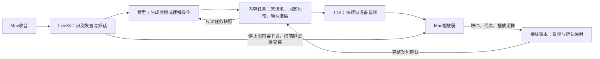

# 故事与普通回答：内容记忆和播放断点方案

2026-10-24。本文为供用户审阅的方案，不表示故事接续已经实现。本轮不修改运行代码、不部署服务、不变更8000正式入口。承接[任务接续职责与接口](2026-10-24-livekit-task-continuation-design.md)，针对当前MacBook→服务器LiveKit独立测试路径细化近期实施范围；长期Go存储单一owner的约定保持不变。

**后续测试约定更新：** 用户已要求停止浏览器主测试，改用[实际设备测试方案](2026-10-24-device-voice-test-design.md)。下述内容任务/句级断点设计继续适用，Mac播放器改为原生音频终端；验收以同设备协议链路和最终手表实机分层取证。

**最新交接行为：** 用户不要求普通插话立即截断旧声音；服务端停止旧内容继续下发，终端排空已接收音频后再播新答案。以[排空交接方案](2026-10-24-drain-handoff-design.md)为准，原稿和完整前缀在排空后结算，不能沿用默认清空缓冲的中断策略。

## 1. 要解决的两个问题

1. 内容记忆：被打断前正在回答哪个请求，原故事/解释有哪些已经确定的文字；插话后仍能找到同一份内容。
2. 播放记忆：哪些短句已完整输出，哪一句只播了一部分；用户说继续时，从首个未完整确认的短句恢复。

记住聊天记录不能代替第二项。当前故事基线在服务器使用真实ASR/LLM/TTS，模拟播放器只播约1.34秒就插话问二加三，回答5后恢复：模型保留187字生成稿，接着从“情节三”生成。代码没有故事计划/句子检查点，不能证明前两个情节已播放。证据为服务器私有`/var/lib/family-robot-livekit-dev/story-baseline-20261024-1`，不保存用户录音、不将合成正文或音频加入Git。

## 2. 选择：固定原稿＋按短句确认

| 方式 | 能否保留原内容 | 能否依据播放证据恢复 | 取舍 |
|---|---|---|---|
| 仅保留聊天记录，让模型续写 | 能保留部分背景 | 不能知道实际播到哪里 | 已观察到生成稿超前，不采用作断点来源 |
| 固定原稿，按短句单独合成和确认 | 能 | 能确认完整短句；当前句允许重读 | 近期推荐，复用现有PCM回报和代次保护 |
| 可靠词级时间轴＋播放采样位置 | 能 | 校准后可能细化到词 | 后续优化；当前供应商/浏览器/设备的词级映射未验证，不能先承诺 |

首版目标是句级或短分句级接续，不承诺接在半个字之后。记下“第4句播放了多少采样”不等于已知道第4句哪个字被听到。

## 3. 架构与职责

内容任务是进度的唯一权威。模型负责理解“接着讲刚才的”“继续解释那个问题”等意图，调用`resume_content()`；工具不接受模型猜出的句号、字符偏移或时间。后台自行根据最新确认前缀选择位置。

LiveKit继续管理麦克风、VAD、ASR、普通问答及生成取消。普通插话停止旧下发，终端已接收音频继续播放到排空，再交接新答案；旧生成失效与旧播放身份结算分开。模型被取消、普通回答完成，都不能清掉暂停原稿。

本阶段先在现有Python独立测试服务内实现会话内内容任务，复用目前计数的完整播放确认、预取和旧代次保护；不继续围绕数数增加专用规则。后续按照既有总体架构将权威任务/文字持久化接入Go owner，Python只保留短期缓存和只读快照，不另建一份长期正文数据库。原8000服务与手表不在首轮切换。

## 4. 需要保存什么

| 数据 | 例子 | 谁能更新 |
|---|---|---|
| 原请求与任务身份 | 讲小狐狸找围巾；task_id、内容版本 | 任务模块依据本轮真实输入创建 |
| 固定原稿 | 第1句至第12句，不可随插话重写 | 原稿完成并校验后固定；改写需新版本 |
| 连续完整播放前缀 | 第1～3句已确认完整，第4句未完整 | 仅依据匹配身份的有效播放回报推进 |
| 当前部分播放观测 | 第4句、块42、epoch7、已输出若干采样 | 播放账本记录；不冒充词级位置 |
| 状态和版本 | 准备、播放、结算、暂停、完成、放弃 | 任务模块串行修改，恢复前校验最新版本 |
| 旁支对话 | 问2+3，答5 | 普通对话上下文；不得改原稿和主任务进度 |

恢复位置只从连续确认前缀推导：确认前3句就恢复第4句，不另存一个能与确认前缀冲突的“模型续讲起点”。最后一句已完成时，继续请求说明本段结束；续编是新的用户请求。

同时保存两个时间概念：VAD检测到新发言的时刻，以及播放器最后有效输出的位置。恢复采用后者的保守完整短句前缀；两者之间存在网络/检测/音频延迟，不能将VAD时刻直接称作扬声器精确断点。

## 5. 生成与播放

1. 故事或需要接续的回答，先生成一份有界、完整的草稿，去掉不适合朗读的格式，校验完成状态，再切成不可变短句/短分句。未拿到完整原稿就不开始本任务播报，避免中途取消后找不到后文。
2. 近期先用短故事验证，建议上限1200字符、40个单位；尽量按自然标点切成15～40字的单位，过长语句再作语义分句，不能按音频时长均分文字。超过上限明确缩短或拒绝，不静默截断结尾。
3. 每单位绑定`task_id / content_revision / unit_id / output_epoch / block_id`与本单位PCM样本范围。最多预取3个单位、每个最多12秒24k单声道s16 PCM；总驻留音频不超过36秒约1.73MB，另外受现有输出队列总上限约束。
4. 逐单位使用固定文本/PCM播放，关闭全文自动写入“已说过的助手历史”。只有匹配单位完整且有效的实际播放回报才能推进完整前缀；生成取消不等于已经排空的音频被截断，SDK handle中断标志不能单独否定合法播放确认。生成完、合成完、发到客户端均不推进。
5. 预取不改变顺序、不推进进度，暂停时不再新增预取。当前已准备音频在有界缓存中保留；被逐出缓存时可以依据同一原句重新合成，但不能重新生成或续写故事。
6. 第一版先接受小幅句间停顿，测量原稿准备时间、首段延迟、段间停顿、合成次数及费用。若体验不合格再优化连续调度；不通过扩大已播确认范围来掩盖延迟。

首版可让故事、解释类长回答与短回答都使用同一内容单位结构；普通短回答往往只有一个单位，打断后重读该句即可。原故事暂停期间的短答案作为旁支，不替换主任务；若旁支答案自己又被打断，显式“继续刚才的回答”可重读旁支，显式“继续故事”恢复主任务。无指向的“继续”在确有两个未完成候选时才简短澄清，不能猜测或覆盖主故事。首版只保留一个主任务和最近一条旁支输出，不建立无限任务栈。

## 6. 插话、回答、恢复的实际流程

例如原稿有12句，第1～3句已播完，第4句播了一半：

1. 用户开口：立即停止旧内容继续下发并封口，保留固定原稿和旧播放身份；终端继续排空已接收音频，任务进入draining。不能沿用强制清空路径的250ms结算期限来假定已排空。
2. 终端排空后最终回报确认第4句只播了一部分：记录“完整前缀3、当前未完成4”，不能因为后面已合成到第9句就改进度。如果排空期间第4句实际上完整结束，则确认到4，恢复第5句。
3. ASR识别用户问2+3：服务端可提前准备回答5，但须等旧音频排空确认后才播新答案，使用独立输出身份，主故事保持暂停。
4. 用户说“接着刚才的故事”：意图路由调用无位置参数的恢复工具；核对发言代次、任务版本、当前会话及未放弃状态，按排空后的最终确认前缀播放原稿后文。
5. 再次在第7句中途插话：更新为第7句未完成，不回到第一次第4句，也不接受第一次旧回报覆盖进度。
6. 用户问“刚才讲到哪了”：依据只读快照说明“前3句已播完，第4句中途停了，我会从这一句接着讲”。展示对应原句供核对，不宣称精确到某个字。

允许一句重读，优先保证不跳过尚未确认完整的内容。

## 7. 给模型的记忆如何组织

每轮明确区分三部分：用户真实说过的话；已确认播完的文本；原任务原稿与暂停状态。后两者由任务模块生成只读快照。

未播原稿可以作为“待播任务数据”给模型参考，但不能标记为助手已经讲完。回答新问题时可以知道原故事主题，普通旁支不能覆盖主任务。上下文压缩可以压缩普通聊天，不能删除固定原稿、权威确认前缀和内容版本。通过模型填参数、提示词“记住位置”或相似度检索得到的内容，均不是播放证据。

`resume_content()`使用原稿；`restart_content()`重置执行计划而不改写原稿；`discard_content()`作废任务及旧回报。用户明确要求换故事/改情节时创建新内容版本，不把它伪装成恢复同一原稿。自然表达的回退通过这些工具执行，避免只匹配固定句式。

## 8. 记忆范围与异常

- 第一阶段保证同一次唤醒内、当前进程中的暂停恢复。原稿从开始播放到明确完成/放弃期间保留在内存，不把暂停当作销毁。结束会话或服务重启后的恢复不属于这一阶段的通过条件。
- 第二阶段将原稿、内容版本、确认前缀及状态接入既有Go文字存储，沿用已有清空/保留期和唯一写入者规则；PCM不长期落盘。检查点写入失败必须标记未保存，重启只恢复成功保存的前缀，允许多重读一句。
- 回报丢失/无效：保留既有完整前缀，从首个未确认单位重读；不丢原稿、不用估计语速前进。
- 迟到ASR、工具、回报：核对发言、内容和输出代次；不能启动旧任务或覆盖新进度。
- 合成连接失败/结果未知：暂停并明确失败，不自动重试未知提交；继续请求由用户明确发起，原稿保持。已准备音频可直接复用。
- 未开始播报时就取消生成：保存原请求与“原稿尚未准备完整”状态，不声称已有可接续原稿；后续明确继续时重新准备有界内容。
- 断线/重连/重启：不得自动开讲。持久化阶段恢复任务数据后，仍等待用户的继续指令。
- 放弃/清空：先退休旧输入、输出与写入代次，再清理状态。后续迟到事件不能复活已放弃内容。

## 9. 实施顺序

1. 服务器内存版通用内容任务：已知三句原稿→单句PCM→完整/部分/未知回报→原稿恢复。抽取现有计数中已验证的播放身份、预取、取消收尾和工具代次保护；不修改数数需求。
2. 真实故事和普通回答：接完整有界原稿准备、分句、主/旁支归属与只读上下文；接通自然语言创建/继续/从头/放弃/查询，不让模型自己选择断点。
3. 设备路径验证：按新测试方案，经小智WebSocket/Opus及Go→LiveKit适配器，使用Mac原生音频终端或M5StopWatch，记录原句ID、最后完整单位、部分单位与恢复单位；语音识别、工具决策、原生/硬件播放回报和声学结果分别报告。原始合成证据留服务器，不要求用户记数字或提供停点，不再以浏览器作为主验收。
4. 再接Go持久化与跨唤醒恢复，最后接手表和I2S/Opus位置映射。每步单独记录证据，不用前一步通过代替后一步。

后端依赖、运行测试、模型调用和服务继续全部在服务器，Mac只编辑/Git、运行测试终端和SSH。原生终端自身的音频代码属于客户端，不在Mac搭建语音后端。首阶段不开新公网端口，不引入向量数据库或额外编排框架。

## 10. 验收条件

- 已知三句原稿：封口时只下发第2句的部分PCM，终端排空后第2句仍未完整，回答旁支问题，再继续时重读原第2句；第1句不重讲，第3句不跳过，文字内容不变。
- 若插话时第2句虽尚在播放，但已经完整接收，排空后第2句完整，则恢复第3句，不能使用最初检测插话时的半句位置；第3句未完整时仍从第3句开始。
- 真实故事在不同句子中途/句尾至少10轮，包含连续两次插话及口语前缀，恢复始终匹配最近确认前缀，不能从模型生成稿末尾续编。
- 普通解释和一条短回答也能保留当前句；旁支不推进故事游标。存在主/旁两个未完成候选时，指向明确的恢复正确，无指向时不擅自猜测。
- 故障注入覆盖回报丢失/无效、旧回报、准备失败、旧工具、会话关闭、放弃和清空，原稿/游标不被错误前进或复活。
- 跨唤醒、断线、进程重启和检查点写入失败仅在持久化阶段验收，未经测试不宣称支持。
- 报告明确区分：模型已生成的原稿、客户端已接收音频、播放器已确认的完整前缀、物理声学听感。首版句级恢复通过不等于已完成词级或手表声学验收。
