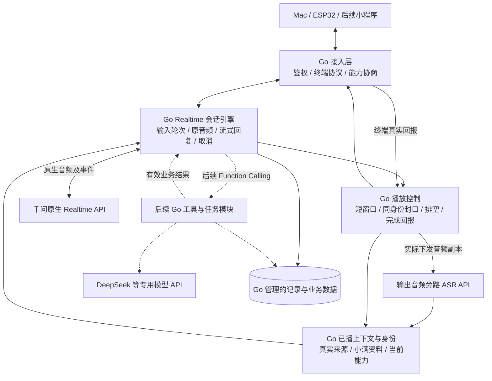

# Realtime 语音与业务后端统一使用 Go：迁移方案

> **迁移后状态更新（2026-10-25）：** 当前Go Realtime与Mac默认切换已完成。用户随后确定旧Python运行实现和完整三段式退出产品主路径，源码标弃用并保留回退/测试参考；服务停用另行处理。详见[代码生命周期](../../CODE_LIFECYCLE.md)。下文保留迁移时的冻结方案和验收要求，不代表仍应开发旧链路。

日期：2026-10-25。状态：**迁移设计，尚未开始迁移代码或切换服务**。

**本次修订：按用户最新确认，首轮只对当前 Realtime 完整链路做一比一 Go 迁移，功能、配置和交互行为保持；对照验收通过后，再单独合入其他模块或做工程优化。迁移基线包含后来上线的联网搜索，不能只冻结身份模块完成时的较早版本。**

## 1. 用户最新决定与启动时机

正式产品采用 **Realtime 统一语音入口，后端通过工具调用多个模型；正式语音与业务后端统一使用 Go**。这次目标已从“Go 为主、Python 语音模块按需长期保留”，收敛为正式运行路径不依赖 Python 语音服务。

用户要求身份模块先完成，再形成可复现基线并启动 Go 迁移。身份首期现已有交接报告；本轮仍只整理方案，不改运行代码、不重启服务。

撰写期间，身份模块完成了提交与报告更新：源码 `9e7e468`，交接记录提交 `7cfa203`。最新报告记录已部署 18032，云端 40＋8 项回归及两次 Mac/CoreAudio 合成会话通过；仍保留照片复合请求能力误述等反例，真人收音/AEC不在该轮验收范围。该交接可作为冻结基线的来源，实施启动时再核对最新提交、配置和实际服务版本。本轮没有重新执行该模块测试或检查服务器进程，也不因报告更新自动进入迁移开发。

后续已上线内置联网搜索：实现 `dc3f28d`、报告 `3b89df8`；本次修订核对时 `main` 为 `3b89df8`。迁移应冻结包含身份、搜索及其他已有语音能力的完整版本，不能退回 `9e7e468` 后把搜索漏掉。实际冻结在实施前完成，同时核对服务器、客户端和受保护配置，不凭仓库 HEAD 推断已部署版本。

本方案承接 [判题协作需求](/Users/chen/code/家庭陪伴/docs/superpowers/specs/2026-10-25-realtime-homework-collaboration-requirements.md) 和 [Realtime 多模型总体设计](/Users/chen/code/家庭陪伴/docs/superpowers/specs/2026-10-24-realtime-task-specialist-design.md)。本文更新后续后端语言和迁移路线，不宣称判题、提醒、全量记忆已经实现。

### 1.1 一比一的定义和变更边界

- 等价范围包括已有功能、开关默认值、模型/声音/VAD、提示词事实与表达原则、终端协议、已播上下文范围、失败/取消/重连和私有记录语义。
- Go 内部的类型、文件和并发实现可以不同；同样输入与受控事件应得到相同的可观察行为。模型随机生成的句子、网络计时与压缩字节不要求每次完全相同。
- 首轮不接入旧 Go 设备工具、三段式内容控制器、判题、提醒或新的存储业务，也不把它们注册为空工具。已有低层 Go 代码仅在行为等价时复用。
- 日志异步化、历史对象回收、队列收紧、连接复用、性能扩容和其他架构整理，另列为迁移后的优化项；不借 Go 重写改变当前行为。
- 冻结后其他会话在 main 上增加的功能，不自动改变本轮范围。需要更新基线时记录新增差异，并重跑对应 Python 基线，避免验收对象持续变化。
- 原有缺陷记录到已知问题清单；若发现阻碍迁移的既有问题，先单独修复和验证基线，再更新版本。Go 移植新增的错误必须在本轮修复。

## 2. “统一使用 Go”的范围

| 部分 | 最终安排 |
|---|---|
| 云端 Realtime 会话、输入轮次、流式回复 | Go |
| 云端 Opus 处理、播放控制、排空、回报校验 | Go 调用已有 C 音频库 |
| 已播上下文、输出 ASR 接入、身份与能力快照 | Go |
| 后续工具、判题任务、多模型调用、业务存储和提醒 | Go，分别按业务阶段实现 |
| ESP32 固件 | 继续 C/C++，不在此次改写范围 |
| Mac 测试客户端 | 继续 Swift，首轮保持现有音频实现和协议 |
| 微信小程序 | 后续客户端独立选型，共用 Go 后端 |
| Python 脚本和旧服务源码 | 迁移期用于对照/回退；正式语音运行不依赖它们，必要离线工具可以保留 |

统一 Go 不表示重新实现 Opus、ASR 或云端模型权重。`libopus` 等 C 依赖仍可以存在；当前 Go 编解码使用 cgo，不能据此宣称最终是无系统依赖的纯静态二进制。

## 3. 当前迁移对象与已有基础

### 3.1 当前体验基线来自哪里

最近正在完善的独立 Realtime 入口是 `tools/realtime-output-live/`，服务器回环 18032：

- Python `server.py`：票据、WebSocket、会话调度、连续输入、流式播放、排空与状态回报。
- `upstream.py`：千问原生语音监听/生成，以及输出音频旁路 Fun-ASR。
- `state.py`：采样时间轴、播放计数、排空状态和最近 16 轮上下文。
- `history.py`：已播文字来源、数字保守等价、ASR 观察与未播尾稿隔离。
- `identity.py` 和 `config/product-identity.json`：小满身份、模型来源和当前入口能力。
- `upstream.py`、`providers.Native` 和 `instructions_for`：内置搜索开关、来源/用量、监听关闭搜索、北京时间及能力联动。
- `audio.py`：有状态 libopus 编解码。
- `tools/realtime-output-probe/`：该实验当前借用的上游基础、调用意图记录和前缀工具。
- Swift `LiveClient.swift`：麦克风上传、CoreAudio 播放、排空和实际完成回报。

这是迁移的行为来源。三段式 Python 服务和旧 Go 网关中不同的任务/播放策略，不自动成为新语音引擎的默认行为。

### 3.2 可以复用的 Go 代码

| 现有模块 | 可复用内容 | 使用限制 |
|---|---|---|
| `internal/qwen/` | 原生 WebSocket、鉴权、音频事件、会话更新、工具报文基础 | 原 `Open` 带旧业务提示和默认 ASR/VAD；需要可选配置入口，不可直接套用 |
| `internal/audio/` | libopus、16k/24k 解码、24k 编码、lookahead 查询、有界缓冲 | 编码模式与 Python 当前不同，必须增加明确选项并保持旧调用默认行为 |
| `internal/realtimeentry/` | 一次性票据、回环监听和独立测试身份的经验 | 当前转接旧小智网关，外部协议不是 18032 的 `/pair`、`/live` |
| `internal/devicetools/` | 设备工具白名单、状态回读、结果验证 | 新入口未接设备工具前不能声明支持音量/亮度控制 |
| `internal/recordstore/` | 有界后台写入、落盘回执、恢复与清理的实现经验 | 是每设备 JSON 快照，不能冒充完整日志或未来任务数据库 |
| `internal/gateway/` | 已有响应身份、代次隔离和工具调用测试 | 主会话有旧中断、历史和任务路由逻辑；不整包接回新主路径 |

建议复用低层能力和已验证的不变量，新建 Go Realtime 会话协调模块。不要为少写代码而把已经淘汰的播放/回答规则带回来。

首先形成一张功能迁移台账：功能编号、Python 来源、有效配置、Go 对应实现、对照用例、结果证据和残余问题。一项已有功能在台账中没有对应关系，就不能宣布完整迁移。台账在冻结后填写，本次没有生成虚假的 Go 完成状态。

## 4. 推荐迁移方式

| 方式 | 影响 | 选择 |
|---|---|---|
| **按当前行为逐模块移植，独立 Go 入口对照验证后切换** | 故障容易定位，现有听感有基线，能分步回退 | **推荐** |
| 一次重写所有语音、工具、数据库与客户端 | 同时改变过多变量，难以判断听感退化来源 | 不作为此次迁移范围 |
| 长期 Python 语音＋Go 业务服务协作 | 可继续当前实现，但正式语音仍依赖 Python | 不符合用户本次统一目标；只允许迁移期临时存在 |

迁移期允许 Python 和 Go 两个服务都运行，客户端每次只连接一个，交替比较；不把同一段真人音频同时送两边，不建立长期双语音后端场景路由。

旧三段式先保留作为既有功能与参考代码。最终产品不以完整三段式和 Realtime 自动切换为目标；停用旧服务和清理源码分阶段处理，迁移完成前不批量删除。

## 5. 最终目标结构

输出 ASR 用于理解机器人已经播放的内容，不是用户输入的 ASR→文本模型→TTS 链路。它是独立云 API 调用，Go 可以直接接入，不要求在服务器保留 Python 运行时。

虚线部分属于迁移稳定后的业务扩展。首轮迁移仍只有现有语音和记录能力，不能因为模块预留就对用户宣称可以判题、设闹钟。

## 6. 必须冻结的行为基线

### 6.1 语音路径与轮次

首轮迁移保持现有双原生连接职责：一条持续监听连接处理原生 VAD 和输入转写；每轮建立新的原生生成连接，把截取的用户原音频与已播文字上下文交给模型。

这两种连接共同服务一条 Realtime 交互路径，不是两套语音模型路线。迁移首轮不同时改成长连接原生历史截断，也不改变每轮重建造成的声音上下文边界。

输入保持 16kHz、单声道、s16 PCM；Mac 上行 20ms Opus。生成输出保持 24kHz、下行 60ms Opus，每包 1440 个输出采样。

当前监听使用 `server_vad`、600ms 静音参数；生成连接为手动提交，首轮保持该分工，不换成旧 18030 的其他 VAD 设置。35 秒输入环形缓存、单语段 25 秒上限、输入转写身份映射与错误后的继续交流，都纳入基线。

同时保留当前生成转写最多 4096 字符、单轮源输出最多 60 秒等边界。新上下文不能误用旧 Go 网关的 12 条 history 或每条 512 字符截断；当前 16 轮和用户文本 2048 字符范围以新引擎自己的契约管理。

### 6.2 流式发声与自然交流

首 PCM 可用后即可进入输出，历史问题与普通问题都不能等待完整回答生成才播放。不恢复整段语义缓存、数字/限定词裁判、关键词回查分类、额外模型重写或固定兜底语音。

由模型根据真实上下文自然回答、续讲和适时反问。程序继续校验协议、参数、身份和播放计数；这些校验不能演变为普通回答的措辞许可表。

### 6.3 普通插话与排空

用户开口后取消旧生成、停止继续下发旧包，终端播放完已经收到的短尾音，再播放新回答。不能换回旧 Go 网关的立即清空策略。

常规下发窗口保持约 300ms，即 `sent - completed < 7200`。`sent` 是服务器音频下发计数，`accepted` 是终端接收计数，`completed` 是终端实际完成播放计数，三者分开。

使用相同响应身份封口 `drain {id, sent}`。终端最终确认 `completed = accepted = sent` 且 `terminal=drained` 后，才释放该封口栅栏。仅仅计数相等或收到普通 `played`，不能代替指定 `drained` 确认。

3 秒缺少所需排空回报时明确失败并结束连接，不能假装旧音频已结束后叠播新声音。收音在等待期间继续。

### 6.4 已播上下文

保持最近 16 轮、按时间排列的用户发言和已播证据；这是近期上下文，不是完整长期记忆。

正常生成结束且全量音频有完整播放确认时，可以使用对应原生转写；被打断时，依据实际播放前缀和输出 ASR，保留来源、候选性质和误差说明。

与生成稿无法对齐但有效的 ASR 观察仍可作为有来源的候选材料，不能简单整段丢成 null。未经播放的生成尾稿不得混入“已经说过”的背景。

120ms ASR 边界保护量、最多 1.2 秒结算等待、完整/候选/未知状态先沿用并记录，不能把识别时间戳说成声学逐字证明。已播前缀与精确同稿恢复继续分开。

### 6.5 小满身份

沿用身份模块最终交接后的 `config/product-identity.json` 和事实注入方式，保留名称、角色、表达风格、语言、开发者/归属为空的语义、实际模型来源与当前能力。

每次建立生成连接都注入当前身份与上下文。用户称呼、历史旧名和临时扮演不写回正式身份文件。

身份 JSON 在进程启动时只读加载，校验 schema 和必要字段，配置摘要进入构建/健康元数据；无效配置在提供服务前明确失败，不默默退回旧名字。保留开发者和归属的 JSON null 含义，不填模型供应商来补空值。

配置校验保留基线支持的有效输入范围；新增更严格的配置政策另行评审。构建/配置摘要仅用于诊断，不要求新增产品界面或额外模型请求。

能力以当前入口实际接通的功能为准；旧 Go 网关有设备工具，不意味着新 Go 入口已经接通它们。身份模块中已记录的语义反例继续列入迁移验收，不能把配置存在等同任何问法都准确。

### 6.6 联网搜索也必须完整迁移

保持当前默认开启，`OUTPUT_LIVE_ENABLE_SEARCH=0` 可关闭，其他非法值仍按基线拒绝；旧探针默认不因正式入口开关而自动开启搜索。

生成连接发送 `enable_search=true` 和 `search_options.enable_source=true` 并核对会话回执；监听连接使用独立配置副本明确关闭，不能修改共享配置后影响下一轮生成。

保留 `response.done.usage.plugins.search` 的计量和 `response.search_info.search_results` 的来源白名单，最多 32 条。缺失不填成已确认的 0，异常可选元数据不阻断音频。不能只复用 Go 现有 `Response` 类型而丢掉它尚未定义的搜索字段。

小满联网能力随开关和连接状态联动，开启时保留现有北京时间与检索说明。首轮不改成独立搜索工具、天气 API、另一种联网策略或新的来源列表界面。

当前官方接口的 `tools` 与内置搜索互斥：本轮保留“搜索按配置启用、tools 未配置”。不为了合并旧 Go 工具而关闭搜索或同时启用冲突参数。后续判题工具与搜索如何共存，待本轮迁移通过后另作功能设计。

### 6.7 冻结清单必须包含有效配置和未设置项

| 基线项目 | 冻结时保存的非秘密证据 |
|---|---|
| 服务与代码 | Python 源码提交、部署身份、启动命令和有效端口；不只记分支名 |
| 模型与声音 | 请求模型别名、提供方实际回执中可得的标识、Tina 等实际音色；别名无法锁定权重时如实标注 |
| 身份与提示词 | 身份 JSON 摘要、当前完整指令、能力范围、北京时间注入规则 |
| 上游配置 | 搜索开关/来源、监听与生成的 ASR/VAD/null 设置，以及未显式设置的采样参数 |
| 播放与上下文 | 采样率、帧长、模式、补齐、窗口、队列上限、超时、16 轮范围和日志字段 |
| 依赖与终端 | Python/Go/libopus/系统版本；同一 Swift 客户端构建及音频设备 |
| 测试和问题 | 测试提交、用例版本、已通过范围、明确反例和计时口径 |

配置中的“缺省”“显式 null”“显式 false/0/空数组”分开记录，Go 序列化时不能因为零值自动增加 temperature、tools 或其他原本未设置的字段。Key 与敏感地址仅引用云端保护配置，不导出为公开清单。

身份/自然对话提示词正文首轮不润色；固定测试时钟后，对比实际发送的指令及请求。比较可忽略请求 ID 和诊断时间等非业务随机字段，但不能通过重写用户文本或提示词来制造一致。

## 7. 模块迁移映射

以下名称是职责组织草案，不代表已经创建或必须在首轮拆成这些通用包。可按当前 Python 模块对应成有限的 Go 文件，优先完成一套行为；避免为了“统一架构”先建通用 Agent 框架或多个服务。业务代码仍在当前仓库、当前 `main` 中推进。

| Python 当前来源 | 建议 Go 落点 | 迁移交付物 |
|---|---|---|
| `identity.py`＋身份 JSON | `internal/product/` | 只读加载、字段校验、能力快照、相同事实的每轮指令构建 |
| `state.AudioRing` | `internal/realtimevoice/input.go` | 绝对采样索引、环形缓存、越界拒绝、原音频分段 |
| `state.Turn` | `internal/playback/`＋会话状态 | 响应身份、计数、窗口、封口和回报规则 |
| `history.py`＋`PrefixTracker` | `internal/conversation/` | 来源化已播证据、保守数字等价、最近 16 轮和未播尾稿隔离 |
| `StreamingNative`＋`Native` | 扩展 `internal/qwen/` 的原生配置入口 | 监听/生成角色、VAD 时间戳、提交/响应/取消与事件限制 |
| `OutputASR` | `internal/outputasr/` | Fun-ASR duplex 协议、有界队列、最终句与时间戳、失败状态 |
| 搜索配置、回执、计量/来源与能力联动 | `internal/qwen/`＋身份/记录对应文件 | 默认值、监听隔离、开关、可选元数据容错和搜索/tool 互斥保持 |
| `audio.py`＋`audioop.ratecv` | 扩展 `internal/audio/` | 明确编码模式、封尾、同一采样时间轴、有状态 24k→16k 转换 |
| `Session` | `internal/realtimevoice/session.go` 等 | 单一状态 owner，输入/输出/取消/排空/结算的协调 |
| `main` 的 `/pair`、`/live` | `internal/voiceentry/` | 保持 Mac 契约的回环票据、会话准入、健康检查 |
| `record`、`Intent` | `internal/voicerecords/` | 私有事件、调用意图、写入顺序、完成与失败语义保持；异步化另行优化 |
| Python 服务启动 | `cmd/voice-server/` | Go 正式语音入口、配置加载、优雅关闭、构建身份 |

`internal/qwen.Open` 的旧默认行为保留；增加显式选项或独立入口，供新引擎选择原生指令、监听/生成设置。不会强制携带旧任务路由提示，也不改变仍在使用的旧服务。

新的 Go 业务任务、判题、SQLite 和提醒另按既有需求展开；首轮不借语言迁移把所有未来功能一次建齐。

## 8. 几个必须专门处理的技术差异

### 8.1 Opus 模式、延迟和尾部

当前 Python 编码使用数值 2049，即 `OPUS_APPLICATION_AUDIO`；现有 Go 编码默认 `OPUS_APPLICATION_VOIP`。新引擎应显式选择与基线一致的模式，旧调用保持默认。

Python 当前在尾部按 `total + 312` 向 1440 样本包边界补齐；Go 已有 `LookaheadSamples()`。两者不能只因 API 更方便就直接互换。迁移时记录实际库版本、编码模式、查询的 lookahead、补零样本和解码后总样本，核对声音尾部、包数与播放坐标。

首轮先实现基线兼容的封尾策略；如既有常量确需校正且阻碍迁移，先在 Python 基线中单独修复、验证和更新冻结版本，再迁到 Go，不让尾部变化藏在语言替换里。验证不要求跨不同 libopus 版本的压缩字节必然一致，但同一测试下的时轴、尾部内容和回报必须自洽。

### 8.2 有状态重采样

Python 使用 `audioop.ratecv(..., 24000, 16000, state)`，当前 Go 库没有对应实现。首选用 Go 实现与基线相同的流式相位、整数舍入和跨包状态，通过服务器上的公开合成数值向量对照。

不能每个 Opus 包重置状态，也不能简单丢采样点代替重采样。应覆盖不同分块方式输出一致、总样本量、边界连续、静音/脉冲/正弦与末尾处理。

输入 ASR 时间戳、24k 解码坐标和 16k ASR 输入时钟分别管理；不能只把整数乘除一下就声称字时间戳已校准。

### 8.3 WebSocket 与状态所有权

每个 WebSocket 由一个 writer 串行发送；reader 只解析后投递有界事件。会话状态由一个 owner 更新，编码、网络和记录 worker 不直接改另一轮状态。

旧输出封口与音频发送必须具有明确先后：已在发送的包要纳入封口；尚未下发的旧包不能越过封口。新 `begin` 不能在旧排空确认前下发。

若采用异步 writer，要区分预留与实际写入完成，明确取消怎样退休未写命令、写成功怎样进入 `sent`、回报先于本地写完成通知时怎样处理。不能把“放进队列”直接等同已完成网络下发。测试要覆盖这些交错，以及正常顺序流程。

### 8.4 严格数字与身份类型

JSON 计数和响应 ID 必须是真正的非负整数，拒绝布尔值、分数、溢出、倒退、超过已下发量和非整包回报。Go 默认 `float64` 解码不得造成大整数精度丢失；采用明确类型或保留数字字面量后严格解析。

当前二进制包前缀是 4 字节大端响应 ID；用明确的无符号范围和溢出处理，跨新会话从新身份域开始，不让迟到旧事件误配。

### 8.5 中文与 Unicode

Python 字符索引迁移到 Go 时使用 rune/明确的字符位置，不能把 UTF-8 字节偏移当字符偏移。中文数字、全角字符、标点和大小写规范化需要语义等价测试。

现有 Python 使用 Unicode NFKC；Go 实现如引入规范化库，需作为明确依赖锁定版本并覆盖字符展开后的索引映射，不能用只处理全角数字的临时替代冒充等价。

保留“一、二”与“12”、“七八”与“78”、口语“二百五”等边界；这些规则只服务记录对齐，不重新变成决定模型能不能说话的裁判。

### 8.6 首轮保持记录契约，异步化另行优化

当前实验同步追加私有 JSONL，并在实际调用前记录调用意图。首轮移植其字段、顺序、调用位置和可见失败语义；不能把“放入异步队列”改称已经保存，也不能先提交付费请求再补意图记录。

Go 内部可采用有明确所有权的存储实现，但不借机改变正文留存、已保存声明、错误处理或推出新归档功能。有界专用 writer、批量刷盘等性能改进在等价验收后单独设计和测试；不把收益算作语言迁移必然效果。

首轮保持对照所需的事件内容和来源，写到独立新目录；旧 Python 记录保留原样，不让两进程写同一文件。没有通过迁移前不批量导入或改写旧档案。

模型 Key、受保护 URL、票据和原始真人录音不入 Git 或普通日志；合成测试数据也不夹带用户真实文字/声音。

### 8.7 有界资源与清理

首轮保留当前队列、等待、历史访问范围和关闭语义，修复 Go 实现新增的泄漏与竞态。Python 当前历史对象可能累积的风险另行登记；不在迁移中直接截断对象、提前退休轮次或改变迟到回报处理，避免让性能优化改变可观察行为。

上行、编码待发与输出 ASR 队列采用冻结时的有效上限：当前输入 100 个 20ms 帧、编码队列 1002 个 60ms 包、ASR 队列 1024 份输入块。不能只在 Go 中偷偷收紧或扩大并改变阻塞/失败行为；实际下发仍受 300ms 窗口约束。记录路径按上一节处理，不在本轮新增一种不同的接纳队列契约。

超时、队列溢出和关闭必须取消相关 goroutine 并回收 codec；失败不能遗留上游连接、无限任务或卡死下一次开始。收紧队列和并发扩容作为后续独立调优，不在同一轮改掉所有基线参数。

## 9. 分阶段迁移与完成标准

| 阶段 | 工作 | 该阶段完成标准 |
|---|---|---|
| 0：冻结完整当前链路 | 在身份交接基础上纳入已上线搜索；记录源码/服务/客户端/配置、功能台账和原有问题 | 基线可复现，全部已有功能有对应用例，不再随 main 新提交自动变化 |
| 1：纯逻辑 Go 对照 | 身份、输入环形缓存、播放状态、历史/前缀、严格解析 | 公开合成固定输入下，输出事实/状态/来源与基线一致，已知反例保留 |
| 2：音频和上游适配 | Opus、重采样、千问监听/生成、输出 ASR、取消和限额 | 云端合成流与失败注入通过，不依赖 Python 子进程或跨语言 IPC |
| 3：新 Go 测试入口 | Go 会话引擎、同一终端协议、私有日志和健康信息 | 原 Swift 音频代码不变即可完成收音、连续问答、流式播放和排空 |
| 4：同条件体验与回归 | 与冻结 Python 交替对照；真实模型、合成 CoreAudio和真人测试分开 | 行为/身份/听感没有已知迁移退化，失败与时延证据完整 |
| 5：切换到 Go | 空闲时切客户端默认入口；核对源码、二进制与配置；Python 作为短期回退 | 日常入口实际连接 Go，单次会话不混连，当前能力声明准确 |
| 6：结束迁移期 | 观察稳定性、检查没有消费者依赖，再停用 Python 语音服务 | 正式运行不需要 Python；回退版本、数据和证据可找回 |
| 后续独立项目：功能整合与优化 | 迁移验收通过后，再单独安排设备工具、判题/任务、记忆/提醒和性能整理 | 不计入本轮迁移；每项另有范围、用例与验收 |

这里是阶段与退出标准，不是本轮立即执行的代码任务单。后续具体实施计划以冻结清单补齐精确文件与测试步骤；本轮止于等价迁移，不因为日历进度到某阶段就自动启动功能合入。

## 10. 测试入口和切换方法

### 10.1 首轮保持客户端契约

Go 首个测试服务保留 `/healthz`、`POST /pair`、`GET /live`，以及 `ready`、`begin`、`end`、`drain`、`status`、`receipt`、`stop` 消息与 4 字节响应 ID 音频封装。

保持票据 120 秒、单次使用、回环监听和单会话准入；Origin 和消息大小限制沿用当前保护目的，并明确测试。健康信息可额外显示后端语言、构建提交和身份配置摘要，不输出秘密。

上游模型、音色、ASR 地址和 Key 从云端受保护配置读取或由服务环境注入，按字段白名单校验；不执行配置文件中的 shell 内容，不为迁移重新生成正式设备凭据，也不把 Key 搬到客户端。

现有 Swift 播放/AEC 代码不改，仅增加可选择远端测试入口的启动器适配。当前 `OUTPUT_LIVE_LOCAL_PORT` 只改变本地转发端口，远端仍写死 18032，不能只改这个变量就声称连上了 Go。

新 Go 服务使用独立、启动前确认空闲的回环端口；首选候选 18040，最终由部署前端口清单确定，不预占用。Python 18032 和原四个服务保持，不提前切换或重启。

### 10.2 首轮只验 Mac，不冒称硬件完成

Mac `CoreAudio_dataPlayedBack` 回报保持其真实来源，不转成旧 Go 协议的 `i2s_dma`。不能为了复用 `internal/protocol.ParsePlayback` 而伪造硬件证据。

后续 ESP32/小程序通过接入适配器进入同一 Go 内部播放语义，但各自的封口、排空和真实完成依据必须分别实现和验收。此次 Mac Go 化不自动完成固件或小程序适配。

后续正式设备接入时，旧小智协议可由 Go 接入适配器转换到同一新语音引擎；不再维护一份独立的旧对话/恢复核心作为长期产品默认。切换该设备之前，原 8000 入口继续按现状服务，不能以 Mac 迁移通过为由提前移除仍有消费者的旧路径。

### 10.3 切换与回退

对照通过后，等当前会话结束再切默认启动器，避免把已经收到的播放回报送到另一服务。保存 Python 基线提交、身份 JSON、受保护配置引用和其原数据目录，不复制 Key 到 Mac。

Go 日常验证出现迁移退化时，停止本次 Go 会话并将后续新会话切回冻结基线，不静默在一句话中间换后端，也不自动重复提交上一轮模型请求。

停用 Python 服务只在 Go 稳定、消费者检查完成后执行。保留源码、历史报告或开发脚本不代表正式请求仍依赖 Python；删除旧源码和废弃三段式另作有证据的清理，不与首次切换捆绑。

切换前记录 Python/Go 的构建、配置、启动器目标和各自日志目录；先演练一次“Go 会话结束→恢复 Python 目标→新会话配对和播放正常”的回退。没有演练不只凭旧进程仍在运行就宣布可回退。

默认入口 Go 化、停旧服务、删除旧代码分成三个动作。首轮不改日志格式/保留期、不批量迁移旧数据；两边绝不写同一个会话文件，回退也不把 Go 输出伪装成 Python 已播历史。

## 11. 测试与证据矩阵

| 类别 | 必测内容 |
|---|---|
| 身份与能力 | 小满、未知开发者、供应商分离、旧名/临时改名、多语言、重连；未接图片/提醒不宣称可用 |
| 联网与配置 | 默认开启/显式关闭、监听关闭、回执核对、来源/usage、可选元数据容错、能力联动、search/tools 互斥与旧探针默认关闭 |
| 语音轮次 | 600ms VAD 配置、原音频分段、25秒限制、晚到转写、第二句替换在途回复 |
| 流式交付 | 提供方首 PCM 后挂起剩余生成，终端仍先收到音频；历史问题不被整段缓存 |
| 排空交错 | 在途包与封口、未下发包撤销、正常 end 与 drain 竞争、旧回报、重复/缺回报、第二次快速插话 |
| 计数和协议 | bool/浮点/溢出、倒退、越界、错误 id、错 basis、非整包、ticket 重用/过期/并发准入 |
| 音频坐标 | 编码模式、lookahead/补零、解码时轴、跨包重采样、首尾不截断、连续包无异常噪声 |
| 已播上下文 | 全播原生转写、中断 ASR 候选、对齐失败仍保留观察、未播尾稿隔离、最近16轮、中文数字边界 |
| 自然交流 | 连续指代、插问数学、故事语义续讲、缺材料时自然反问；不恢复措辞硬拦截 |
| 故障恢复 | 上游关闭/错误、ASR失败/延迟、队列满、磁盘失败、取消、关窗、服务结束、再次开始 |
| 资源与构建 | goroutine/codec/连接清理，云端 `go test -race ./...`、`go vet ./...`、`go build ./...` |
| 回归范围 | 若扩展共用 qwen/audio，旧网关与设备桥相关测试必须通过；不以新入口通过代替旧调用兼容 |

纯状态与协议测试使用人工构造的事件和公开合成小数组，做 Python 参考输出与 Go 结果的差异核对；迁移验证时 Python 可运行在云端，最终 Go 服务不调用它。

真实模型不可逐字要求两轮随机生成相同；比较身份事实、上下文来源、回复目标、取消/播放行为和语义质量。数据结构不同但语义相同可以接受，证据字段不能被偷偷升级。

合成 CoreAudio 验证与真人听感分开。首轮建议至少 30 个普通轮次、10 次快速插话/排空和一次 20 分钟持续会话；样本量仅是验收起点，完整披露失败，不能据此宣布规模化容量或长期零故障。

语言迁移不承诺提高模型速度。使用同一 Mac、声音配置、模型/VAD、网络和场景交替比较；记录语音话尾、服务端 VAD、建连/结算、首包和实际播放。准备反馈与实质答案分开，不把不同计时口径合并。

### 11.1 三层对照，分别回答不同问题

1. **确定性差异测试**：用公开文本、小数值音频向量、人工构造 ASR/播放事件和固定时钟，对照 Python 与 Go 的状态、指令事实、JSON、错误和记录输出；同一例的业务结果必须一致。
2. **受控传输测试**：在云端用模型替身复现“首 PCM 到达但生成未完成”、封口竞争、异常元数据、断网和关闭。先证明 Go 没有新增整段等待、叠播、重复生成或身份混配，再调用真实模型。
3. **真实模型与听感对照**：使用同一终端交替测试，检查语义、声音、自然度和实际播放；不要求随机回答逐字一致，也不把传输通过当成语义正确。

普通问答、实际发生搜索的联网问答、历史回查、插话/排空、重新连接分组统计。搜索开启但未发生查询，与存在真实搜索计量的样本分开；不能把联网等待混进普通问答后评价 Go 快慢。

两边顺序交替，使用等价初始上下文；不能让一边带旧记忆、一边从空会话开始。记录网络与提供方变化；供应商别名漂移或限流导致的差异不能直接归因语言。

### 11.2 切换前必须满足的条件

- 功能台账中的已有能力全部有 Go 对应和通过证据；迁移不漏搜索、关停、重连或日志能力。
- 确定性、协议与受控流式/排空测试全部通过；没有新增旧音频越过封口、新旧叠播、未播尾稿进入上下文或重复付费重试。
- 真实模型验证中，不增加语义审查/改写请求；单次正常回复仍只有基线所需的生成与输出 ASR，监听角色保持。
- 合成 CoreAudio 和真人复验完成；没有尚未解决的 Go 新增无回复、串音、异常退出或能力丢失。
- 在同口径分组对照中没有持续性时延退化。默认诊断触发线为普通问答的 `Go中位数－Python中位数 > max(100ms, 10%×Python中位数)`：触发后先调查和复测，不直接切换；未触发也不能替代功能/听感验收。该数值是计划中的诊断线，不是已测结果或允许必然变慢的承诺。
- 样本不足时不声称 P95 或容量领先；报告实际样本、最大值、失败次数和原始计时定义。
- 基线已知问题与 Go 新增问题分别列出，回退已实际演练。

如后续要调整诊断线或测试范围，必须在 Go 对照结果出来前写入冻结清单，并说明理由，不能测完再放宽以凑通过。

### 11.3 已知问题保持可见，不伪装成迁移成果

当前记录中的天气预报范围被说成实时气温、复合图片/提醒请求能力误述、缺失历史被模型误解、ASR候选误差和故事非同稿恢复，分别保留对应反例。

不要求 Go 故意制造同一句错误；也不能因某次随机回复恰好正确，就宣布换语言解决了模型问题。若原有缺陷妨碍这轮验收，按独立基线修复处理，保留前后证据。

## 12. 首轮不同时做的变化

- 不换模型、音色、VAD、Opus模式或播放策略来“顺便提速”；必要兼容差异单独记录。
- 不加入三段式的用户 ASR、文本对话模型或独立 TTS。
- 不恢复已经移除的回答审查、关键词路由或模型重写。
- 不把近期 16 轮扩成全量长期记忆，不重新设计所有存储。
- 不同时实现判题、提醒、微信小程序和摄像头。
- 不接入原 Go 网关已有但当前 Realtime 入口尚未开放的设备/会话工具，也不合入三段式内容控制器。
- 不删除或替换当前内置搜索，不为 tools 的未来接入改变本轮联网路线。
- 不同时进行日志异步化、历史回收、队列重新定额、连接复用和数据库重构。
- 不恢复多人/声纹开发，不依声音自动建立个人身份。
- 不把词级候选前缀或故事语义延续升级为同稿精确断点已通过。

## 13. 运行和协作约定

开发、提交、推送直接使用 `main`，不创建分支或 worktree。实施前重新读取 [开发交接](/Users/chen/code/家庭陪伴/docs/DEVELOPMENT_HANDOFF.md)，核对其他会话工作区改动，按明确范围提交，不把在途身份文件一并带入迁移提交。

后端依赖安装、编译、运行时测试、真实模型调用和服务部署均在云服务器。Mac 负责代码/Git、SSH和原生测试客户端；不在 Mac 启动 Go/Python 语音后台，不复制服务器模型 Key。

不部署到当前活动端口，也不重启正在被用户使用的窗口服务。每阶段记录源码提交、二进制/配置身份、端口、日志目录、验证结果与遗留问题；验收后再进行对应切换，避免文档先写“统一完成”。

## 14. 完成迁移的判断

只有同时满足以下条件，才能称“正式语音后端已统一 Go”：

1. 当前纳入正式发布范围的终端实际连接同一个 Go 语音引擎，核心 Realtime、排空、已播上下文和小满身份均由 Go 承载；只完成 Mac 时只认领 Mac 入口迁移。
2. 运行语音不需要 Python 服务、Python 子进程、Python SDK 包装或跨语言桥。
3. 当前全部功能与配置，包括身份、搜索、流式、近期已播上下文和排空，逐项通过对照；真实播放和真人复验有记录。
4. 身份、能力和模型来源跟随真实配置；未开发的业务没有被宣称可用。
5. 失败恢复、日志保存、资源回收和回退可用；不丢旧数据，不重复付费重试未知请求。
6. 部署提交和仓库版本可核对，旧服务的继续/停用状态有明确记录。

Go 迁移完成与判题功能完成、精确续讲完成、ESP32/微信真机完成，是不同交付结果，分别验收。

## 附录：本次核对的来源

- [身份配置](/Users/chen/code/家庭陪伴/config/product-identity.json)、[身份构建](/Users/chen/code/家庭陪伴/tools/realtime-output-live/identity.py)、[身份验证报告](/Users/chen/code/家庭陪伴/docs/verification/2026-10-25-xiaoman-identity.md)。
- [Python 主会话](/Users/chen/code/家庭陪伴/tools/realtime-output-live/server.py)、[上游接入](/Users/chen/code/家庭陪伴/tools/realtime-output-live/upstream.py)、[状态](/Users/chen/code/家庭陪伴/tools/realtime-output-live/state.py)、[已播历史](/Users/chen/code/家庭陪伴/tools/realtime-output-live/history.py)、[编解码](/Users/chen/code/家庭陪伴/tools/realtime-output-live/audio.py)。
- [当前 Swift 协议端](/Users/chen/code/家庭陪伴/tools/realtime-output-live/LiveClient.swift)、[启动器](/Users/chen/code/家庭陪伴/tools/realtime-output-live/open.command)。
- [Go 千问客户端](/Users/chen/code/家庭陪伴/internal/qwen/client.go)、[Go 音频库](/Users/chen/code/家庭陪伴/internal/audio/opus.go)、[旧播放协议](/Users/chen/code/家庭陪伴/internal/protocol/playback.go)、[原工具调用](/Users/chen/code/家庭陪伴/internal/gateway/session_tools.go)。
- [移除回答硬拦截的验证](/Users/chen/code/家庭陪伴/docs/verification/2026-10-25-realtime-natural-dialogue.md)、[排空验证](/Users/chen/code/家庭陪伴/docs/verification/2026-10-25-realtime-drain-test.md)、[Realtime 输出实验说明](/Users/chen/code/家庭陪伴/tools/realtime-output-live/README.md)。
- [联网搜索验证](/Users/chen/code/家庭陪伴/docs/verification/2026-10-25-realtime-search.md)、[当前完整配置与版本限制](/Users/chen/code/家庭陪伴/docs/verification/2026-10-25-realtime-config-switches.md)。

上述运行结果引自已有报告；本轮没有新增后端测试、付费模型调用或部署。实施前冻结包含身份和联网搜索的完整版本，再按冻结清单展开代码步骤。
