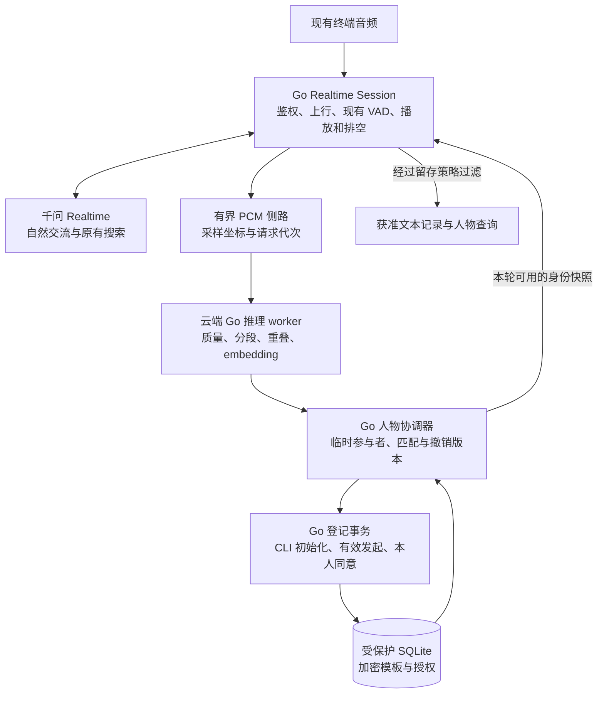

# Go Realtime 声纹识别与多人对话：恢复设计方案

日期：2026-11-01（Asia/Shanghai）。状态：**恢复设计评审，尚未实施**。

用户本轮要求继续推进声纹功能，先查阅旧方案并整理设计；已选定首位成员通过云端管理命令开启登记，管理页面后做。本文件是供评审的设计，不代表已安装识别模型、建立声纹库、采集真人样本或接入正式语音。

本文件更新[原多人方案](2026-10-24-speaker-identity-multiparty-design.md)的实现路线与阶段状态。原先关于访客、登记授权、记录归属和删除的产品要求继续有效；实现以本页的 Go Realtime、分期范围与验收约束为准。

## 1. 用户需求与不可改变的边界

1. 已登记的人再次说话，可以在证据充分时识别；没有匹配到时允许未知，不硬猜姓名。
2. 新人直接参与聊天，不先问姓名，不主动邀请登记，不自动保存其声纹。
3. 普通新增登记必须由**已有有效声纹且本次发言被可靠识别的人**明确提出，并取得目标本人同意。任意满足条件的已登记者均可发起，不限定家庭管理员。
4. 首位成员使用单独的受信任初始化流程，由本人同意；这不开放访客自行登记，也不把第一个开口的人自动设成主人。
5. 多人轮流发言时区分“谁说的”和“回复谁”；短语、噪声、换人和重叠可降级为未知或混合。
6. 后续聊天记录类似群聊，可按获准记录的人查询；个人背景不能在多人之间串用。
7. 声纹识别有开关，可以比较开启/关闭的流畅度、资源与识别效果。
8. 产品继续使用 Go＋千问 Realtime；声纹分析在云端并行运行。三段式备用链路不接入本轮开发。
9. 识别用于称呼和对话归属，不作为支付、开门、读取敏感档案等操作的充分身份认证。

“未匹配”只表示当前证据不能确定身份，可能由距离、噪声、感冒或短语音造成，不等于已经证明是从未出现过的新人。

## 2. 当前代码事实

核对基线：本轮开始时 `main` 为 `7a1391e`。以下是源码事实，未在本轮重新验证云端进程。

| 现有组件 | 已有能力 | 本功能不能直接假定的能力 |
|---|---|---|
| `internal/realtimelive/session.go` | 上行解码、16k PCM 环形缓冲、提供方 VAD 分段、转写、回复和排空 | 无说话人侧路、稳定人物 ID、人物权限快照 |
| `internal/realtimelive/native.go` | Realtime 音频输入、语音生成、转写事件与搜索 | 无已验证的具名多人识别接口 |
| `internal/realtimelive/ownership.go` | 鉴权设备、连接及记录归属 | `device_id` 不是 `person_id`，当前没有家庭作用域绑定 |
| `internal/voiceidentity` | 终端登记及服务器凭据 | 名字含 identity，但不提取或保存生物声纹 |
| `internal/deviceauth` | 小智终端凭据校验 | 不识别真实发言者 |
| `internal/realtimelive/memory.go` | 同设备有界近期记忆及明确清除 | 未区分设备上不同人的发言，不能直接用作私人记忆 |
| `audit.go`、`records.go`、`cmd/realtime-records` | 私有事件/审计、设备与会话查询 | 无人物授权过滤、群聊消息索引及按人查询 |
| `device_controls.go`、`native_tools.go` | 设备工具的候选路由、独立无声工具会话与回执 | 没有声纹登记工具及登记事务 |
| Mac／微雪／M5／C3 | 现有收音、播放和终端协议 | 不证明声纹在这些声学路径上已达到质量要求 |

当前普通语音保留内置搜索，工具规划使用独立无声会话。新增登记工具必须沿用这个分工，不能把 `tools` 直接塞入有声搜索会话、意外改变其音频模态或关闭搜索。

原多人方案中以 Python `conversation_log.py` 为当前入口的描述已过时；新的接线点是 Go Session、recorder、memory 和 records CLI。Go recorder 已能编码嵌套 JSON，但结构化字段验证、权限与查询仍须新增。

## 3. 三种技术路线与建议

| 路线 | 优点 | 代价和限制 | 本次选择 |
|---|---|---|---|
| **Go 业务层＋云端 Go 推理 worker＋ONNX 模型** | 保持 Go 主后端；音频不增加外部声纹处理方；资源和保存边界可控 | 有原生库部署、模型许可与真实声学评测工作 | **推荐，先隔离评估** |
| Go 调用云厂商声纹服务 | 本机少维护推理环境 | 需确认账号可用性、留存、费用、网络耗时和多人接口能力 | 独立备选，不默认开通或上传 |
| Go 调用 Python/PyTorch 识别服务 | 可选算法较多，研究工具成熟 | 增加 Python 常驻、依赖与运维面，不符合本项目优先统一 Go 的方向 | 不作为首版产品路线 |

Go 推理仍可能通过 CGO 使用 ONNX Runtime／sherpa-onnx 原生库；“Go 主后端”不等于纯 Go 或零原生依赖，也不要求把模型数学实现重写一遍。

优先评估 sherpa-onnx Go API 的中文 CAM++ embedding；用官方可获取的 ERes2Net 作为质量/资源对照。分段与重叠检测独立评估，不把 embedding 提取器当作完整 diarization。具体模型、版本、SHA256、预处理和许可在隔离评估通过后锁定；尚未选择可发布的模型产物。

官方识别样例会写 WAV、打印姓名，并使用示例阈值；这些行为不得照搬到产品。官方分段 Go 示例是 non-streaming，不能据此声称已有满足实时预算的在线分段。

## 4. 分期交付，先做到什么

| 阶段 | 交付 | 出阶段条件 |
|---|---|---|
| P0：可行性与参数校准 | 云端独立 Go worker；embedding、分段/重叠候选、资源和开关对照 | 获得固定模型产物、可追溯质量/延迟结果；不影响正式服务 |
| P1：可信登记与识别观测 | 家庭/设备绑定、首人 CLI 登记、模板存储、逐段已知/未知结果、撤销 | 独立测试会话完成登记后识别；不接人物记忆，不向日常对话注入私人背景 |
| P2：普通对话与受控新增 | 已登记者发起＋本人同意；Realtime 采用本轮人物事实；获准文本的群聊查询 CLI | 两人交替及访客流程通过，普通聊天/搜索/设备控制不回归 |
| P3：按人回查与个性化 | 有授权的按人检索、偏好来源、回复对象与访问过滤 | 不串人、不泄露私人内容，删除及纠错能使派生数据失效 |
| P4：扩展体验 | 管理页面、更多板型/距离条件、复杂换人、必要的分段文字对齐 | 各功能另列场景，不以 P2 通过代替全部多人能力 |

首个开发包聚焦 P0，成功后才进入 P1。P1 允许在隔离测试会话生成识别事件，但不把人物名字自动注入当前正式聊天。

P2 首版支持同一时间一人、轮流发言。一个 VAD 区间中换人或重叠时可以保留混合/不确定，不承诺把每个字准确分给不同人；不能把整段统一归给分数最高的人。

人物识别不要求先完成精确故事恢复、提醒或判题。本轮也不实现这些模块的多人所有权改造。

## 5. 目标结构

只有一条产品语音对话链路。说话人分析复用上行 PCM，不再增加一套回答用 ASR→LLM→TTS，也不向 LLM 提供声纹向量。

推理 worker 独立进程，处理模型和原生库；Go 主服务拥有设备作用域、匹配、授权、存储和对话决策。worker 仅收必要音频及模型参数，不持有数据库密钥，不做人物授权决策。

## 6. 设备、家庭与人物的作用域

新增服务器管理的 `household_id → device_id` 绑定。客户端只能使用已经鉴权的设备身份；不能自填家庭或人物 ID 扩大检索范围。

- 初期家庭只有一个受控作用域，按服务端清单逐个绑定 Mac 测试端和实体终端。
- 合成 fixture、模型评估和正式家庭使用不同作用域与数据库，禁止混入真实记录。
- 同家庭的多个已绑定设备可匹配同一人的模板，但必须分别验证麦克风、距离和编码差异。
- 未绑定家庭的设备保持普通交流，声纹为 unavailable，不搜索整个模板库。
- 当前设备记忆仍是设备数据，历史 `device_id` 不自动转成人物身份。

`person_id` 由服务器生成，不以姓名、MAC、音频哈希或设备凭据代替。自报姓名只作为本会话称呼，不因此取得同名人物档案权限。

## 7. 音频接入与坐标

沿用现有 16kHz、mono、s16le 的解码后上行。在音频生命周期拥有明确内存所有权的位置增加非阻塞侧路；不在 WebSocket 读取、音频发送或 `s.mu` 内进行模型计算、数据库写入或同步 IPC。

每个音频片段至少带：家庭、设备、session_id、音频流代次、起止采样、job_id 和配置版本。实际发言产生 turn_id 后，再按明确区间与提供方 item_id 建立映射。

当前 Go 在 `AudioRing.Append` 后调用 `listener.Append`；环形缓冲进度、成功发送进度和提供方毫秒时间不是天然同一个坐标。实施时维护映射，记录成功 append 的采样游标；丢弃、重连或坐标无法验证时使对应身份结果无效，不改变现有 VAD 时间戳来迁就声纹。

提供方 VAD 只作已有分轮基础。侧路质量/分段不能直接触发 `interrupt`、拒绝播放或改变 C3 收音门控；先保留当前插话行为。

持续侧路窗口与话尾后的补充分析共同覆盖一次发言。只识别了某个短窗口，不能把姓名扩展到此前/此后的未评估区间。缺口、丢任务和覆盖不足明确记录为 partial/uncertain。

原始 PCM 和临时 embedding 仅在有界内存及本机 IPC 中流转。请求退出后释放，禁用 worker core dump，不写 WAV、临时文件、请求体日志、追踪附件或持久缓存。RAM 处理不承诺可对所有运行时/内核内存副本作可证明擦除，部署须检查 swap 和转储策略。

## 8. 识别状态与结果应用

| 状态 | 含义 | 处理 |
|---|---|---|
| disabled | 本会话关闭 | 不提取/匹配，不保留上次会话人物 |
| pending | 当前证据未齐 | 普通问答先用中性称呼 |
| temporary | 有可区分的本会话声音，但无可靠具名匹配 | 会话内访客标签，不自动持久化声纹 |
| recognized | 有效模板匹配及质量/覆盖条件满足 | 可用最小身份事实；登记等动作另校验 |
| uncertain | 音频短、候选相近、结果冲突或覆盖不足 | 不强配姓名，不使用个人历史 |
| mixed / overlap | 区间包含多人或重叠 | 不把整段转写归给某人；必要时请分别说 |
| unavailable | 未配置、超时、worker/模型故障 | 继续普通交流，身份动作不执行 |

识别策略同时检查语音质量、有效时长、最优匹配、次优差距和区间一致性；相似度不是概率，不写“99% 就是某人”。识别阈值、拒识阈值和两候选差距必须通过留出的正负样本校准，不能抄官方 demo 的 0.5。

本会话匿名聚类与已登记匹配使用不同阈值。一个人的连续短句可复用有范围的证据，但每个新发言仍须检查换人，不能用上一轮人物身份作为无期限默认值。

身份事件包含 `session_id / stream_generation / input_span / turn_id / identity_revision / model_revision / consent_revision`。迟到结果只能更新匹配的原区间和记录；不覆盖当前正在讲话的人，不重放已经输出的回答，不追认已经执行的动作。

结果为补充证据而非声音真实性证明。录音重放、电视、相似声音及合成声音必须作为反例评估；首版不宣称活体检测或抗伪造认证。

## 9. 不增加普通聊天等待

普通问答不等待声纹完成。构造本轮 prompt 时取得一个不可变身份快照：有可靠结果就携带称呼与来源，尚无结果就中性回答。冻结后晚到的识别结果不插入正在流式播放的半句话；可用于后续轮次及原消息的受控归属更新。

P0/P1 不接个人历史。P2 也默认只使用本会话可共享内容；P3 以后由授权过滤器决定可检索内容，不能先注入私人背景、再等待识别通过。

登记发起、目标本人同意和个人资料访问属于局部身份门槛。此类操作可有界等待相关区间的最终证据，超时说明未确认并保持正常交流；不让整个音频上行等待模型计算。

不为每个音频包调用完整识别，不新增每轮固定登记确认语，不让推理结果决定是否继续送音频。

## 10. 资源、故障与限额

以下为 P0 起始保护值，可由评估收紧；不是已测性能或用户识别承诺。

- 每会话侧路环形缓冲最多 12 秒：16k×2×12＝384,000B PCM，此外原有主链路环形缓冲仍独立计入。
- 单次推理音频最多 8 秒/256,000B。更长发言按连续有坐标的窗口处理，未覆盖部分不作身份推断。
- 全局初始 1 个运行任务、2 个排队任务，单槽上限如上；3 槽 PCM 总量最多 768,000B。worker 的转换数组、原生 scratch 和模型 RSS 另外测量，不能只报 PCM 池。
- 同设备最多一个排队分析请求，新请求可替换尚未开始的旧观察任务；被丢弃区间标记覆盖缺口。登记任务单独保留控制状态，但不能无界占用推理队列。
- 初始每次调用截止 2 秒，过期后结果失效；原生调用不能及时取消时由 worker 看门狗终止并有界重建，主会话不中断。
- worker 采用单个固定实例、受控线程数。未验证库线程安全前，不共享 extractor 做并发调用。
- worker 通过受权限控制的 Unix socket 通信，帧长/采样率/类型/模型版本有上限；启用 systemd 内存/CPU约束，日志只留固定错误码和统计。
- 依赖异常、OOM、崩溃、队列满或密钥不可用：声纹功能降级，关闭登记和私人检索；现有一般对话继续。

不通过丢主链路音频、加固定首播等待或修改 VAD 阈值来换取声纹结果。

## 11. 首位成员：已选云端管理命令

拟新增 `speaker-admin`，只在云服务器受信任管理边界使用；不是在 Mac 上传录音，也不暴露公网免认证登记 API。以下是拟定交互，命令尚不存在。

1. 运维者选择已经鉴权并绑定家庭的目标设备，检查该家庭从未完成首次初始化。
2. CLI 创建一次性 bootstrap 意图，绑定家庭、设备、即将接入的指定测试会话、请求 nonce、策略版本与最长 5 分钟有效期。
3. 设备进入显式登记模式后，向本人说明保存声纹的目的及范围。只有本人明确同意才开始采样；CLI 的操作本身不是本人同意。
4. 本人确认称呼，按提示分别说 3 段短句，起始目标每段 3～5 秒干净人声。语音长度与质量以 P0 校准为准，不只按总秒数判通过。
5. 分段/重叠质量检查、单人一致性和独立口令检查通过后，原子保存首个模板与授权；不把同意前的语音补进登记样本。
6. 用未参与模板创建的后续语音验证识别；单独报告“已保存”与“识别验证通过”。

首个同意话语和后续样本必须能在当前登记会话中可靠关联到同一临时参与者。多人抢答、目标不清、重叠检测不可用或失败时不落库；需要本人单独说清。动态短句可辅助防止误用旧片段，但不因此宣称活体认证。

同家庭同时最多一个 bootstrap。首次完成标记持久化；删除全部模板不会自动重新开放首人入口。意图一旦被会话领取，断连/重启/过期后失效；未领取的 nonce 不得被任意其他设备领取。恢复空家庭须运维显式开启独立恢复流程，保留不含生物特征的审计，不能成为日常新增成员的旁路。

管理界面后续复用同一服务端流程，不另造一套授权条件。

## 12. 后续成员：双条件登记

例如系统已识别小李，小李说“帮小王登记声纹”：

1. 模型可提出登记意图；服务器从当前音频证据获取发起者，校验有效模板、家庭、证据时效和当前直接请求。
2. 目标绑定到本会话可区分的临时参与者，不能仅凭名字猜。目标尚未开口时，先请目标本人说话以建立本次目标，不能把下一位任意开口者自动当目标。
3. 有效发起后才说明用途并询问目标本人是否同意。本人同意不能由发起者代答，沉默和继续聊天不算同意。
4. 同意话语必须与本次目标的临时说话人证据一致，采样从明确同意后开始。
5. 采样、质量校验和原子保存使用与首人一致的底层机制。提交前再次检查发起者未撤销、意图未取消、目标及同意证据有效。
6. 原子保存成功才可确认已记住；验证匹配使用独立新片段，不拿注册样本匹配自身当验收。

状态：`requested → initiator_verified → target_bound → awaiting_consent → collecting → quality_checked → committing → enrolled`。拒绝、撤回、超时、断连、证据冲突及登记期间更换模型均使请求终止；不自动跨会话恢复待登记状态。

普通聊天插问可继续，不算同意；在没有绑定本次登记请求的明确本人答复时，不执行登记。长时间无有效推进按超时终止。重连后要重新提出有效请求和同意，旧候选音频不复用。

同一会话拒绝后不反复劝说；其他人重复要求不能覆盖拒绝。目标本人明确改变意愿后，仍需核对有效发起及新的同意，不自动沿用失效请求。

陌生人单独说“记住我的声音”、自报名叫小李、转述“他说同意了”、引用登记命令，都不满足普通登记条件。名字不等于模板身份。

目标已经具有有效模板时，不借“新增”自动覆盖或更新。重复请求按同一幂等键返回原状态；同名的不同人仍用不同 person_id。明确更新模板另走本人同意与质量验证，并使旧版本按声明范围失效。

## 13. 数据存储与加密

正式拟定位置为专用服务器目录 `/var/lib/family-robot-speakers/`；P0/P1 独立评估使用隔离目录和数据库。目录0700，SQLite/日志0600，运行账户仅有必要权限。当前未创建这些位置或数据。

| 数据 | 主字段与用途 |
|---|---|
| `households`／`device_bindings` | 家庭、鉴权设备、状态与版本；由管理边界维护 |
| `persons` | 随机 person_id、家庭、加密称呼、状态、人物版本 |
| `voice_templates` | template_id、人物、模型摘要、预处理版本、维度、加密特征、质量、consent_id、撤销版本 |
| `consent_grants` | 用途、范围、本人同意事件、发起者/初始化来源、策略版本和撤销状态 |
| `enrollment_requests` | 请求状态、期限、幂等键和提交回执；同意前不存目标音频/向量/候选人物档案 |
| `revocations` | 生效版本及最小撤销证据，防止迟到任务使模板复活 |

采用 SQLite 管理关系，应用层 AES-256-GCM 认证加密模板及敏感字段；随机 nonce，AAD 绑定家庭、人物、模板、模型和 schema。密钥独立保存在云端受保护配置，不进 Git、Mac、客户端或模型 prompt。

数据库事务校验请求版本和撤销版本，一次提交人员、模板、授权和最终状态。提交回执不确定时按幂等请求查询，不重建重复模板、不提前播报成功。SQLite 驱动及原生依赖在 P0 云端检查后固定，不在 Mac 安装运行环境。

首次启动只加载许可范围内的有效模板。已有模型更换后不直接比较不同向量；无原录音可重提取时，需要本人重新登记。匹配成功不自动吸收当天语音更新模板，避免未授权扩充和错误模板污染。

原始登记录音默认不落盘，未登记访客的临时 embedding 不进任何持久表。普通聊天记录不放向量，LLM 只获得可用称呼、归属状态及允许使用的上下文。

## 14. 撤销、删除和重启

- 撤销先原子提升版本并使模板不可检索，再使与目标关联的在途 worker 结果、登记提交及内存匹配缓存失效；所有消费者提交/使用结果前重查版本，不影响无关家庭的一般交流。
- 首版提供受信任 CLI 的查询、撤销及删除命令。语音撤销入口在 P2 实现本人明确请求及目标校验；证据不足时引导可信管理入口，不猜着删除他人模板，不假报成功。
- 只删除声纹不自动删除文字；删除文字、人物档案和声纹是独立明确范围。关闭识别也不等于删除模板。
- 声纹数据库不进入现有通用自动备份。以后增加备份必须带撤销账本和恢复过滤，不能恢复被撤销模板。
- 删除范围检查数据库页、WAL/SHM、维护副本、索引和导出；只承诺实际完成的逻辑失效/清理，不宣称底层介质已不可恢复。
- worker/service 重启可以重载有效已授权模板；不能恢复访客临时聚类或未完成登记的音频。未完成登记终止，成功提交的授权与模板不会因回执丢失重复创建。

## 15. 聊天记录与文本授权：上线前置条件

**不能只给现有日志增加 person_id。** 现在 `user_text`、`restored_context`、`settled_playback`、生成文本和记忆快照都可能保存正文；若访客不允许文字留存，仅去掉姓名仍会留下可识别内容。

识别功能开启的会话采用新的留存策略：声纹授权、文字存档授权、个人检索授权分别记录，不能互相推导。新人未表态时默认仅会话内交流，不为此主动插入登记/留存问卷；需要记录时再处理明确授权。

P1 首个成员登记只取得声纹所需授权，不默认取得全部聊天存档权。P1/P2 未获文字授权的测试会话使用内存上下文，持久诊断仅保留无正文、无向量的运行统计；不能写一份完整 raw events 再声称查询页面没有显示就算未留存。

具体接线包含：

1. 统一的服务端留存过滤器覆盖事件、审计、输入转写、生成稿、实际已播文本、恢复上下文、工具参数、memory 和调试导出。
2. 未确定授权的数据先在有界内存等待；过期丢弃，不进入磁盘暂存。后来同意默认从同意点生效，不自动补存之前的对话。
3. 助手复述访客信息时同样受保护。首版无法可靠逐句追踪来源时，采用整轮保守禁止持久化，而非仅过滤用户输入。
4. 混合发言或本会话存在未授权参与者时，不把共享上下文/摘要写进已登记者个人档案。保守抑制可能减少记录，但不能误归属保存。
5. 故障降级不退回“未知人物正文全部落盘”。身份可用性与文字留存策略分开，前者失败时后者继续生效。

此策略是识别开启会话的前置条件。关闭组保持既有设备记录行为，页面/CLI 明示当前模式；不得把旧设备记录行为描述成已经具备访客逐人留存控制。

## 16. 旧设备记忆的兼容

旧 `.memory` 与旧会话记录原样保留，不删除，不自动标记成设备主人的发言，也不以本次识别结果回填历史人物。

识别开启的 P1/P2 会话不加载旧设备记忆，也不把新访客对话写回该共享快照；只使用本会话允许共享的临时上下文。这是试点会话的明确范围差异，不能宣称开关两组功能完全相同。

P3 新增版本化的人物/共享作用域检索。原设备背景若以后需要迁移，必须有明确来源与授权，不能依靠猜测归属。关闭识别后新建普通会话可继续原设备记忆，但不会混入试点期间未授权的人物数据。

“清除聊天记忆”继续按其当前声明范围执行；新增人物数据后另行定义明确删除范围，不让同一句旧命令悄悄删除全家庭声纹。

## 17. 群聊式记录与查询

P2 为获准留存的文本增加 schema v2 消息与元数据索引；正文单一来源，索引可重建，不复制出绕过删除策略的第二份全文。

消息字段至少包括：家庭/设备/会话、message_id、turn_id、时间、role、临时 speaker_id、可空 person_id、身份状态/版本、对应音频区间、文本状态、reply_to、in_reply_to、文字授权引用、可见范围和实际交付状态。

示例展示应能表达“小李：我喜欢恐龙”“访客A：我喜欢太空”“小满 → 访客A：……”。访客标签只在同一会话内有效；声纹未登记但明确允许文字保存时，可以保留该会话的标签，不能把下次访客A当成同一人。

一个混合 VAD 区间只有整段转写时，消息标 mixed，不能伪造字词归属。进一步拆分需要独立的分段文字时间对齐；必要时只为相关片段增加受控 ASR，不因此替换主 Realtime 链路。

迟到识别以原消息ID＋递增版本更新；权限验证通过才可建立人物索引。已发送回答不因后来识别出小李而改写回复对象。旧 schema v1 仍可读，人物标 unknown，不静默升级。

首版提供受保护 CLI：按会话、人物、时间与关键词查询；字段白名单、分页、记录存在性及权限校验单独实现。网页群聊视图安排到 P4。

## 18. Realtime 如何使用人物事实

Go 在每轮生成前注入简短的受控人物快照：当前输入归属、识别范围、允许称呼、回复对象候选、是否有待处理登记请求。所有称呼与历史正文视为数据，不可作为系统指令。

模型负责自然表达与提出业务意图，不能凭“我是小李”自行选择 person_id、授予登记权限或切换他人档案。服务器校验工具参数，忽略模型提交的发起者身份，以本轮证据绑定真实发起者。

P2 的登记工具复用独立无声工具规划方式；普通聊天不增加固定的第二轮 LLM。只在登记候选或已有登记事务需要处理时规划，并共享现有有界转写等待预算。候选判断只能用于减少调用，不能成为授权依据；未识别出请求时可澄清，不能降低双条件门槛。

有声会话继续保留现有搜索、流式和同一音色。工具确认根据真实事务回执生成；“可以保存”不是“已经保存”，“已保存”不是“已通过识别质量验收”。

## 19. 回复对象与多人交谈的限制

分别记录 speaker、addressed_to 和 reply_to。识别到某人不表示他正在向助手说话；熟人间闲聊时不过度抢答的能力要单独验证，不能仅凭声纹声称已实现。

首版对明确向助手发问的轮流交流给出回应。遇到“他”“继续”等对象歧义或多人同时问时自然澄清，不把最近识别的人当所有问题的默认归属者。

单扬声器仍是公开播放，只能做到语义上回复某人，不能让其他在场人听不到。因此 P3 的个人检索只提供适合当前共享听音场景且已获准的内容；敏感档案需要其他可信授权/私密交付途径。

C3 保持按键、播放中不上行；不会因为云端加了声纹而获得播放中自然插话。微雪/M5 和 Mac 保持现有音频处理；声纹也不是既有回声误打断问题的替代修复。

## 20. 开关与对照测试

新增会话前选择的 `speaker_enabled`，默认关闭；服务端保留总关闭及设备试点白名单。客户端开关不能启用未经允许的家庭或登记权限，CLI 必须能读回本次实际模式。

- 关闭：无PCM侧路、特征提取和模板匹配；不沿用旧姓名。关闭不删除授权模板。
- 开启：侧路工作，可返回未知；不自动启动登记。会话中切换需结束重开，避免身份与个人背景残留。
- worker异常：功能为 unavailable，一般交流继续，但仍执行该会话的文本授权规则。

只比较当前 Realtime 的 off/on，不要求恢复三段式作四组测试。

性能对照分两类：①相同公开上下文、均关闭跨会话记忆的隔离基线，测声纹本身开销；②实际产品配置，披露 on 组对旧设备记忆的隔离差异，不能把上下文减少导致的提速归功于算法。

记录冷/热启动、输入话尾→首个模型音频、客户端实际首播、临时标签/具名身份完成时间、换人延迟、CPU、RSS、队列丢弃、unknown 与误归属。不同设备分别报告。

P0 起始目标：普通问答新增等待为0；温态 on/off 首播 P95 差值不超过150ms、有效短片段推理 P95不超过500ms，均作为待测目标。未达到则优化/缩小试点，不伪装成零延迟；身份确认时间还受有效语音长度影响。

## 21. 验收矩阵

| 编号 | 场景 | 必须结果 |
|---|---|---|
| A01 | 关闭开关 | 不创建特征请求，原问答/搜索/控制/播放可用 |
| A02 | 新访客加入并提问 | 直接回应，不询问登记，不持久化访客声纹 |
| A03 | 首人 CLI＋本人同意＋新样本 | 绑定正确设备/会话，原子保存，独立片段验证 |
| A04 | 首人未同意、多人抢答、nonce被其他设备使用 | 不保存，不扩大初始化范围 |
| A05 | 已登记两人交替＋未登记负例 | 正确匹配或拒识，不把未知强分给最近的人 |
| A06 | 相似声音、短“嗯”、噪声、远距离、儿童、录音重放 | 分别统计；不以小样本零错宣称普遍可靠 |
| A07 | 已登记者提出，目标本人同意 | 保存后才确认，独立后续语音可匹配 |
| A08 | 自报名、访客自行要求、代同意、引用/否定登记请求 | 不满足双条件时不保存 |
| A09 | 拒绝后另一人反复要求 | 不再次劝说，正常聊天继续 |
| A10 | 同意前语音、超时、断连、取消、重启、迟到结果 | 不补存、不串会话、不复活登记 |
| A11 | 同一VAD段换人/重叠，文字只有整段 | 标混合/不确定，不编造每人说了什么 |
| A12 | 文字未授权、助手复述、调试导出、恢复背景 | 全链路无禁止正文落盘；只留必要统计 |
| A13 | 旧设备记忆与新的多人会话 | 无自动人物迁移、无访客正文回写旧记忆 |
| A14 | 关键词/按人查询，人物纠错/撤销/删除 | 权限与来源正确，索引/缓存同步失效 |
| A15 | worker挂起、崩溃、库错误、队列满、DB/密钥故障 | 普通音频不中断，登记失败有真实回执 |
| A16 | 两设备同时启用、跨家庭/伪造person_id | 无作用域串用，无晚到身份覆盖新发言 |
| A17 | 两人说不同偏好，再各自追问 | P3按授权来源回答，不把转述当本人确认 |
| A18 | 模板删除后旧任务提交、重启/恢复旧数据库 | 撤销版本阻止模板和人物记忆复活 |
| A19 | Mac／微雪／M5／C3各自现场 | 分别验收；不把云端/合成输入结果当硬件效果 |

P0 校准集与验收集分开，登记片段不进入识别验收。每个目标设备先做同一设备，再做跨设备；支持儿童需有相应样本，不从成人结果外推。真实参与者须明确同意测试与相应样本留存，默认只RAM处理。

首轮探索可由2名已登记参与者＋至少1名未登记负例，覆盖多次独立短句；这些样本只帮助发现失败。正式发布前扩展人群和条件、报告误接纳/误拒识及样本数，不能用探索零错误代替总体指标。

进入 P1 的最低探索门槛：在阈值冻结后的留出集合中，2名已登记者各至少10条独立、满足最小时长的干净语句，每人被正确接纳至少8条，其余只能拒识；未登记者至少10条语句，不得被接纳为上述任何熟人。短语音、换人、重叠与重放另列反例，不用它们冲淡干净语句的拒识统计。这只是允许继续受控开发的小样本门槛，不是发布准确率或安全保证；全部返回未知不算通过。分段/重叠检查未具备可验证结果前，不开放真实登记。

## 22. 拟定代码边界与开发顺序

| 目录/模块 | 职责 |
|---|---|
| `internal/speaker` | 状态、采样区间、worker协议、结果版本与匹配策略 |
| `internal/speakerstore` | 家庭绑定、加密模板、授权、事务、撤销 |
| `cmd/speaker-worker` | Go＋原生推理，模型加载/健康与有界资源 |
| `cmd/speaker-admin` | 云端管理、首次登记、授权状态、撤销与受控诊断 |
| `internal/realtimelive/speakers*.go` | Session接线、身份快照、登记协调及留存过滤适配 |
| `cmd/realtime-records` | v2消息/人物查询；保留旧格式读取 |

目录仅为设计，当前没有创建这些模块。避免把推理、模板加密与登记状态机全部写进已有大 Session 文件；不为本功能重写现有音频协议。

开发顺序：先锁P0模型/原生依赖与校准报告；再设计P1具体接口和红绿测试；最后按P2/P3独立计划接入人物对话、记录和检索。每期均要求规格校验、适当代码审查与云端验证，再进入相应受控现场验收。

所有后端依赖、推理与运行时测试在云服务器；Mac只编辑/Git及后续授权测试客户端。先隔离服务和设备白名单，默认正式功能关闭；不为了方案评审部署、重启、刷机、开串口或自动收音。

## 23. 发布、回退与当前决策

发布前核对无活动会话，保留原Go产物和受保护配置哈希；先单设备，再多设备。首版不更改任何固件，不自动扩大并发容量。

回退分两层：停止新试点会话／关闭侧路不等于删除数据；已有识别开启会话必须保留留存过滤和权限约束。退回不懂多人字段的旧Go二进制前，先结束所有试点会话，隔离人物库及新增记录路径，禁止将人物数据作为旧设备记忆加载。回退不能复活已撤销授权。

当前明确：恢复设计、Go Realtime单入口、Go侧路推理优先评估、首人云端CLI、双条件新增、不主动登记访客、默认开关关闭、先P0再逐期接线。模型产物/阈值和现场效果属于P0产出，不是本轮已验证事实。

本轮交付设计与交接更新，不实施模型安装或业务代码。用户评审本方案后，再按选定阶段编写实施计划；不因本页存在就自动启动全部多人功能。

## 24. 官方依据与核对范围

2026-11-01只核对官方文档和源码，未下载/运行模型：

- [sherpa-onnx 说话人识别](https://k2-fsa.github.io/sherpa/onnx/speaker-identification/index.html)：提供识别及模型入口，不代表项目现已具备人物业务闭环。
- [Go VAD＋说话人识别示例](https://github.com/k2-fsa/sherpa-onnx/blob/master/go-api-examples/vad-speaker-identification/main.go)：核到embedding、注册与匹配用法；文件blob为 `063896734031714ba76e9e1fa8f12b9532eedbbc`。示例不是本项目实时、安全或留存策略实现。
- [Go non-streaming说话人分段示例](https://github.com/k2-fsa/sherpa-onnx/blob/master/go-api-examples/non-streaming-speaker-diarization/main.go)：核到分段＋embedding的独立组合；blob为 `4521bf67cb247bf078da4f8aef37f57136c2ff33`，不能冒充在线延迟测试。
- [3D-Speaker官方仓库](https://github.com/modelscope/3D-Speaker)：提供CAM++／ERes2Net等相关构件。仓库代码许可不替代具体模型权重与分段模型的许可检查。

未核实当前云服务器能否在本预算内运行所选模型；P0必须测量。没有声纹、登记、多人场景或开关对照已通过的结果。
