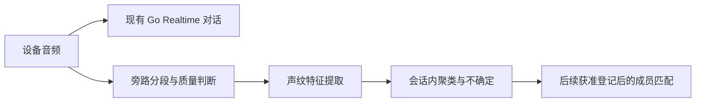

# 声纹方案补强：可重复评测与引导式现场验证

日期：2026-11-04（Asia/Shanghai）。用户已在本聊天批准“使用新的方案，先记录新方案，然后开始开发”。本页记录已确认的范围；直接在 main 开发、提交和推送。

## 1. 决定与当前事实

继续 Go＋千问 Realtime 主对话、云端 Go worker＋sherpa-onnx／ONNX 声纹旁路。当前 ERes2Net-base 是对照基线，不能因为一次真人流程没有达到目标就认定模型差。ERes2NetV2 是模型候选，Diart／pyannote 是分段与在线聚类的对照候选；没有决定替换当前模型、引入产品 Python 服务或切换正式入口。

当前最直接的缺口是：合成输入不能代表真人；现场测试缺少清楚的步骤、同连接要求和逐步判定。11月3日的 A／不确定／不确定保留为失败观察，原因未确认；不归因于用户经验不足，也不被新方案改写为通过。

## 2. 目标处理流程与分期

分段、换人、重叠检测、特征与已登记匹配分别验收。现有时长／RMS 门禁不等于已检测人声或重叠，单句首样本成为 A 不等于已经识别出真人姓名。

1. **本次首个开发包：评测入口和真人引导。** 建立合成／公开真人来源明确分开的评测接口，冻结阈值后检验独立语句；为隔离声纹客户端加入单人三步测试。先把结果变成可解释、可重复的证据。
2. **模型与成熟流程对照：** 用获准公开真人语料比较现有模型与候选，分别报告误认、拒识、耗时；Diart／pyannote 的兼容、CPU／内存和在线延迟独立评测。评测结果决定是否进入下一开发包；本次不把未知效果写为改进。
3. **现场和产品接线：** 单人同连接 → 两人 A→B→A → 播放／噪声 → 各实体设备；通过后再单独接入已确认的登记、人物权限和记忆阶段。

## 3. 首包 A：引导式单人测试

只在已有 `--speaker-test` 隔离客户端展示，普通客户端和关闭声纹的对照组保持原功能。启动窗口不申请麦克风；仍由用户点击原“开始对话”后才连接和收音。引导不会自动点击按钮、切换开关、结束／重开连接或记录真人结果到磁盘。

测试窗口明确说明：同一位参与者、保持同一连接、一次一句、正常语速；建议每句约3～5秒，实际是否满足原门禁以原因事件为准；等待回答和原因结果后再进行下一步，三步之间不点“结束对话”。

三步固定提示：

1. “小满，给我推荐一种在家可以做的简单运动。” 建立本轮临时候选，第一句不算人物识别准确率。
2. “如果我每天只运动十分钟，应该先从什么动作开始？” 期望与第一步同标签。
3. “小满，请告诉我运动之前可以怎样热身，记得说得简单一点。” 期望与第一步同标签。

采用明确的“准备本步／记录下一句”控制，将步骤绑定到此后新的 input_id。只消费已通过既有协议验证的结构化事件，不从中文展示文字反向解析。pending 不算结果，重复／迟到／先前 input_id 不能推进；新一轮或断开后清除绑定和基准。发生拒识时停留本步，显示原因及重试建议；重试要绑定新的发言，不能靠重放旧事件通过。非同标签只记本步未通过，不声称发现了另一个真人。

结果明确显示为“本次单人三句标签一致性通过／本步未通过／未完成”；不显示整体声纹通过。连接关闭时保留最后的简短可见结论供用户阅读，但清除临时标签及事件状态；新连接重置引导。播放器忙时不能准备下一步；只提示用户等待，不改变 VAD、AEC、上行、取消或排空策略。

## 4. 首包 B：公开真人评测接口

复用 Linux speaker-lab 的有界 WAV、摘要核验和受控 worker；新增独立 `evaluate` 命令，不放宽原 synthetic-only `benchmark` 的来源约束。

公开真人清单标明 `source_kind=public_human`、来源 ID、官方 HTTPS 来源、许可参考、单人片段依据、16000Hz；每条使用匿名 `fixture_1`～`fixture_8`、绝对本机路径、WAV SHA256、原录音 SHA256、语句摘要、样本数和 `enrollment`／`calibration`／`evaluation` 划分。真实路径／录音／姓名／声纹向量不进入 Git 或输出报告。

每位至少1条建模板、2条校准、1条独立评测，至少3位。原录音或同一文字不能跨划分，重复 ID／路径／音频摘要拒绝；不能把同一录音切两段后分别当登记和验收。阈值只用 calibration 拟合，evaluation 不参与拟合；enrollment 只建模板。不能分离时明确返回校准失败，不回退默认阈值。

报告只含模型／清单摘要、来源类别、维度、用例数、质量拒绝、校准状态、评测总数／正确匹配／误归／拒识及独立推理耗时；不输出逐人向量、姓名、文件路径、原文或任意原生错误。识别率只统计独立 evaluation，不把校准或反复重放计入样本数。有效率与误归／拒识同时报告，不能用全部拒识冒充无误认。

输出始终有 `human_acceptance=false`、`production_acceptance=false`、`feature_enabled=false`、`segmentation_assessment=unavailable`、`overlap_assessment=unavailable`。公开真人语料是离线模型证据，不证明家庭真人、连续流、多人重叠或实时产品效果。运行不修改试点或产品阈值。

## 5. 执行环境、验收与边界

- Go／ONNX／语料处理与后端测试只在云服务器执行；Mac只编辑／Git及客户端 SDK 构建、无麦克风客户端状态测试。
- 新云端目录、固定源码摘要、低并行测试；确认磁盘后才获取有限公开语料。保留正式服务、隔离试点和所有设备，不刷机、不自动开麦或切换产品。
- 首包验收：客户端状态 RED→GREEN、普通／试点／soak 构建；公开真人清单／划分／评分／隐私测试 RED→GREEN，云端 lab 普通／race／vet／build及相关原生用例；根相关包回归。
- 完成实施不代表已运行真人语料基准、完成成熟分段接入或通过真人验收。实施、运行数据、部署、现场和后续阶段分别记账。

## 6. 官方资料依据

- [腾讯会议声纹识别](https://cloud.tencent.cn/document/product/1095/137282)：预登记、单人分割、候选匹配和拒识。
- [3D-Speaker完整音频流程](https://github.com/modelscope/3D-Speaker/tree/main/egs/3dspeaker/speaker-diarization)：VAD、分段、特征、聚类及可选重叠检测。
- [Diart](https://github.com/juanmc2005/diart)：在线分段＋特征＋增量聚类，对照时另测依赖和资源。
- [3D-Speaker真人语料](https://3dspeaker.github.io/)：多设备、多距离、不同方言；数据获取与使用先核对来源及条款。
