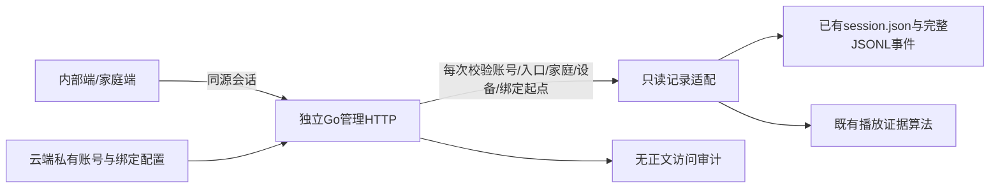

# 管理平台首个真实闭环：登录、家庭/设备授权与只读聊天

## 授权与目标

2026-11-09用户走查设备→聊天列表→详情→设置后反馈“还可以，现在继续开发”，核心UI评审通过，进入真实后端首批。用户另明确选择：当前微雪机器人接入自有家庭，仅开放本次绑定之后的新记录；旧记录不自动分配、不导入。

本轮交付独立Go管理服务、真正的账号会话/退出、显式家庭/设备授权、已有Go文字记录的只读查询，以及两端核心页面接入。保持完整31页mock预览用于后续页面评审；真实入口只开放已接入页面，不能混用虚构数据或失败时回退mock。

## 最小结构与交付顺序

复用Go标准库HTTP/密码派生、现有私有JSON原子写入、`realtimelive`的记录元数据合同及`realtimestate.PlaybackEvidence`；不修改正式语音热路径、不建立新数据库/索引服务、不引入执行框架。账号/家庭/绑定在本轮由云端CLI一次配置，配置文件0600是这批只读预配置账户的权威；网页注册、邀请、转让和权限编辑以后到相应阶段再增加持久业务存储。这是按当前最小范围作出的实现取舍，不表示此前PostgreSQL建议已被用户选择或数据库平台已交付。

1. 先建立配置、账号/会话、明确授权与记录投影，用两个合成家庭验证隔离。
2. 接入已确认Vue核心页面，区分真实入口和演示入口；必要加载/空/失败/无权限状态继续有效。
3. 云端构建/测试、独立部署，当前微雪仅从真实绑定时间开始读取。新实机记录需用户实际发言，未获得现场证据前不能宣称实机整链验收通过。

## 账号与权限

- 管理服务仅监听云端回环`127.0.0.1:18791`，Mac经SSH转发作为客户端。初版账号名`owner`、家庭名`我的家`，云端生成独立初始密码，不复用SSH/模型/设备凭据，不写入Git或Mac文件。
- 标准库PBKDF2-SHA256使用独立随机盐、600000轮及恒定时间比较；配置只保存密码摘要。登录请求大小有界、失败统一回执、尝试频率和并发密码核验有界。
- HttpOnly、SameSite=Strict会话cookie，路径`/api/`，内部/家庭入口分开命名；会话8小时、随机256bit标识，服务端只留摘要，退出即时撤销，服务重启须重新登录。
- 内部工作角色与家庭正文权限分别校验。内部管理员身份不自动获得任何家庭正文。每个账号显式列出家庭及其可见设备、正文许可；跨家庭/设备/未知ID一律拒绝。没有正文许可时列表也不泄露转写、生成稿或摘要。
- 采用标准库CrossOriginProtection拦截跨站非安全请求，不配置旁路；登录/退出只用POST JSON。API无跨域开放，敏感响应no-store，页面加基本安全响应头。
- 每次正文读取在响应前写无正文私有审计；审计失败返回失败，不先输出正文。审计不保存查询原文、密码或聊天文本。

## 绑定与旧记录

私有配置保存绑定ID、版本、家庭ID、已核实的设备ID、起始UTC时间，后续关闭区间保留历史；同设备重叠区间非法。本轮只给当前微雪建立一个从部署绑定时刻开始的区间。读取时将源manifest设备ID、开始时间与该区间相交，不能用当前登录家庭补猜旧归属。

没有manifest、没有设备身份、绑定之前的记录、Mac合成fixture和其他终端不进入首个家庭的结果。原文件不改写、不移动、不删除。页面当前按每次连接展示记录，并明确尚未按30分钟业务聊天合并。

## 记录投影

- 元数据与原始事件是档案来源，设备7天/24轮记忆不是档案索引。只读原文件，不启动语音客户端/模型，也不读取原始音频或供应商凭据。
- 只消费换行完整的JSONL事件，未完成尾行留待下次；完整行损坏、超限、归属不匹配和文件读取失败均为明确错误，不静默跳过。目录和文件路径必须有界、拒绝路径穿越及符号链接逃逸。
- 仅`user_text`形成有效最终转写；预览、无效识别和拒绝事件不伪造用户发言。生成全文来自`generated/generated_interrupted`，不能视为已播正文。
- 重建generated、interrupt、output_asr_final、normalized playback/device_playback后，复用`PlaybackEvidence`；最新一轮没有`settled_playback`也可以投影。完整播放须有完整生成、有效样本总数和设备终态；样本不能单独换算精确逐字位置。ASR观察保留来源/误差提示，无法确定已播文字时明确未知。
- 文字保存、音频播放、内容是否满足用户请求分别呈现；本轮不声称修复故事准备句，也不增加模型内容判定。
- 列表按源开始时间倒序，分页有界；查询管理路径只读，与实时语音进程隔离。首先提供手动刷新及可见聊天页的低频刷新，不引入SSE/索引服务作为本轮门槛。

## 接口与前端

`/api/{scope}`中scope仅允许admin/family：POST login/logout、GET session、GET devices及单设备、GET families及单家庭、GET accounts（内部端）、GET conversations（device/offset/limit）、GET conversations/{recordID}（可带expected device）。所有资源请求经过同一权限校验。JSON错误含稳定code和中文message，不直接返回文件路径或底层错误。

DTO复用当前前端必要字段，补来源/记录状态；音量、亮度、电量未上报为null，不造默认数值。首次进入无设备参数时可选择首个获准设备；明确提供的错误ID不能回退到别的设备。真实设置页只显示资料/未上报状态，不开放尚未接入的保存、删除、记忆或硬件操作。

mock与live采用显式构建模式；原18790演示保留，真实服务18791同源提供静态页面和API。登录使用真实账号/密码，不把演示验证码当真实认证；真实正文只在页面内存，不写sessionStorage。过期登录回到登录界面，错误不被示例数据掩盖。

## 验证与部署

所有依赖、Go/Node运行测试和构建在云端独立目录执行；Mac仅代码/Git、浏览器客户端。绑定/账号配置、原记录、审计、初始密码和生成构建不入Git。

云端定向/race测试覆盖两个家庭隔离、内部无正文许可、绑定前后边界、未知/伪造ID、登录/过期/退出/跨站、审计失败、完整/打断/未知播放、最后一轮无settled、源事件冲突/部分尾行/超限和路径逃逸。前端保留mock回归，新增live请求/401/403/失败不回退/空数据与分页检查。云端只读接入及浏览器验收与用户后续实机发言分开记录。

独立管理服务只读现有记录，配置/审计写入自己的路径，静态资源只来自专用发布目录；systemd限定资源和文件写范围。不重启正式Go语音、不刷固件、不改记忆策略、不自动开麦或播放声音。用户现场可用时，再验证绑定后新记录出现在两端。
