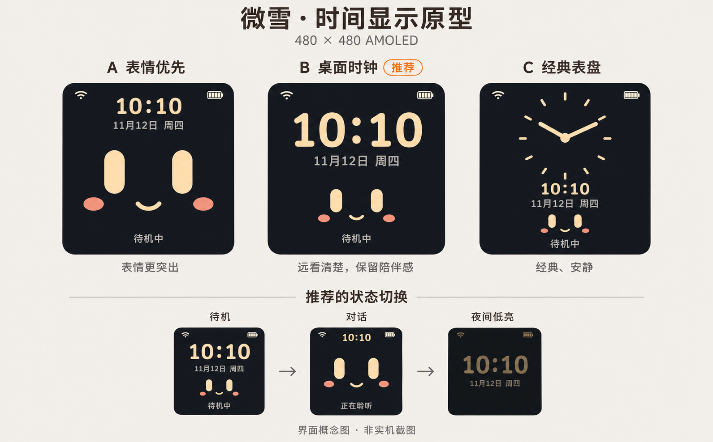

# 微雪时间显示：B桌面时钟方案

确认日期：2026-11-12（Asia/Shanghai）。用户已明确“方案采用b，先记录吧”。**状态：视觉方向和以下显示规则已确认；仅记录，暂不开发、部署或刷机。**

## 采用的方向

适用于当前唯一支持的微雪ESP32-S3 2.16开发板，屏幕480×480。采用原型中间的B“桌面时钟”：深色背景、暖色大号数字、日期星期和缩小的现有CHICK-01表情。时间便于远看，同时保留陪伴感。

原型由内置imagegen生成，为视觉概念，不是实机截图或精确像素验收。图中的时间、日期和电池图标仅为示例。A/C保留在同一张对比图中作为本次选型依据，**不是新增三个可切换主题**。

生成提示词：[原始提示词](assets/2026-11-12-waveshare-clock/imagegen-prompt.txt)。

## 三种显示状态

| 状态 | 显示规则 |
| --- | --- |
| 正常待机 | 大号`HH:mm`居上，下面为日期/星期；下半部显示小号CHICK-01表情，底部保留“待机中”等实际系统状态。 |
| 对话 | 时间缩到顶部，恢复大表情和现有嘴型；底部继续依据实际状态显示聆听、思考、说话、停播等文字。 |
| 低亮待机 | 暖色、低亮、静态大时钟及小日期，隐藏表情；沿用现有低亮/熄屏逻辑，不强制常亮。 |

对话中的情绪/嘴型仍来自现有真实状态和播放事实，时间显示不替代状态判断。配网、错误、升级及系统提示页面继续拥有原有显示优先级，不能被时钟遮挡。

“夜间低亮”是原型中的低亮视觉状态；本次不额外确认按固定时段自动切换的规则，也不改变用户当前亮度偏好。

## 时间与刷新原则

- 使用24小时制，只显示时、分；日期和星期作为次级信息。
- 联网校时后由设备本地时钟推进；具体校时来源及现有时间能力在实施前核对，复用已有机制，不新增模型调用或业务服务。
- 尚未获得有效时间时显示`--:--`，不将示例时间或无效日期当作真实时间。临时断网不等于已经校准的本地时钟立即失效。
- 时钟文字按分钟变化更新，跨日更新日期/星期；状态切换时更新相应布局。不显示秒，不增加冒号闪烁或翻页动画。
- 原型沿用深色背景和暖色表情配色；具体字体、字号、安全区和缩放在真实480×480界面验证，不能直接将AI图片视为固件资源。
- 用户补充实屏四角有圆角，原左上信号、右上电量图标存在裁切。顶部图标沿用微雪板级安全区，左右各留屏宽10%（480px屏为48px）；未来时钟布局也需保留这一区域。本项图标修正独立于尚未实施的时钟功能。

## 实施边界与后续

本次仅保存决策、原型和交接入口，不修改固件、语音、配网、音量/亮度控制、服务或设备状态。没有新增实机视觉、功耗、内存或音频性能成绩。

待用户另行安排实施后，再核对当前固件和校时能力、拆分实施任务。实现继续复用公共显示/状态机制，保护采音、播放与AEC；依赖、构建和运行验证在云端，微雪实机再分别检查可读性、状态切换、未校时/断网、低亮/熄屏和语音回归。M5/C3不在当前产品实现或发布门槛内。
