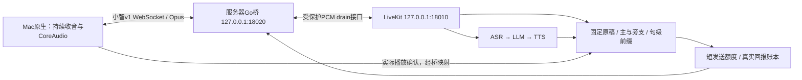

# 原生设备链路：排空交接与原稿恢复

2026-10-24。实施依据：[低延迟方案](../superpowers/specs/2026-10-24-low-latency-handoff-design.md)、[实施计划](../superpowers/plans/2026-10-24-low-latency-handoff-implementation.md)。本轮完成服务器与Mac原生测试端，未切换8000正式服务，未刷写M5。

后续补充：原生真人收音的六声道转换故障已修复并现场复验，见[麦克风修复记录](2026-10-24-native-microphone-fix.md)。以下保留首轮排空验证口径。

## 已实现的行为

一次开始后持续收音。普通插话停止旧内容继续下发；已接收音频自然排空，新回答可在独立待播区准备，终端本地依赖栅栏放行，不额外等待排空ACK往返。结束对话/显式硬停止使用独立路径。

故事与回答保存有界固定原稿。只有绑定同一内容版本、单位和输出块的有效最终播放回报，才能推进连续完整句前缀。SDK生成取消不代表已下发音频没播完；完整排空的句子仍可确认，部分句子恢复时保守重读。旁支不覆盖主稿；两个未完成候选会澄清。已确认文字按单位派发时的用户轮次进入模型的助手历史，迟到回报不改变归属。

Python适配器只使用SDK公共AudioOutput接口。取消时释放SDK生命周期为interrupted/unknown，真实播放账本独立结算。绑定前取消、handoff发送期间取消均有回归；不会遗留无人结算的future。

正常原PCM窗口300ms，新答案预置120ms，全局原PCM420ms。Go对每块预留真实Opus lookahead和末帧补零，所有未完成块的设备逻辑时间线累计最多600ms。它们是代码额度，未经过声学校准，不能宣称物理停声上限600ms。运行时缓存分配为主稿1单位、旁支1单位、串行状态提示1单位，每单位最多12秒；避免两个控制器各预取3段导致总驻留超限。

下行24k/mono/60ms Opus，上行16k/mono协商20/40/60ms，后端每次接收至多20ms PCM。Go映射位置为`clamp(device_played - lookahead, 0, backend_valid_samples)`，最终确认还要求编码尾部全部播完。Mac明确使用`coreaudio_playback`，不伪装I2S证据。

控制消息带递增control_seq，终端起播记录已应用序号。起播和撤销双向交叉时，保留在终端收到首次撤销前已经开始的音频；收到撤销后不能再开始。重复撤销保留第一次因果栅栏。

## 自动验证

所有后端运行、模型调用和依赖检查均在云服务器；Mac只构建、测试原生客户端。

| 检查 | 本轮结果 |
|---|---|
| Python全量 | 109项通过，84.093秒；包括内容核心18、DrainOutput9、通用会话15及原有回归 |
| 历史客户端回归 | Node25项通过；未作为新方案的浏览器主验收 |
| SDK播放探针 | 3项通过 |
| Python依赖 | pip check通过 |
| Go全库 | `go test -race -timeout 180s ./...`、`go vet ./...`、`go build ./...`通过 |
| 原生构建/状态 | Apple Swift/C/libopus构建；ledger、原稿证明和SSH失败清理测试通过 |
| 正常待机回归 | 云端受控WS发送sleep，原生实际音频路径正常收尾，无websocket_receive错误；未完成fixture仍判失败 |
| CoreAudio实际输出 | 同一播放器/Opus代码的`--self-test`通过：旧8640采样完整排空、待播2880采样在旧完成后放行、未播撤销、最终ACK重试 |
| 规格/质量审查 | 内容核心、Python会话、Go桥、原生端分别审查；发现问题经失败回归复现后修复 |

CoreAudio最终位置只来自`.dataPlayedBack`；进度读取player时钟并扣除presentation latency及保守渲染余量，显式记录调度间隙，避免把underrun静音当成内容。合成流成功必须证明同一主稿ID、revision和总段数，观察暂停、旁支完成及恢复动作，并核对首个恢复handoff的单位号，不能只看到任意main完成就通过。

## 真实云端与Mac实播

两次付费链路均复用私有合成输入，不采集用户录音。第一次使用较长旧fixture，第二次另行生成明确要求三句话的短故事请求。取消/超时记录保留，未自动重试结果未知的调用。

1. 长故事：同一`main:1` revision1在首句部分下发时插话，旁支回答后从unit0恢复；恢复后确认前8句，原15单位未完成时触发旧客户端90秒测试期限。本次整体记为失败，不以中间成功代替整段验收。测试fixture现改为180秒硬期限。
2. 三句故事：真实ASR→LLM→TTS，经Go/Opus到Mac实际播放；首句插话→旁支完成→模型工具resume main→同一`main:1` revision1从unit0恢复→3单位全部完成→所有final获ACK，客户端退出0，总耗时约26.7秒。

短故事本次共有3次ASR（482/487/548ms）、3次LLM（1032/501/959ms）和4次TTS（823/267/639/684ms）阶段记录；首句恢复复用了已准备PCM，不再次合成。上述时间是provider intent提交至完成的阶段时长，不是独立相加后的用户端总延迟。

本机同一单调时钟上的观测：

| 指标 | 长故事用例 | 三句故事用例 |
|---|---:|---:|
| 合成插话开始→客户端收到排空通知 | 302ms | 294ms |
| 收到排空通知→旧块最终CoreAudio回调 | 222ms | 307ms |
| 合成问题源话尾→新回答本地放行，估算 | 3041ms | 2019ms |
| 播放进度采样中观察到的最大未播设备采样 | 7200/300ms | 7200/300ms |
| 记录的underrun | 0 | 0 |

话尾估算使用同机注入时刻加已知1.52秒合成问题长度，存在输入调度及编码误差；放行也不是外部麦克风测得的扬声器启声。排空通知前包含VAD和网络，不能把这294ms当成纯服务器封口耗时。仅2个响应样本，不报告P50/P95，也未达到/证明方案的P50约1.5秒目标。声学AEC、真人听感、RTT/抖动矩阵、不同句中至少10轮及连续二次插话压力仍需后续验收。

## 部署与入口

- 源码`/opt/family-robot-livekit-dev`，Python运行环境`/opt/family-robot-livekit-runtime/venv`，桥二进制`/opt/family-robot-livekit-runtime/bin/livekit-device-gateway`。
- 独立`family-robot-livekit-dev`监听loopback18010，新增`family-robot-livekit-device`监听loopback18020；原`family-robot.service`/8000保持原发布。
- [原生入口](../../tools/native-voice/open.command)、[使用说明](../../tools/native-voice/README.md)、[桥协议](../../cmd/livekit-device-gateway/README.md)、[服务模板](../../deploy/family-robot-livekit-device.service)。Mac不启动后端，不复制模型Key或长期令牌。
- SSH授权的loopback配对返回120秒一次性票据，设备绑定native-mac，走stdin；单会话、15分钟、8轮、连续发言25秒。没有drain/staging能力的旧固件明确拒绝。
- 原稿和前缀首版只保留同一次连接/进程内；重连、跨唤醒、服务重启不自动恢复。Go持久化、手表新协议/固件和I2S/AEC实机验收尚未完成。

私有证据：服务器checkout`.superpowers/drain/{python-final,go-final,node-final,sdk-final}.log`；Mac`.superpowers/native-voice/{cloud-run-2,cloud-run-3,root-selftest-final}.jsonl`及`root-build-final.log`。仅合成输入和无正文元数据，不加入Git。公开仓库保留本报告、源码与合成边界单测。

代码分组提交：Python内容/排空会话`25ee76a`，Go桥与原生终端`391c4d9`。发布前后端35个Python/Go源码与测试文件SHA256逐项匹配云端；原8000服务MainPID仍为2261506。文档提交沿用main，源码与私有运行证据分开。
