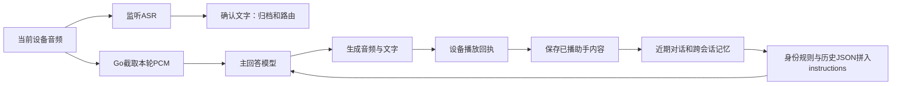

# 对话逻辑性评测：当前请求、错误回灌与模型边界

日期：2026-11-14。范围：微雪16:00、16:02两次实际会话、当前运行源码审计，以及同一上游模型的云端隔离对照。仅评测，未部署新逻辑、刷机、重启或清除用户记忆。

## 结论

应优先修复Go服务端应用层的对话编排与内容验收。已找到“越纠正越重复”的可复现干扰因素：最近一条错误助手回复被多次送回主回答上下文，模型继续沿用它；本批保留当前问题及其他上下文、仅移除该助手文字的全部副本后，话题恢复。当前模型在这种错误历史中的纠错能力也不稳定，不能据此认定模型完全无责。

未发现Go把上一轮PCM错送为本轮、共用主回答连接或提前清零输入的证据；现场故事的短输出也不是被播放层截断。最初那次错误回答与最初短故事的触发原因仍未完全定位；本报告对后续重复循环的证据更强。

## 实际链路

监听ASR与主回答是不同连接/用途。最终ASR文字在发起主回答前已取得，但主回答入口只提交本轮PCM，未把这份已确认文字作为独立文字请求传入；正确的日志转写不能证明主回答模型也按同样文字理解。该做法本身可用于原生语音模型，不是已经证实的协议错误；它是本轮重要观测与编排缺口。后续文本对照也表明，单独补当前文字不足以消除本例重复。

对应当前Git源码：`internal/realtimelive/session_input.go:245`、`session.go:679/758`、`native.go:203`。运行源码为云端self-echo候选，保留与main未部署MemoryOnly/speaker的差异；不能用main整包替换生产。

## 现场证据与源码审计

- 两会话各9个准入输入，采样范围单调递增；15次实际Native提交长度均与唯一对应的当前片段一致，另3条暂停输入在上游提交前被后续输入替代。每轮生成新建Native连接，PCM独立复制并在reply退出后清理；合成输入/Native/环形缓冲的相关race测试也通过。原始真人音频未保存，故这些元数据不等于逐字音频语义证明。
- 枚举任务的一轮只生成33字符，完整播放220320样本/9.18秒，输出ASR确认省略大部分数字；后续错误声称已完成。故事的一轮只生成64字符，完整播放347040样本/14.46秒，native正常completed，输出ASR结尾与生成一致；该轮无interrupt或播放错误。
- 后续3条明确纠正故事问题的ASR文字正确，生成却返回旧数字任务。不存在这一段因60秒输出上限、75秒请求超时或播放排空超时而被截断的证据。
- 第二会话恢复历史JSON从3664增长至10265 Unicode字符；末轮当前用户及单份助手正文仅381字符，另有550字符跨会话正文。大量余量是播放诊断、时间/来源及同一助手文字的多重副本，未发现本例超长拒绝或历史顺序错误。
- 主回答将历史整体拼入instructions；相同助手内容可出现在assistant_spoken_prefix、spoken_text、observed_text及tail_words。错误回复忠实留档是合理的，但“以前说过完成”没有被区分为“客观任务已经完成”，再次注入后容易成为续写模板。
- 跨会话资料按最近8轮＋最多6条摘录加入，没有按当前任务相关性选择。本例旧数字任务确实存在，但消融不支持把跨会话记忆单独认定为重复循环主因。
- 另一条gateway的`internal/qwen/client.go:110`已有数数/列举/朗读必须覆盖范围的规则；当前机器人运行的是realtime-output-live路径。当前路径虽已有完整故事与“音频完成不代表任务完成”的指导，本轮仍出现内容失败。不能用另一条路径的规则或测试替代当前链路验收。

## 云端真实模型对照

模型：现有`qwen3.8-omni-flash-realtime`，沿用云端受保护配置和实际Native/InstructionsFor实现。隔离目录`/home/ubuntu/dialogue-quality-20261114`，仅以客户端方式调用上游，没有启动额外语音服务；200个基线Go/mod输入逐一与已发布来源核对一致，另加3个临时诊断测试文件，不进入Git或生产。

主试验34次尝试，31次正常完成可评分；2次provider错误及1次60秒输出上限截尾不算语义失败。另1次辅助合成朗读没有通过输入文字一致性检查，未进入语音对照，**有效音频重放样本为0**。没有重放真人原音。

“full”是原restored_context与重建产品提示，不是当时完整请求的逐字副本：未复现控制/记忆回执/音乐指导的追加字符串，能力和时间也按测试重建。以下是相同测试条件内的观察，每条件2次，不是普遍成功率或显著性检验；固定顺序和模型随机性仍是限制。

### 当前问题仍被回答成旧任务的消融

| 条件 | 回到故事话题 | 完整交付新事件及结果 |
| --- | --- | --- |
| 重建现场历史＋当前明确文字请求 | 0/2 | 0/2 |
| 仅去掉跨会话记忆 | 0/2 | 0/2 |
| 简化历史投影，保留同样正文 | 0/2 | 0/2 |
| 先确认当前文字item写入，再请求回答 | 0/2 | 0/2 |
| 额外在提示末尾强调当前转写 | 0/2 | 0/2 |
| 仅去掉最近整轮错误对话 | 2/2 | 0/2 |
| 只保留最近故事片段 | 2/2 | 0/2 |
| 保留当前问题/其他上下文，只清最近错误助手文字的全部副本 | 2/2 | 0/2，1次有部分新情节 |
| 仅清最近一轮用户文字，保留错误助手内容 | 0/2 | 0/2 |

最后两组进一步拆开了“删整轮”的混杂：助手消融清除9处文字路径，只减少79字符（12638→12559），保留原用户问话、其他记录与播放元数据；清用户组仅减少6字符。前者恢复话题，后者继续重复旧数字任务。相较之下，移除数千字符旧记忆或压缩诊断并未恢复。这更支持与该段错误助手文字有关的干扰；文字内容、位置和重复次数的贡献尚未分别隔离，也未做等长度替换对照。

6个话题恢复样本中只有1个推进到新的遇见与决定，没有明确的行动结果，其余继续询问是否续讲或只解释停止位置。因此不能把话题恢复写成修复成功。对角色历史消息组织的2次尝试得到provider错误，未获得有效回答；错误详情未取，不能直接断言错误原因，更不能把该方案视为已验证可发布。

### 基础任务与复述检查

| 任务 | 本批结果 |
| --- | --- |
| 文字请求逐项枚举1至50 | 7/7完整，包括最小提示控制；确定性校验连续顺序和全部数字，不以完成声明计分 |
| 更换故事：情节有起因、行动、变化、结果 | 4/6完整 |
| 更换故事：同时完整且未复述本会话已播故事 | 3/6达标，三种历史条件各1/2 |
| 明确纠正故事问题，18个有效样本 | 12次仍答旧数字任务，6次回到故事；1次部分推进，0次达到完整新事件＋结果标准 |

两次未完成的故事正文与本会话先前故事片段相同；另一次情节虽完整，但复述刚讲过的故事。这些是文本内容与任务执行问题。最小提示的长故事因测试沿用60秒上限而截尾，已单列，不能记为自然完成或模型逻辑失败。

## 责任边界与下一步

| 层面 | 当前证据支持的判断 |
| --- | --- |
| 固件/音频播放 | 对已核对的短故事完成了所收到的音频，不是本次内容失序的解释；其他音频历史问题不因此被判全部解决 |
| Go采样、内存及轮次归属 | 未发现错PCM、旧连接复用或提前清理的证据；缺真人原音及主回答输入理解记录，保留观测边界 |
| Go对话编排 | 当前文字与历史缺少清晰分层、错误助手内容多次回灌、缺少纠正后的任务聚焦，是应优先处理的应用问题 |
| 上游模型 | 确实生成这些错误回答；基础文本任务有能力，但在错误历史中纠错不稳，故事完成与换题也不稳定，不能完全免责 |
| 验收 | 上游completed/硬件played只证明技术链路完成；此前759/734项功能/race检查不等于真实语言任务质量通过 |

建议先在当前实际运行链路做小范围设计：明确本轮请求；主回答只保留一份必要的已播文字与中断信息；用户纠正时处理上一条待纠正回答，避免把它当当前任务状态或续写模板；再以逐项枚举、换题不复述、纠正后聚焦、完整故事为内容回归。原始档案与记忆不需直接删除，也不先引入通用任务框架或新服务。

这几项需组合验证：本批已反驳“只补一句当前文字”“只去跨会话记忆”“只压缩JSON”就能修好的判断。使用同样的干净、明确输入再评估当前模型，仍不稳时再与其他模型作同条件对比。本轮没有完成该产品修复，也没有证明最初错答的唯一触发原因。

## 证据

云端`assessment-summary.json`保存评分、条件、200项来源证明与当前PID/摘要；主回答仍为PID732503、SHA dcd233c8/build self-echo-20261114-fddfc11，ready/memory_ready、0会话。矩阵结果摘要f96844fe…，归因组d7b95dc2…，助手/用户拆分组f7186fa2…；临时诊断源摘要e1686c30…、0aa84e5d…、1d624647…。独立源码审计与内容评分复核一致。原始历史、试验回复、受保护配置和任何音频均未写入Git；本轮未额外采集或保存真人原音。
